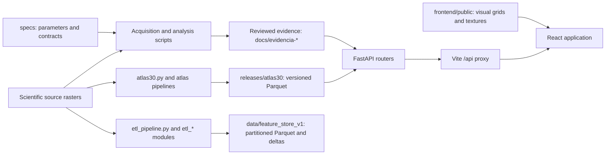

# Project structure and local run assessment

Inspection date: 14 November 2026. This assessment describes the checked-out implementation; scientific validity and worldwide coverage are separate from software startup.

## Architecture and data flow

The repository combines a browser application, a small HTTP API, reproducible scientific analyses, and two generations of larger-scale data processing. It is a local application rather than a packaged production deployment.



The last feature-store branch has its own CLI and contracts. The current HTTP routes do not read that store. The existing `/api/atlas` implementation reads the earlier `releases/atlas30` schema instead.

## Repository map

| Location | Implemented role |
| --- | --- |
| `frontend/` | React 18, TypeScript, Vite 5, Cesium; npm lockfile, domain tests, static scientific visualizations. |
| `backend/app/` | FastAPI application with scenario, regional-search, scale sensitivity, surface-dimension, mineral, and worldwide-atlas routers. |
| `backend/tests/` | API behavior, evidence integrity, invalid input, legacy search, and temporary-release tests. |
| `scripts/` | Scientific acquisition, reproducible analyses, visual generation, Atlas publication, and newer ETL command-line entry points. |
| `pipelines/atlas_*` | Source inventory/downloads, window/grid geometry, terrain metrics, contextual/temporal layers, and refinement. |
| `pipelines/etl_*` | Arrow schemas, feature extraction, Parquet feature store, DuckDB queries/compaction, and streaming workers. |
| `specs/` | Versioned JSON configurations and scientific/storage contracts. The analysis, search, source, and scenario subtrees contain active configurations; some README files describe earlier plans. |
| `docs/01-vigentes/` | Current architecture, operation, and scientific harmonization documents. Start navigation at `docs/README.md`. |
| `docs/02-versiones-anteriores/`, `docs/03-obsoletos-e-historico/` | Previous deliveries and historical proposals. |
| `docs/evidencia-*`, `docs/exploracion-*` | Committed reviewed outputs, manifests, figures, and fixtures consumed by APIs and scientific tests. |
| `frontend/public/` | Browser-served grids, manifests, imagery, and planetary textures. |
| `data/regions.json` | Legacy catalog used by `/api/regions` and deprecated `/api/search`. |
| `data/raw/`, `data/features/`, `data/normalized/`, `data/visual/` | Local scientific inputs and derived products; excluded from Git. |
| `releases/atlas30/` | Local versioned world-search datasets, active-release pointer, and replay-query SQLite database; generated releases are excluded from Git. |
| `packages/analogos_core/`, `ml/`, `experiments/` | Reserved scientific-library/ML work; no deployed learned search model. |
| `pixi.toml`, `pixi.lock`, `Makefile` | Primary reproducible environment and developer tasks. |

## Browser structure

`src/main.tsx` mounts `App`, which delegates to `app/AtlasShell.tsx`. The shell exposes five workspaces: comparison, dimensions/minerals, regional exploration, worldwide search, and sensitivity. `app/useAtlasState.ts` validates URL parameters and maintains browser navigation. Domain types and formatting live in `domain/`; API loading and adapters live in `data/`; reusable visualization/control components live in `components/`.

`useResource` aborts outdated requests and keys returned data to the current URL and retry attempt. Cesium is loaded on demand for location context. Its globes use static planetary textures and window outlines, not detailed terrain reconstruction. Vite proxies `/api` to `127.0.0.1:8000`; the frontend starts on port 5173.

## API and persistence

`backend/app/main.py` creates the app and registers six routers. Scenario APIs read committed JSON evidence, verify file identity against manifests, and report unavailable/changed evidence explicitly. They do not rerun raster processing per request. Regional exports and allowlisted evidence downloads are also available.

`atlas_store.py` queries release Parquet through DuckDB with bounded threads/memory and parameterized values. Atlas search persists versioned criteria in local SQLite so queries can be replayed. There is no external database server required for application startup. The historical weighted-percentage search remains exposed but is deprecated and separate from the main comparison UI.

## Scientific processing

Earlier scripts produce bounded Jezero–Earth comparisons and preserve source identity, coverage masks, scale, and missing-data states. The older 30 m Atlas samples nominal 3 km windows and publishes releases used by the web search.

The newer ETL uses Arrow schemas for base terrain, spectral and temporal enrichment, and source manifests. Base records partition by UTM zone/band; enrichment records append as deltas with compaction and DuckDB unified views. It distinguishes measured absence, insufficient support, unavailable products, and fetchable data. The contract uses a 240 m slope baseline, 360 m roughness radius, and 720 m extraction halo. Streaming orchestration combines download prefetch with process workers and temporary raster cleanup.

These generations have different schemas, metrics, and consumers. Their scores should not be treated as interchangeable, and scientific analysis changes require reviewing evidence/manifests before publication.

## Environment and setup

The supported path is `./scripts/inicializar.sh`. It installs Pixi under `.tools/`, uses `pixi.lock`, installs the conda-forge Python 3.11/Node 22/geospatial environment, runs `npm ci`, checks Mars/Moon CRS definitions, runs backend tests, and builds the frontend. The first installation is large because it includes GDAL/PROJ and `proj-data`. It does not download source rasters or require `.env` values.

`backend/pyproject.toml` and `backend/uv.lock` describe a smaller API-only environment. They are not replacements for the full scientific Pixi environment. The HDF5 mineral-analysis reader has an additional pinned environment created by `bash scripts/preparar_minerales.sh`; it is unnecessary for serving already published mineral JSON.

Run in separate terminals from the repository root:

```sh
make backend
make frontend
```

- Application: http://localhost:5173
- API documentation: http://127.0.0.1:8000/docs
- Repeat standard checks: `make check`
- Frontend domain tests: `cd frontend && ../.tools/pixi/bin/pixi run npm test`
- Root scientific/ETL tests: `.tools/pixi/bin/pixi run python -m unittest discover -s tests -v`

## Findings and boundaries

1. **Worldwide release is absent in this checkout.** Git intentionally excludes generated releases and raw rasters. `/api/atlas` should return an explicit 503 until a real release is restored or generated. Installation alone cannot restore the documented 3,782-window publication.
2. **New feature-store integration remains separate.** `etl_pipeline.py` outputs `data/feature_store_v1`; `backend/app/atlas_store.py` reads `releases/atlas30`. A publication adapter or API change is required to expose the new store through the existing interface.
3. **Documentation paths have drifted.** Several links in the root README and `pipelines/README.md` target documents moved into the versioned documentation folders. Some placeholder READMEs also understate implemented functionality. Use `docs/README.md` as the current index.
4. **Default validation covers only part of the repository.** `make check` checks CRS, backend unittest discovery, and frontend compilation; it omits the root scientific/ETL tests and frontend domain tests.
5. **Scientific core remains coupled to scripts.** The reserved `packages/analogos_core` library has not absorbed reusable analysis functions; scripts import other scripts, and multiple feature generations coexist. This complicates reuse and future API integration.
6. **This is a local development setup.** Vite and reload-enabled Uvicorn are development servers. Deployment configuration, authentication, and operational service management are outside the current startup workflow.
7. **Generated-store ignore rules are incomplete.** Parquet files are ignored globally, but the newer `data/feature_store_v1` directory itself is not excluded, so generated JSON manifests could appear as untracked files after ETL runs. Review generated outputs before committing.

## Verification results

The standard Pixi installation was attempted with the checked-in lock. Most packages were cached, but repeated interrupted conda downloads prevented a complete scientific environment. Lower concurrency and a conda-forge mirror were also attempted. The lockfiles and dependency declarations were preserved.

For application startup, a separate ignored `.venv` was created with Homebrew Python 3.13 and the six dependencies declared in `backend/pyproject.toml`, plus `httpx` for API tests. Frontend dependencies were installed with `npm ci --no-audit --no-fund` using the existing Node 24 installation. This fallback satisfies the application dependency ranges but is not the locked Python 3.11/Node 22 scientific environment.

Fallback restart commands from the root:

```sh
.venv/bin/python -m uvicorn app.main:app --app-dir backend --host 127.0.0.1 --port 8000
npm --prefix frontend run dev
```

Use the fallback commands while the full Pixi environment is incomplete; `make backend` and `make frontend` may otherwise attempt to finish that installation first.

Validation results:

- Backend API tests: 36 passed with `cd backend && ../.venv/bin/python -m unittest discover -s tests -v`.
- Installed API dependency consistency: `pip check` passed.
- Frontend domain tests: 12 passed.
- TypeScript and Vite production build: passed.
- Frontend HTTP request: 200 at `http://127.0.0.1:5173/`.
- API documentation: 200 at `http://127.0.0.1:8000/docs`.
- Live API requests through the frontend proxy: regions, scenario catalog, Jezero comparison, regional search, multidimensional comparison, Earth minerals, and Jezero minerals all returned 200.
- Static visual manifest and both planetary textures returned 200.
- `/api/atlas` returned the expected 503 explaining that no publication is active; `/api/atlas/versions` returned an empty array.
- Backend and frontend were left running on loopback ports 8000 and 5173.
- Browser visual inspection: unavailable because the browser automation connection closed before responding.
- Full scientific/ETL suite: not executed; the Pixi scientific environment is incomplete. Scientific pipelines were inspected, but their end-to-end execution has not been verified in this checkout.
- The newer Starlette test client emits an `httpx` deprecation warning in the API fallback; all API tests still pass.

No application source, scientific evidence, lockfiles, or credentials were changed. Download experiments were removed; the completed Pixi package cache remains available to a future setup retry. The application fallback is installed and operational, while the full scientific environment still needs completion with `./scripts/inicializar.sh` on a stable connection.
