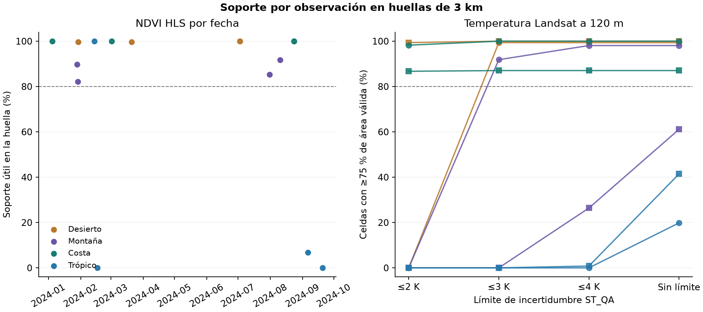

# Plan de armonización de las dimensiones de superficie

**Pregunta científica.** ¿Qué características de superficie pueden describirse de forma reproducible con las fuentes disponibles y bajo qué condiciones aportan evidencia para buscar o caracterizar un análogo?

1. **Cobertura y agua.** Medir WorldCover y JRC por área sobre las huellas de 3 km. Contrastar el resultado de WorldCover con el muestreo por vecino más cercano a 30 m y comprobar la separación de cero, relleno y ausencia de fuente. Incluir el control costero de Carolina.
2. **Reflectancia y nieve.** Calcular NDVI, NDMI y NDSI por observación HLS con máscaras y diagnóstico radiométrico. Contrastar L30 y S30 en celdas comunes del mismo día. Contar fechas con soporte suficiente y evaluar qué índices aportan información para los usos planteados.
3. **Térmica.** Armonizar Landsat por escena a celdas de 120 m. Medir sensibilidad a la incertidumbre ST_QA y al área observada en cada celda. Para THEMIS, conservar la rejilla de 100 m y medir sensibilidad a huella y desplazamiento nominal. Registrar temperatura e inercia en sus propias unidades.
4. **Materiales.** Contar muestras originales únicas de EMIT, separar el efecto del ajuste espectral y de la relación profundidad/incertidumbre, y agregar por familia mineral además de por código de biblioteca. Medir cuantiles `p95` y `p50` de los indicadores CRISM en dos huellas declarando el denominador completo de la ventana. Evaluar si existe una magnitud común para compararlos entre cuerpos.
5. **Selección.** Publicar valores observados con procedencia, soporte, escala, unidad y fecha aplicando el mismo umbral de cobertura de ventana (`80 %`) y un mínimo de muestras calificadas en EMIT (`n ≥ 30`). Documentar el uso de cada característica y la evidencia requerida para las dimensiones que siguen pendientes. Seleccionar la fuente más informativa por magnitud, huella y propósito.

## Resultado del 11 de noviembre de 2026

Se obtuvieron valores para cobertura, agua histórica, NDVI y temperatura superficial como caracterización terrestre. En Jezero se obtuvieron inercia térmica en ambas huellas e indicadores espectrales en 1,8 km (a 3 km el recorte CRISM cubre el 72,26 % de la ventana y queda bajo el umbral del 80 %). Las detecciones EMIT se describen por familia mineral y por entrada de biblioteca según el grupo y la calidad de ajuste. El catálogo conserva el soporte y la identidad de cada observación para que los resultados se puedan utilizar según el propósito de la búsqueda.

| Dimensión | Característica del piloto | Fuente y escala | Uso |
|---|---|---|---|
| Cobertura | Fracción de árboles, construido, suelo desnudo o vegetación escasa y agua permanente | WorldCover 2021 v200, área intersectada de celdas nativas de clase 10 m | Filtros terrestres según la actividad. Se conservan las 11 clases en la evidencia. |
| Agua histórica | Media de ocurrencia sobre área válida | JRC v1.5, 1984–2024, rejilla nativa de clase 30 m | Contexto de persistencia. Seleccionarla cuando la pregunta requiere historia del agua. |
| Reflectancia | NDVI mediano por fecha y lugar | HLS L30 o S30, 30 m, una observación seleccionada por fecha | Estado óptico de la vegetación en la fecha observada. |
| Temperatura superficial | Temperatura mediana en K por escena | Landsat L2 ST, agregada a 120 m | Contexto térmico terrestre en la fecha observada. |
| Inercia térmica | Mediana y rango intercuartílico en J m⁻² K⁻¹ s⁻¹/² | THEMIS, rejilla nativa de 100 m | Caracterización térmica de Jezero. |
| Materiales | Fracciones por familia mineral y por entrada de biblioteca entre muestras calificadas (`n ≥ 30`), y cuantiles `p95` y `p50` de indicadores CRISM | EMIT en muestras originales únicas y CRISM en su rejilla de 18 m | Evidencia espectral local. La correspondencia entre instrumentos requiere calibración espectral. |

El [archivo de características del piloto](../../evidencia-armonizacion-superficie/features-piloto.json) contiene 131 registros, 84 con valor. Incluye fracciones EMIT por familia mineral y por código de biblioteca, cuantiles `p95` y `p50` de CRISM en dos huellas marcianas y estados explícitos de cobertura insuficiente (`insufficient_coverage`), muestra insuficiente (`insufficient_sample`), ausencia de soporte (`no_support`), ausencia de escena (`no_scene_selected`) o falta de un activo local (`missing_local_asset`). Cada valor se relaciona con su sitio, huella, producto y, cuando corresponde, fecha o período. Los umbrales de cobertura y calidad son decisiones del piloto para inspeccionar la selección.

## Cobertura y agua

Se intersectaron los píxeles de cada producto con las huellas en una proyección local equivalente (`LAEA`). Se dividió el área por clase o la suma ponderada de ocurrencia entre el área válida, registrando también su proporción respecto a toda la huella. Se compararon esos resultados con vecino más cercano a 30 m sobre la misma proyección. Se obtuvieron cinco huellas WorldCover y seis JRC con cobertura completa. La diferencia máxima por clase en WorldCover fue **0,22 puntos porcentuales** en la muestra, en montaña. El cálculo nativo por área conserva los bordes de la huella y evita incorporar otro paso de muestreo, aunque a escala de 3 km el muestreo a 30 m introduce una desviación despreciable. [ESA WorldCover 2021 v200](https://doi.org/10.5281/zenodo.7254221)

En la transición costera de Carolina, WorldCover clasifica **33,39 %** de la huella como agua permanente y **7,83 %** como humedal herbáceo. JRC devuelve **31,74 % de ocurrencia media**, **32,82 % del área con ocurrencia ≥50 %** y **40,33 % del área con ocurrencia positiva**. La fracción de JRC con ocurrencia ≥50 % concuerda estrechamente con el agua permanente de WorldCover, mientras el área adicional con ocurrencia menor (`7,51 puntos porcentuales`) es compatible con la señal intermitente del humedal costero. En cambio, en montaña (Alpes), WorldCover clasifica **1,66 %** como agua permanente, pero JRC registra **0,188 %** de ocurrencia media y solo **1,044 %** del área con ocurrencia positiva (`0,071 %` con ocurrencia ≥50 %): un cauce estrecho de montaña bien resuelto a 10 m queda subdetectado o mezclado en píxeles de 30 m de Landsat. Estos pares distinguen la cobertura cartografiada instantánea de la frecuencia histórica y muestran que la resolución limita la detección de cuerpos de agua angostos.

Se conservaron ceros de ocurrencia medidos en costa del piloto original, trópico y Atacama. La ausencia de JRC local en el control polar queda como `null`. Se aplicó el dominio de 0–100 antes del cálculo. Las cinco teselas anteriores están fijadas por sus hashes y el recorte costero se obtuvo el 11 de noviembre. JRC informó una corrección de valores fuera de dominio el 10 de noviembre y un posible desplazamiento entre las colecciones Landsat usadas en la serie. La validación de bordes temporales requiere considerar ese desplazamiento. [Notas de JRC Global Surface Water v1.5](https://global-surface-water.appspot.com/download)

## Reflectancia y nieve

Se procesaron 16 escenas con cuatro bandas de reflectancia y Fmask por escena. Para NDVI y NDMI se excluyeron nube, adyacencia, sombra, agua y nieve. Para el ensayo NDSI se conservó nieve y se excluyó agua. Se compararon sumas mínimas de bandas de 0,001 y 0,01 y el efecto de excluir aerosol alto. Los cocientes requieren ambas bandas finitas y no negativas. El piloto usa suma mínima 0,01, excluye aerosol alto y exige 80 % de centros válidos. Para observaciones del mismo día se selecciona la de mayor soporte. Los empates se resuelven por hora UTC e identificador. [Guía HLS v2](https://lpdaac.usgs.gov/documents/1698/HLS_User_Guide_V2.pdf)

Los dos pares L30–S30 del mismo día se evaluaron con esa misma política (`0,01` y sin aerosol alto) y compartieron rejilla y **9.982 y 10.000 centros** respectivamente. En Utah, con 143 s entre adquisiciones, la diferencia absoluta mediana de NDVI fue **0,0024** y su P95 **0,0087**. En la costa árida, con 642 s entre adquisiciones, fue **0,0081** y su P95 **0,0282**. En estos terrenos desnudos (`NDVI` entre `0,057` y `0,156`), la discrepancia P95 entre sensores del mismo día (`0,028`) es del mismo orden que toda la variación observada entre fechas en el desierto (`0,126` a `0,154`): fuera de su papel para filtrar vegetación (que ya resuelve WorldCover), el NDVI tiene bajo poder discriminante dentro del dominio de suelos áridos análogos a Marte.

Quedaron **11 observaciones por fecha y lugar** con soporte suficiente. Se aceptaron tres en desierto, cuatro en montaña, tres en costa y una en trópico. En trópico el 20 de septiembre, el soporte de NDVI pasó de 17,3 % a menos de 0,1 % al excluir aerosol alto. Los resultados por fecha describen escenas seleccionadas de 2024. Para describir fenología o estacionalidad hace falta una serie con fechas comparables y cobertura repetida.

NDVI y NDMI tuvieron una correlación de rangos de Spearman de **0,70** (y correlación lineal de Pearson de **0,92**) entre las 11 observaciones seleccionadas. La diferencia entre ambos coeficientes se debe a que en suelo desnudo se invierte el orden entre desierto (`NDVI ≈ 0,14`, `NDMI ≈ −0,06`) y costa árida (`NDVI ≈ 0,06`, `NDMI ≈ −0,005`), porque en ausencia de dosel el cociente `NIR–SWIR1` responde al contraste mineral y de albedo del sustrato antes que a agua foliar. Se conserva NDVI como primera característica óptica de vegetación y NDMI requiere validación específica según el régimen de cobertura. La nieve se observó solo como bandera QA en **86 centros despejados** de dos escenas de montaña (`6` en enero y `80` el 10 de agosto en una huella con 79 % de bosque, compatible con falsos positivos de Fmask en nube o sombra). NDSI queda como diagnóstico y la nieve necesita controles independientes con cobertura suficiente.

## Temperatura superficial e inercia térmica

En las ocho escenas Landsat se convirtió ST_B10 a K y ST_QA a K de incertidumbre, y se excluyeron relleno, nube, cirros, sombra y agua según QA. Se conservó nieve cuando la observación era válida. Se agregaron valores y soporte a bloques de 120 m, cercanos al muestreo térmico nominal de 100 m. Se ensayaron límites ST_QA de 2, 3 y 4 K y un caso sin límite, con soporte mínimo por bloque de 50 %, 75 % y 95 %. El criterio del piloto usa 3 K, al menos 75 % de área válida por bloque y al menos 80 % de bloques aceptados en la huella. [Especificación Landsat Collection 2 Level-2](https://www.usgs.gov/media/files/landsat-8-9-olitirs-collection-2-level-2-data-format-control-book)

Con el criterio anterior pasan **5 de 8 escenas**. La diferencia entre la mediana de los centros de entrega y la de los bloques de 120 m es de hasta **0,067 K** en esas cinco escenas, bajo el mismo límite de incertidumbre. Además, el barrido muestra dos propiedades clave para las siguientes fases:

- **`ST_QA` actúa como selector de escenas y sesga contra ambientes húmedos.** Dentro de cada huella, la incertidumbre estimada es casi uniforme: en Utah el 16 de enero (`ST_QA` mediano `2,18 K`) la cobertura pasa de `0 %` con `≤2 K` a `99,4 %` con `≤3 K`; en el trópico (`ST_QA` mediano `5,4–5,7 K`) el soporte es `0 %` en `≤2`, `≤3` y `≤4 K` (salvo `0,8 %` en septiembre a `≤4 K`). La ausencia inducida por `ST_QA` no es aleatoria: excluye sistemáticamente escenas tropicales y montañosas de verano (`61,1 %` sin límite y `26,4 %` con `≤4 K` el 25 de agosto), por lo que la futura función de similitud no debe penalizar la falta de dato térmico como disimilitud física.
- **La temperatura por escena mide estado meteorológico/estacional, no una constante del sitio.** En la misma huella de Utah pasa de `278,69 K` en enero a `316,77 K` en agosto (`38,1 K` de amplitud), superando las diferencias entre sitios en una fecha aislada.



La línea punteada muestra el criterio de cobertura del 80 %. Cada línea térmica corresponde a una escena. Se preservan los perfiles de todos los escenarios en la evidencia.

En THEMIS, la mediana de Jezero fue **239,76 J m⁻² K⁻¹ s⁻¹/²** (IQR **32,67**) con 930 centros válidos de 930 en 3 km (`100 %` de soporte). Desplazar la huella 100 m en las cuatro direcciones sobre el CRS proyectado del producto cambió la mediana hasta **0,87** en esa unidad, mientras reducir la huella a 1,8 km (342 centros) la elevó **13,45** (hasta `253,22`, IQR `29,24`): la elección del tamaño de ventana domina en un factor ~15 sobre una traslación de un píxel. La inercia térmica es una propiedad física del material superficial y no es comparable directamente con la temperatura instantánea de Landsat ST; relacionar ambos cuerpos exige estimar inercia térmica aparente en Tierra (mediante pares día–noche y albedo) en lugar de cruzar K con unidades de inercia. [Producto THEMIS de Jezero](https://doi.org/10.5281/zenodo.4931348)

## Materiales

Se procesaron tres pares EMIT para huellas de 1,8 y 3 km. Las posiciones ortorrectificadas se vincularon con su índice de muestra original y cada muestra se contó una vez. Se verificaron los pares, se distinguieron relleno y código cero, y se restauró el ajuste con el factor ×2 documentado por NASA. Para separar la causa de pérdida de soporte, se midieron por separado el filtro de relación señal/incertidumbre (`profundidad > 2σ`), el filtro de ajuste (`2 × fit ≥ 0,8` y `0,9`) y su combinación (`0,5`, `0,8` y `0,9`). Además, las entradas de biblioteca se agruparon por **familia mineral** (sin mezclar espectros de mezcla con minerales puros) y se calculó la entropía de Shannon (`bits`) como diagnóstico de dispersión espectral. El piloto exige al menos `n = 30` muestras únicas calificadas para publicar fracciones (`status = measured`); por debajo se marca como `insufficient_sample`. [Tutorial EMIT L2B Mineralogía de NASA LP DAAC](https://nasa.github.io/LPDAAC-Data-Resources/external/Working_with_EMIT_L2B_Mineralogy.html)

| Escena y grupo, 3 km | Muestras únicas (`>2σ` solo / `fit ≥0,8` + `>2σ` / `fit ≥0,9` + `>2σ`) | Entropía biblioteca / familia (`≥0,8`, bits) | Lectura por familia mineral y por entrada de biblioteca |
|---|---:|---:|---|
| Utah 2023, grupo 1 | 2.061 / 2.057 / 10 (`insufficient_sample`) | 0,59 / 0,00 | Las tres entradas presentes (IDs 31, 2 y 47) son variantes de **hematita**, que representa el **100 %** en todos los umbrales. El cambio entre `≥0,8` y `≥0,9` es solo entre subentradas de biblioteca y deja una muestra minúscula (`n = 10`) porque el ajuste restaurado se concentra en `0,82–0,86`. |
| Utah 2023, grupo 2 | 1.596 / 1.596 / 1.593 | 1,31 / 0,95 | El recorte de `2.061` a `1.596` muestras lo produce **exclusivamente `profundidad > 2σ`** (con `fit ≥ 0,8` solo pasan las `2.061`). Agrupando por familia, dominan **moscovita (`73,4 %`)** e **illita (`24,8 %`)** de forma estable entre `0,5`, `0,8` y `0,9`. |
| Atacama enero de 2023, grupo 1 | 2.022 / 1.928 / 993 | 0,03 / 0,00 | Dos entradas de nanohematita (IDs 47 y 45) suman el **100 % de familia hematita** en todos los escenarios. |
| Atacama enero de 2023, grupo 2 | 1.582 / 1.568 / 400 | 2,39 / 1,86 | Dispersión alta entre 20 entradas de biblioteca con baja profundidad de banda (`p50 ≈ 0,035`): a `≥0,8` encabezan coincidencias con referencias orgánicas/sintéticas (`54,9 %`, incl. `organic_plastic-vinyl`), aragonito (`18,4 %`), montmorillonita (`12,6 %`) y sílice/vidrio hidratado (`11,2 %`); a `≥0,9` pasan a dominar sílice/vidrio (`33,3 %`), orgánico/sintético (`34,3 %`) y montmorillonita (`29,8 %`). La alta entropía diagnostica coincidencia débil/ambigua en el rango de 2 µm. |
| Atacama septiembre de 2022, ambos grupos | 0 / 0 / 0 (`no_support`) | — | Hay 2.021 muestras geolocalizadas y ninguna identificación válida en estos archivos. |

En Utah, **3.200 posiciones GLT corresponden a 2.061 muestras originales**. En Atacama enero de 2023, el grupo 2 tiene 178 muestras válidas con código cero entre 2.022 muestras geolocalizadas. Agrupar por familia mineral evita confundir diferencias de granulometría o recubrimiento en la biblioteca (como las tres hematitas de Utah) con cambios de composición, mientras conservar las fracciones por ID y la entropía permite detectar cuándo el identificador responde a ruido o artefactos de biblioteca en bandas débiles.

En CRISM se evaluaron cinco indicadores (`OLINDEX3`, `BD530_2`, `D2300`, `MIN2295_2480` y `BD1900R2`) declarando el **denominador completo de la huella**:

- En la huella de **1,8 km** hay **10.200 centros totales**, de los cuales `9.806` caen dentro de la franja adquirida (`394` fuera de franja con `nodata = 65535`) y **8.897 pasan `IN = 0`** (**87,23 %** de la huella completa y `90,73 %` dentro de la franja), superando el umbral del 80 % (`status = measured`).
- En la huella de **3 km** hay **28.390 centros totales**, de los cuales `22.074` están dentro de la franja (`6.316` fuera del borde de la escena) y **20.514 pasan `IN = 0`** (**72,26 %** de la huella completa y `92,93 %` dentro de la franja). Al aplicar la regla uniforme del 80 % sobre toda la ventana, el recorte de 3 km queda marcado como **`insufficient_coverage`** (`value = null`, conservando `unmasked_p95` y `unmasked_p50` en metadatos de diagnóstico). Así se separa explícitamente el efecto del tamaño de huella del truncamiento por borde de franja.
- En ambos recortes, el relleno de SR (`65535`) ya coincidía exactamente con los píxeles donde `IN ≠ 0`, por lo que comparar `IN = 0` frente a validez de ráster resulta **no informativo** en esta escena y no constituye una prueba discriminante de la máscara.
- Como las unidades carbonatadas y filosilicatadas de Jezero ocupan parches localizados dentro del abanico y su entorno, la mediana espacial (`p50`) refleja el fondo espectral: en 1,8 km, `MIN2295_2480` tiene `p50 = −0,00606` (sin señal aparente) pero **`p95 = +0,00127`** (y máximo `+0,0087`), y `D2300` pasa de `p50 = 0,00579` a **`p95 = 0,01214`**. Por ello se publican ambos cuantiles (`crism_*_p95` para cola de detección localizada y `crism_*_p50` para fondo). Para cruzar con EMIT en la siguiente fase se requiere calcular formulaciones equivalentes de parámetros de banda sobre reflectancia EMIT L2A remuestreada a las longitudes de onda de CRISM. [Documentación CRISM del PDS](https://pds-geosciences.wustl.edu/missions/mro/crism.htm)

## Dimensiones que requieren otras observaciones

| Dimensión | Decisión para una huella de 3 km | Evidencia que habilitaría la característica |
|---|---|---|
| Viento, aire y aerosoles | Evaluar con soporte regional. ERA5-Land tiene paso aproximado de 9 km y MAIAC AOD describe la columna atmosférica a 1 km. | Series regionales y variable comparable para el proceso de interés. Atribuir polvo requiere distinguir tipos de aerosol. [ERA5-Land](https://www.ecmwf.int/en/era5-land) · [NASA MAIAC](https://www.earthdata.nasa.gov/s3fs-public/2025-04/MCD19_User_Guide_V6.pdf) |
| Humedad de suelo | Mantener la dimensión pendiente de observación física. | Medida superficial o in situ con profundidad, soporte y fecha conocidos. NDMI describe una respuesta óptica distinta. |
| Nieve, hielo y persistencia | Mantener WorldCover y NDSI como evidencia de cobertura o señal puntual cuando se valida. | Fechas con referencia independiente y observación polar. MOD10A1 de 500 m es candidato para series regionales de nieve. [NSIDC MOD10A1](https://nsidc.org/data/mod10a1/versions/61) |
| Geología y subsuelo | Conservar evidencia mineralógica específica de instrumento y cartografía como dimensión propia. | Unidades geológicas a escala adecuada, interpretación de procesos y observaciones de subsuelo donde la pregunta lo requiera. |
| Iluminación, obstáculos y biología | Mantener la ortoimagen de Jezero como evidencia visual de detalle. | Datos radiométricos o series geométricas para iluminación, inventario validado para obstáculos y mediciones directas para biología. |

La selección se aplica según la pregunta. Para excluir vegetación o zonas construidas, las fracciones de WorldCover son suficientes en la huella estudiada. Para caracterizar una fecha concreta, NDVI o temperatura añaden una observación distinta. Para un proceso térmico o mineral entre cuerpos, la condición para avanzar es contar con una magnitud física común y soporte validado. Así se pueden combinar filtros y contexto con el piloto topográfico sin tratar cada capa como otra medida del mismo parecido.

## Evidencias y reproducción

[Mediciones y sensibilidad por dimensión](../../evidencia-armonizacion-superficie/mediciones.json) · [Entradas verificadas](../../evidencia-armonizacion-superficie/entradas.json) · [Manifiesto](../../evidencia-armonizacion-superficie/manifest.json) · [Tercera entrega: muestreo estratificado, fichas de características y puentes entre cuerpos](Tercera%20entrega%20-%20muestreo%20estratificado%20y%20puentes%20entre%20cuerpos.md)

```sh
bash scripts/ejecutar_minerales.sh scripts/armonizar_dimensiones_superficie.py
bash scripts/ejecutar_minerales.sh -m unittest discover -s tests -p test_armonizar_dimensiones_superficie.py -v
```

© ESA WorldCover project 2021 / Contains modified Copernicus Sentinel data (2021) processed by ESA WorldCover consortium.
