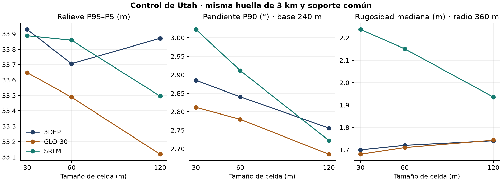

# Plan de acción para armonizar la topografía en Utah

La primera exploración confirmó que 3DEP, GLO-30 y SRTM cubren el control desértico de Utah. La pregunta del ensayo es cuánto cambian pendiente, relieve y rugosidad cuando medimos ese mismo terreno con distintas fuentes y escalas.

1. **Verificar las entradas locales.** Contrastar los tres archivos con el inventario de la primera entrega. Registrar proyección, paso, relleno y referencia vertical. Usar 3DEP como referencia de terreno para este control.
2. **Igualar la geometría y el soporte.** Proyectar y agregar desde cada archivo nativo a rejillas métricas alineadas de 30, 60 y 120 m. Usar huellas concéntricas de 1.800 y 3.000 m y leer un margen de 720 m. Medir solo donde las tres fuentes aporten soporte completo.
3. **Separar los efectos.** Comparar los productos a igual huella, celda y vecindario. Al variar la celda, calcular una pendiente con base física constante de 240 m además de la pendiente con vecinos inmediatos. Calcular rugosidad con radios físicos de 360 y 720 m. Comparar las huellas conservando fijos los demás parámetros.
4. **Cuantificar y comprobar.** Registrar cuantiles, diferencias pareadas y cobertura por descriptor. Verificar el efecto de añadir una cota constante y comprobar que las máscaras y los denominadores sean consistentes.
5. **Decidir qué se puede trasladar.** Identificar qué resultados dependen de la configuración y qué pruebas hacen falta en otros ambientes antes de seleccionar características para el Atlas.

La selección de un control desértico prioriza la disponibilidad de tres fuentes coincidentes. Las observaciones representan una sola región y los cambios de fuente reúnen diferencias de sensor, fecha, superficie y referencia vertical.

## Ejecución del 11 de noviembre de 2026

Se ejecutaron 28 configuraciones de descriptor, huella, celda y vecindario, cada una sobre los tres productos. El centro fue 38,6° N, 110,6° O. Los archivos coincidieron con los SHA-256 de la primera entrega. La cobertura común fue **100 % en todas las configuraciones**, incluyendo los vecinos requeridos para cada descriptor. La huella de 3 km contiene 10.000, 2.500 y 625 celdas a 30, 60 y 120 m, respectivamente.

| Producto | Paso aproximado en el centro, este × norte | Referencia vertical | Relleno de cabecera |
|---|---:|---|---|
| 3DEP | 1,00 × 1,00 m | NAVD88 | −999999 |
| GLO-30 | 24,20 × 30,84 m | EGM2008 | Sin valor declarado |
| SRTM GL1 | 24,20 × 30,84 m | EGM96, según procedencia | −32768 |

3DEP representa el terreno sin vegetación ni construcciones. GLO-30 representa una superficie editada que puede incluirlas. Las referencias verticales se conservaron por producto. [Metadatos de la tesela 3DEP](../../evidencia-fase-1/utah-1m.xml) · [Documentación de Copernicus](https://dataspace.copernicus.eu/explore-data/data-collections/copernicus-contributing-missions/collections-description/COP-DEM) · [Procedencia de SRTM en el proyecto](../../../specs/analysis/primer-caso-fase2.json)

Cada rejilla se obtuvo por promedio desde el archivo nativo en una sola operación. Se exigió una fracción de soporte de al menos `1 − 10⁻⁶` por celda y se aplicó la intersección de las tres máscaras antes de derivar características. La pendiente usa diferencias centradas en dos direcciones. Su base es la distancia entre los extremos de la diferencia. La rugosidad es el RMS residual de un plano ajustado en un vecindario cuadrado. El radio indica la distancia del centro al último centro de cada eje. El margen se conserva al recortar ambas huellas para que cambiar su tamaño solo cambie qué celdas se resumen.

## Resultados

Para la huella de 3 km y celdas de 30 m se obtuvieron estos valores. P90 es el percentil 90 de las celdas medidas.

| Descriptor | 3DEP | GLO-30 | SRTM |
|---|---:|---:|---:|
| Relieve P95–P5 (m) | 33,93 | 33,65 | 33,89 |
| Pendiente mediana, base 60 m (°) | 1,44 | 1,41 | 2,22 |
| Pendiente P90, base 240 m (°) | 2,89 | 2,81 | 3,02 |
| Rugosidad mediana, radio 360 m (m) | 1,70 | 1,68 | 2,24 |
| Rugosidad P90, radio 360 m (m) | 6,20 | 5,33 | 6,06 |
| Rugosidad mediana, radio 720 m (m) | 3,90 | 3,89 | 4,11 |



- **Producto y base de pendiente.** Con la celda fija en 30 m y la huella en 3 km, la mediana de las diferencias absolutas por celda entre SRTM y 3DEP pasa de **0,93° a 0,32°** al ampliar la base de 60 a 240 m. Entre GLO-30 y 3DEP pasa de 0,19° a 0,05°. La base debe registrarse junto con el tamaño de celda para reproducir el descriptor.
- **Tamaño de celda.** A base fija de 240 m, el P90 de pendiente de 3DEP pasa de 2,89° a 2,76° entre celdas de 30 y 120 m. En SRTM pasa de 3,02° a 2,72°. La agregación inicial cambia el resultado incluso cuando la distancia entre muestras de la derivada es constante.
- **Radio de rugosidad.** A 30 m en la huella de 3 km, duplicar el radio de 360 a 720 m eleva la mediana de 3DEP de **1,70 a 3,90 m**. En el radio de 360 m las medianas de 3DEP y GLO-30 difieren 0,02 m, mientras que sus P90 difieren 0,87 m. Conviene conservar cuantiles y diferencias pareadas para estudiar el tramo alto de la distribución.
- **Huella.** A 30 m, el relieve de 3DEP pasa de 27,81 m en la huella de 1,8 km a 33,93 m en la de 3 km. La diferencia de 6,12 m por cambiar la huella supera la separación máxima de 0,28 m entre productos en la huella de 3 km para ese descriptor. Este resultado depende de qué terreno incluye cada cuadrado concéntrico.

## Decisión para la validación

Registrar la huella y la base física de la pendiente, así como el radio de rugosidad, como parte de la definición de cada característica. Conservar el relieve P95–P5 como candidato para describir amplitud vertical en este control y llevar la pendiente a bases de 60 y 240 m a la siguiente comparación. La primera observa cambios más locales en la rejilla de 30 m y la segunda permite comparar las tres rejillas con una distancia común entre extremos.

El experimento siguiente necesita ventanas con terreno de referencia y condiciones distintas, en particular bosque y transiciones tierra–agua. Seleccionar huellas que contengan esas coberturas y repetir la matriz antes de definir tolerancias para la búsqueda. El control desértico tiene soporte completo y solo aporta evidencia sobre esa región. Se mantuvieron las referencias verticales originales y el corregistro se basó en las georreferencias disponibles. El control de desplazamiento constante no cuantifica variaciones espaciales del datum ni errores de registro entre sensores.

## Reproducción y controles

Desde la raíz del repositorio:

```sh
bash scripts/ejecutar_minerales.sh scripts/contrastar_topografia_utah.py
```

Al sumar 1.000 m al 3DEP agregado a 30 m, el cambio numérico máximo fue inferior a `10⁻¹²` en los tres descriptores probados. Se verificaron las máscaras, los denominadores y la geometría de las huellas. Las pruebas existentes de análisis pasaron y la figura se inspeccionó visualmente.

[Resultados completos y diferencias pareadas](../../evidencia-armonizacion-utah/resultados.json) · [Manifiesto de reproducción](../../evidencia-armonizacion-utah/manifest.json) · [Programa del experimento](../../../scripts/contrastar_topografia_utah.py)
