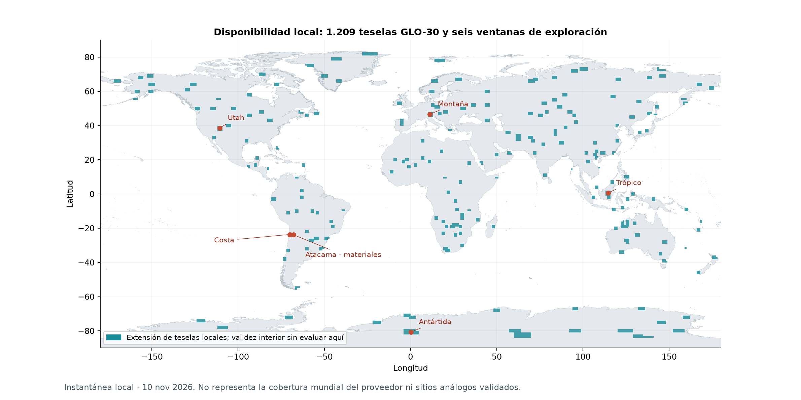
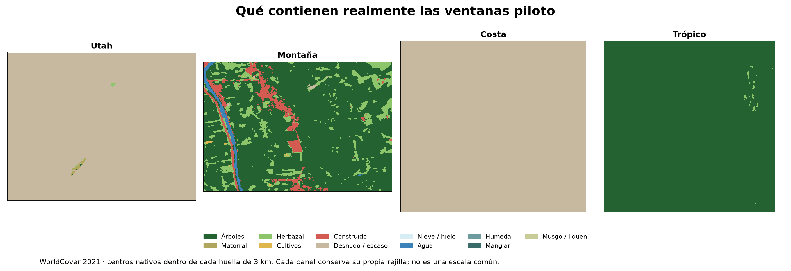
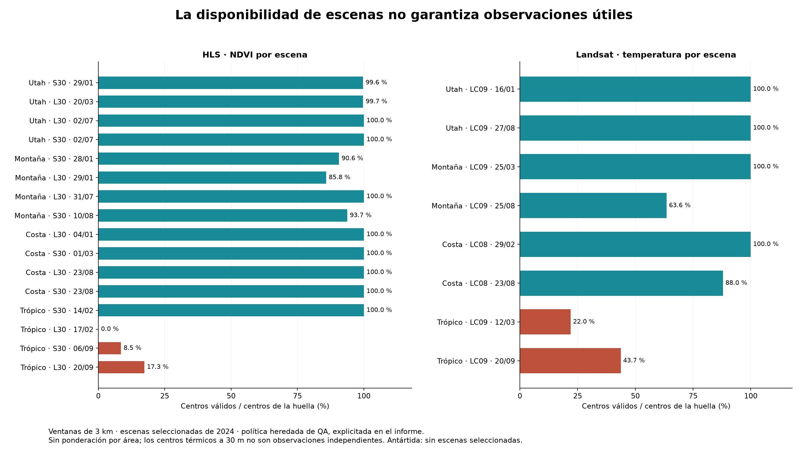

# Primera entrega: exploración de fuentes y preguntas científicas

Fecha: **10 de noviembre de 2026**, America/Managua. Estado: exploración reproducible de entradas locales; las características y comparaciones siguen en investigación.

## 1. Resultado y orientación

Hay datos suficientes para comenzar experimentos de armonización topográfica, cobertura de superficie, reflectancia, temperatura por observación y evidencia mineralógica en casos concretos. La disponibilidad es muy desigual entre dimensiones y territorios. La siguiente decisión científica debe considerar tanto la intención de búsqueda como la calidad y el soporte de las observaciones.

La visión aportada por el usuario y el texto del challenge orientan este trabajo hacia **encontrar lugares útiles para una pregunta o actividad**, incluyendo sitios fuera del conjunto de análogos conocidos. La importancia de una variable depende de esa intención. Una misma cobertura de nieve puede ser un objetivo de investigación, una condición de ensayo o una exclusión; no debe eliminarse mediante una regla universal.

El catálogo se utiliza como memoria del proyecto y mapa de hipótesis. La revisión metodológica aporta experimentos de control. Sus decisiones previas sobre escala, dimensión y función no fijan una arquitectura definitiva. En esta entrega se conserva cada producto en su soporte nativo y se investiga su contenido; no se construye una puntuación de similitud.

**Hallazgos principales: conjunto real de fuentes, variación fuerte del soporte temporal, escala de ajuste EMIT que necesita tratamiento explícito, información auxiliar polar aprovechable y controles piloto que deben ampliarse.**

## 2. Qué se examinó y qué significan los resultados

Se inventariaron **1.509 archivos, 44,06 GB decimales** bajo `data/raw/`, contando etiquetas, archivos comprimidos y auxiliares operativos. Eso no equivale a 1.509 observaciones científicas. La instantánea contiene:

| Familia | Disponibilidad observada |
|---|---|
| GLO-30 | 1.209 GeoTIFF legibles; otros tres archivos auxiliares o incompletos dentro de esa carpeta |
| WorldCover / JRC | Ocho mapas de clases y cinco teselas de ocurrencia |
| HLS | 80 bandas en 16 escenas; cuatro escenas por cada uno de cuatro ambientes |
| Landsat ST | 24 bandas en ocho escenas; dos escenas por cada uno de cuatro ambientes |
| EMIT | Tres pares MIN/MINUNCERT: uno de Utah y dos de Atacama |
| CRISM | SR de 60 bandas e IN de nueve bandas, más cinco archivos de metadatos; sin cubo IF en `data/raw/` |
| HiRISE / THEMIS | Un DTM, una ortoimagen RED_C y un producto de inercia térmica |
| Controles terrestres | Dos SRTM, una tesela 3DEP de 1 m, dos paquetes GMTED |
| Polos terrestres | Dos paquetes de mosaicos a 500 m; contienen elevación y capas auxiliares |
| Marte regional / Luna | 38 IMG MOLA entre tres carpetas, incluidos recuentos; un IMG LOLA y sus etiquetas |
| Máscara terrestre | Natural Earth, 11 registros multipartes, cuatro columnas y ninguna geometría inválida según el lector |

Se leyeron las cabeceras de todos los rásteres sueltos, las variables de los seis NetCDF, los dos GMTED dentro de ZIP, las capas ráster de los dos paquetes polares y la máscara vectorial. La ortoimagen se abrió con Pillow porque este entorno no incluye el lector JP2 de GDAL; su geometría procede de la etiqueta PDS. No quedaron errores de lectura en el inventario final.

La exploración de valores tiene dos alcances deliberadamente distintos:

- **Perfiles de huella:** seis ventanas terrestres y Jezero, con lado de 3 km como experimento inicial. Se leyeron todos los centros nativos interiores de las fuentes seleccionadas que intersectan esas huellas. Hay 17 perfiles espaciales terrestres, 24 perfiles de escenas temporales y dos registros de ausencia de selección polar. EMIT y CRISM se recortaron de nuevo a estas huellas; no se reutilizaron las cifras anteriores de 1,8 km.
- **Parches diagnósticos:** cinco recortes nativos de 32 × 32 por activo seleccionado, repartidos entre centro y cuadrantes. Para GLO-30 se seleccionaron 24 activos por posiciones equiespaciadas en la lista ordenada; en otras familias, hasta cuatro. También se muestrearon las capas polares dentro de los paquetes. Estos parches sirven para detectar problemas de lectura, dominios y rellenos. **No constituyen un muestreo probabilístico ni estiman distribuciones mundiales.**

Las fracciones de esta entrega usan **centros de píxel dentro de la huella completa**, incluyendo agua, sin máscara de tierra y sin ponderación por área. No son las fracciones del ranking anterior ni porcentajes de superficie exactos. Las estadísticas de un producto a 1 m, uno angular y uno térmico a 30 m conservan soportes diferentes. Un centro almacenado tampoco equivale necesariamente a una observación independiente.

Los originales permanecen intactos. Se calcularon SHA-256 de **180 entradas interpretadas o muestreadas**; el inventario completo conserva tamaño y fecha de modificación, sin afirmar una verificación criptográfica de los 44 GB. No se descargaron nuevos originales científicos.

## 3. Preguntas que orientan la selección de variables

| Intención | Pregunta investigable | Variables que conviene explorar | Evidencia adicional necesaria |
|---|---|---|---|
| Practicar aterrizaje, navegación o aproximación | ¿Qué terrenos reproducen las formas y escalas visuales que requiere el ensayo? | Pendiente distribuida, relieve, organización espacial, rugosidad a distintas bases, textura e iluminación | Escala del vehículo/sensor, obstáculos, imágenes de detalle y diseño del ensayo. La topografía regional no certifica un lugar de aterrizaje |
| Emular formas topográficas | ¿Qué combinación de geometría y disposición espacial caracteriza el objetivo? | Cuantiles e histogramas, curvatura, posición topográfica, orientación y continuidad de formas | Etiquetas de formas y revisión independiente; resolver redundancia y efectos del DEM |
| Probar instrumentos de materiales | ¿Hay evidencia de los materiales o rasgos espectrales que necesita detectar el instrumento? | Identificaciones y mezclas de biblioteca, profundidad, ajuste, incertidumbre, indicadores espectrales | Espectros, máscaras de observación, respuesta instrumental y contraste geológico |
| Investigar polvo, viento o procesos atmosféricos | ¿Qué régimen de transporte, erosión o deposición interesa reproducir? | Viento y su variación, aerosoles, propiedades superficiales, formas y cambios eólicos | No hay series locales suficientes de viento, presión o aerosoles; definir un modelo del proceso y sus límites entre cuerpos |
| Ensayar condiciones térmicas | ¿Qué temperaturas, ciclos o duración de exposición necesita el ensayo? | Temperatura por fecha y hora, dispersión espacial, incertidumbre; eventualmente ciclos y extremos | Serie temporal apropiada y variables del entorno. Ocho escenas locales no caracterizan extremos climáticos |
| Agua, hielo y alteración | ¿Interesa agua actual, persistencia del hielo o evidencia de procesos pasados? | Clases, ocurrencia, nieve, topografía, evidencia espectral y contexto geológico | Separar observación actual e interpretación histórica; seleccionar productos específicos de hielo o subsuelo |
| Habitabilidad, biología y subsuelo | ¿Qué propiedad biológica, geoquímica o cavidad debe reproducirse? | Variables específicas por definir con observaciones de campo o catálogos especializados | Las fuentes locales no caracterizan microorganismos, habitabilidad ni geometría de cuevas; NDVI no sustituye esas mediciones |

La futura consulta debería expresar objetivo, cuerpo o proceso de referencia, escala, período, requisitos obligatorios, preferencias y tolerancia a información faltante. Los pesos representan preferencias entre variables habilitadas. La validez científica, las condiciones obligatorias y la incertidumbre requieren tratamiento explícito; un peso alto no resuelve una magnitud mal definida.

## 4. Hallazgos sobre los datos

### 4.1 La disponibilidad local no delimita el universo de búsqueda



Las teselas GLO-30 locales están distribuidas por muchas regiones, pero dejan grandes espacios sin archivos en esta copia. El mapa muestra extensiones de archivos, no cobertura válida de píxeles, resultados de búsqueda ni lugares nuevos descubiertos. La búsqueda mundial debe distinguir cobertura del proveedor, descarga local, procesamiento realizado y soporte utilizable.

Los cinco ambientes del piloto temporal y los sitios iniciales de materiales son útiles para diagnosticar el procesamiento, pero no bastan para seleccionar características representativas de todo el planeta. Será necesario ampliar controles a otras regiones, latitudes, coberturas y morfologías sin escogerlos por su parecido previo con Jezero.

### 4.2 Los nombres de los ambientes no describen necesariamente la ventana



Dentro de las ventanas de 3 km, WorldCover presenta:

| Ventana | Observación sobre centros nativos válidos |
|---|---|
| Utah / «desierto» | 99,71 % de clase 60: suelo desnudo o vegetación escasa |
| «montaña» | 79,40 % árboles, 12,57 % herbazal, 6,05 % construido y 1,66 % agua |
| «costa» | 100 % de clase 60; no aporta un borde tierra–agua en este recorte |
| «trópico» | 99,75 % árboles y 0,25 % herbazal |

Esto recomienda un control costero adicional que cruce efectivamente la línea de costa y controles montañosos que separen vegetación, construido y terreno expuesto. WorldCover describe cobertura de 2021; no valida automáticamente el estado de una escena de 2024 ni la mecánica del suelo.

### 4.3 Topografía: buenos casos iniciales, todavía con soporte desigual

GLO-30 tiene elevación válida en todos los centros nativos interiores de las cinco ventanas piloto. En Utah, la tesela 3DEP cubre los **8.993.056 centros** de la huella en su rejilla de 1 m; SRTM y GLO-30 también cubren esa ventana. Hay, por tanto, un caso concreto para contrastar fuente después de revisar referencia vertical, agregar elevación y controlar soporte.

HiRISE aporta **8.992.946 centros válidos** en la nueva huella de Jezero. Estas cifras establecen cobertura de elevación; no establecen cobertura de pendiente o rugosidad, que necesitan vecindades y márgenes. Tampoco justifican comparar directamente estadísticas nativas de 1 m con las de GLO-30.

El control tropical es casi completamente arbolado según WorldCover. Es un caso adecuado para estudiar cuánto del relieve superficial se relaciona con cobertura, pero esta exploración no estima todavía la contribución del dosel. No hay un DTM terrestre independiente local para cada ambiente.

### 4.4 HLS: las máscaras y la radiometría necesitan decisiones por uso



Se emparejaron y comprobaron las rejillas de las cuatro bandas y Fmask de cada escena. En el trópico, los soportes de NDVI con la política heredada son **100 %, 0 %, 8,5 % y 17,3 %**, en orden cronológico. La observación de febrero de Landsat dentro de HLS está completamente marcada como nube. La disponibilidad temporal no puede resumirse únicamente como «cuatro escenas».

La máscara HLS del procesamiento anterior utiliza el entero 46: excluye nube, adyacencia, sombra y agua, **pero conserva nieve y todos los niveles de aerosol**. Es una política concreta, no una máscara universal para todas las intenciones. La documentación de [HLS v2](https://lpdaac.usgs.gov/documents/1698/HLS_User_Guide_V2.pdf) permite decodificar estas condiciones por separado. Se compararon tres políticas exploratorias: despejado, heredada y terrestre sin nieve/agua.

En las dos escenas de enero de montaña quedan **tres y seis valores de NDVI fuera de [−1,1]** incluso después de la máscara heredada; coinciden con entradas negativas en rojo o NIR. Al conservar agua, los extremos del cociente llegan aproximadamente a −191 y 169 en una escena. No se recortaron silenciosamente a [−1,1]: eso ocultaría el problema. Hay que investigar reflectancia negativa, suma de bandas pequeña, sombra, agua y aerosoles antes de usar colas, varianza o distancias sobre estos índices.

HLS excluye la Antártida según el [proveedor](https://hls.gsfc.nasa.gov/data-products/). Para esa dimensión polar hace falta otra fuente. La ausencia de escenas Landsat seleccionadas en el piloto polar es un estado distinto y no demuestra ausencia de cobertura del sensor.

### 4.5 Landsat: soporte e incertidumbre cambian la lectura de una escena

Se aplicó la conversión de temperatura y se interpretó `ST_QA` con escala **0,01 K**, conforme al [formato de USGS](https://d9-wret.s3.us-west-2.amazonaws.com/assets/palladium/production/s3fs-public/media/files/LSDS-1328_Landsat8-9_OLI-TIRS-C2-L2_DFCB-v7.pdf). Las ocho escenas tienen rejillas compatibles entre sus tres bandas. La tabla completa conserva fecha, cuantiles y soporte.

| Caso | Soporte tras QA | Temperatura p50 | ST_QA p50 |
|---|---:|---:|---:|
| Utah, 16 ene 2024 | 100 % | 278,66 K | 2,18 K |
| Utah, 27 ago 2024 | 100 % | 316,78 K | 1,56 K |
| Montaña, 25 ago 2024 | 63,57 % | 301,76 K | 4,28 K |
| Trópico, 12 mar 2024 | 22,04 % | 293,10 K | 5,65 K |
| Trópico, 20 sep 2024 | 43,72 % | 296,11 K | 5,42 K |

En ambos casos tropicales y en montaña de agosto, un umbral exploratorio `ST_QA ≤ 3 K` elimina todos los centros que habían pasado QA. Eso muestra sensibilidad a la incertidumbre, no justifica adoptar automáticamente ese umbral. El procesamiento existente comprueba disponibilidad de `ST_QA`, pero no impone un límite sobre su magnitud.

Dos fechas por ambiente permiten describir esas observaciones. No permiten atribuir una amplitud anual, un extremo climático o un ciclo diurno. Además, la malla distribuida de 30 m no crea detalle térmico independiente a esa escala.

### 4.6 EMIT: calidad, escala del ajuste y muestras repetidas

Se verificaron los hashes de los tres pares y su correspondencia espacial y temporal, y se calcularon nuevos recortes de 3 km:

| Lugar y fecha | Centros GLT | Muestras originales únicas | Resultado de clasificación disponible |
|---|---:|---:|---|
| Utah, 9 jun 2023 | 3.200 | 2.061 | Datos y coincidencias en ambos grupos |
| Atacama, 9 sep 2022 | 2.750 | 2.021 | Geolocalización disponible, pero relleno en las variables mineralógicas de ambos grupos |
| Atacama, 30 ene 2023 | 2.750 | 2.022 | Grupo 1: 2.750 coincidencias; grupo 2: 2.504 y 246 observaciones sin coincidencia |

La primera escena de Atacama no demuestra ausencia de minerales. La segunda distingue correctamente un cero observado sin coincidencia de un relleno. En Utah, contar los centros GLT como observaciones independientes inflaría el número de muestras aproximadamente **1,55 veces**. Los conteos de clases aquí son diagnósticos sobre la rejilla, no abundancias minerales ni fracciones exactas por área.

**Se detectó una regla de interpretación que debe incorporarse a la futura armonización:** NASA muestra que `group_*_fit` está almacenado a media escala y restaura el ajuste multiplicando por dos en su [tutorial de mineralogía](https://nasa.github.io/LPDAAC-Data-Resources/external/Working_with_EMIT_L2B_Mineralogy.html). Las variables locales no declaran un `scale_factor` que comunique esa regla. El lector existente conserva el valor almacenado.

Por ejemplo, en Utah el ajuste mediano del grupo 1 es **0,4176 almacenado y 0,8353 tras ×2**. El informe conserva ambos. Aplicar 0,8 sobre el almacenado excluiría todas las detecciones. Con ajuste ×2 ≥ 0,8 y profundidad > 2σ quedan 3.193 centros del grupo 1 y 2.480 del grupo 2; son umbrales exploratorios, no probabilidades de identificación correcta. El [ejemplo NASA VITALS](https://nasa.github.io/VITALS/python/emit_aviris/critical_minerals/01_alunite_temporal_aggregation.html) confirma la convención y motiva considerar máscaras y repetición temporal.

Antes de trasladarlo a producción hay que fijar la correspondencia con versión/build local, documentar la convención del ajuste y seleccionar máscaras de observación compatibles. El paquete local solo contiene MIN y MINUNCERT, sin reflectancia L2A ni máscaras complementarias. Esta entrega no cambia resultados publicados ni transforma automáticamente clases EMIT en indicadores CRISM.

### 4.7 CRISM y THEMIS: el nuevo recorte aporta evidencia propia

En Jezero a 3 km la ventana completa contiene **28.390 centros en la rejilla CRISM**, de los cuales **22.074 caen dentro de la franja adquirida** (`6.316` fuera del borde de escena con `nodata = 65535`): 20.514 tienen máscara IN = 0 y 1.560 quedan excluidos, lo que representa **72,26 % de soporte sobre toda la huella** (y `92,93 %` dentro de la franja cubierta). Se exploraron las 60 variables SR; sus cuantiles están en el anexo. IN también ofrece residuos espectrales, espaciales y atmosféricos que conviene incorporar al control de calidad. El soporte observado no establece que todos los indicadores tengan interpretación mineralógica fiable.

El cubo IF de 489 bandas y la tabla WV están documentados en el proyecto, pero el cubo no está entre los originales locales inventariados. Las etiquetas por sí solas no habilitan un análisis de espectros completos. Hay que decidir si los indicadores SR bastan para una pregunta o si hace falta adquirir reflectancia y sus auxiliares.

THEMIS aporta 930 centros válidos en su rejilla nativa para la huella nominal de 3 km, con mediana **239,76 J m⁻² K⁻¹ s⁻¹/²**. Se mantiene separado de la temperatura Landsat. El recorte utiliza la transformación declarada entre CRS; la diferencia de radios y la precisión de corregistro entre productos marcianos siguen pendientes de validación independiente.

### 4.8 Información útil que el resumen por dimensión puede ocultar

- **ArcticDEM/REMA:** los paquetes de 500 m contienen, además del DEM, recuentos, dispersión `mad` y fechas mínima/máxima; ArcticDEM también incluye `datamask` y `countmt`. Conviene interpretar cada capa con la versión del producto antes de decidir qué significa «elevación disponible». Las capas `browse` son visuales. La [documentación PGC](https://www.pgc.umn.edu/guides/stereo-derived-elevation-models/pgc-dem-products-arcticdem-rema-and-earthdem/) advierte que son modelos de superficie y mosaicos de múltiples fechas.
- **LOLA:** la etiqueta local declara valores de altura en **kilómetros**. Explica que `HEIGHT = DN × SCALING_FACTOR`, mientras que sumar `OFFSET = 1737,4 km` produce radio planetario. Aplicar mecánicamente el offset que expone el lector confundiría altura y radio. Es una decisión semántica, previa a cualquier comparación.
- **MOLA:** distinguir explícitamente productos de topografía y recuentos. Algunas cabeceras ENVI exponen cero como nodata; no debe heredarse esa interpretación sin contrastarla con la etiqueta y la función de cada producto, especialmente en recuentos. Los perfiles diagnósticos permanecen en unidades almacenadas.
- **JRC:** se observaron bloques de valor 255 en teselas que no declaran nodata. La máscara de dominio 0–100 es necesaria antes de resumir. En las huellas centrales estudiadas predomina el cero válido; ello no describe inundación en una fecha ni descarta otras formas de agua.

## 5. Relación con la revisión metodológica

| Advertencia | Lo que ya está presente | Lo que corresponde investigar |
|---|---|---|
| Diferencias entre modelos de elevación | GLO-30, SRTM y 3DEP disponibles en Utah | Contraste con igual huella y agregación; referencias verticales y efecto de superficie |
| Tamaño de celda y rugosidad | El código usa radio constante de 360 m; la base de pendiente depende de la celda | Pruebas de soporte real, bordes y sensibilidad de las características, antes de evaluar rankings |
| Denominadores y costa | Se registran fracción de tierra y soporte por métrica; hay umbrales 0,8 y 0,95 | Validar implementación, denominadores y casos difíciles. La ventana central «costa» no prueba esa situación |
| Estadísticas similares, formas diferentes | Existe imagen de Jezero y métricas resumidas | Seleccionar formas y controles negativos; evaluar estructura espacial y revisión ciega |

Las observaciones anteriores son lectura de código e inventario, no una certificación completa del motor actual. La exploración nueva se ejecuta por separado y no sustituye silenciosamente sus denominadores o reglas.

## 6. Experimentos prioritarios y criterios de decisión

| Orden | Experimento | Resultado medible | Decisión que habilita |
|---:|---|---|---|
| 1 | Semántica y máscaras de EMIT, LOLA, MOLA, HLS y Landsat | Valores antes/después, soporte, unidades, muestras únicas y casos límite | Fijar lectores por producto y versión; mantener ausencias y ceros separados |
| 2 | Ampliar controles por estratos y reservar regiones | Cobertura real de costa, desierto, bosque, nieve, relieve, construido, bordes de tesela y zonas poco estudiadas | Elegir una muestra de desarrollo y bloques geográficos de validación |
| 3 | Contraste topográfico Utah y controles adicionales | Características tras agregar a 30/60/120 m; variar huella y vecindad por separado | Determinar qué descriptores son estables y a qué escalas |
| 4 | Cobertura y soporte por área | Diferencias entre conteo de centros, intersección de áreas y máscaras de tierra | Definir denominadores defendibles por característica y escenario |
| 5 | Reflectancia y observación temporal | Sensibilidad a agua/nieve/aerosol, sumas pequeñas, fecha y sensor; cobertura conjunta | Elegir índices, controles radiométricos y agregaciones temporales |
| 6 | Térmica con incertidumbre | Cambios de distribución y área útil con distintos criterios QA; más fechas si lo exige la pregunta | Determinar qué se puede afirmar sobre observaciones, ciclos o extremos |
| 7 | Materiales y formas | Correspondencias espectrales justificadas, falsos positivos y revisión independiente | Habilitar variables comunes o conservar evidencia específica por instrumento |

Las cifras de esta entrega ayudan a diseñar los experimentos; no se elige ahora un umbral universal. Una característica avanzará si tiene definición física, soporte, procedencia, interpretación de calidad y una estabilidad adecuada para su caso de uso. Si falla, puede cambiar de escala, convertirse en condición/contexto o descartarse con un motivo documentado.

## 7. Cómo conservar la ambición de descubrimiento mundial

La investigación debe separar **la descripción de los lugares**, que puede reutilizarse, de **la intención de cada búsqueda**, que determina qué variables interesan y qué restricciones aplica. También conviene distinguir dos entradas: una región planetaria de referencia y un conjunto de condiciones deseadas para un ensayo o proceso, aunque no exista una única región objetivo.

Para ampliar el alcance propongo:

1. Construir un registro mundial de disponibilidad por producto, fecha y escala, con motivos de ausencia. La falta de procesamiento local no debe interpretarse como falta de interés científico.
2. Diseñar un muestreo espacial por estratos, con bloques reservados, incluyendo lugares fuera de análogos conocidos. La muestra de evaluación no debe seleccionarse usando la misma similitud que después se pretende evaluar.
3. Explorar huellas y soportes múltiples. En una malla de ventanas de 3 km separadas 10 km existen espacios sin evaluar: una búsqueda sistemática puede necesitar densificación, desplazamientos de malla o una etapa regional seguida de detalle, según su intención.
4. Evitar exigir que todos los sitios tengan todas las fuentes. Definir por escenario información imprescindible y opcional; mostrar evidencia incompleta sin premiar ni penalizar automáticamente la falta de observación. Los candidatos con información insuficiente pueden pasar a una cola de adquisición.
5. Tras validar características, estudiar pesos, restricciones y alternativas por dimensión. Mantener diversidad espacial y de propiedades para no llenar los resultados con ventanas vecinas del mismo lugar.
6. Evaluar utilidad para la actividad propuesta mediante referencias y controles independientes. La ausencia de un sitio en nuestro catálogo no prueba que sea un descubrimiento nuevo: esa afirmación requerirá revisión bibliográfica y geológica posterior.

**Vacíos actuales:** no se localizaron originales de viento/reanálisis, aerosoles, humedad de suelo, nieve temporal, cartografía geológica vectorial de detalle, biología o cavidades en `data/raw/`. ERA5-Land, MAIAC, SMAP, MOD10A1, GLiM y otras fuentes del catálogo son candidatas a selección y exploración; no se les atribuyen aquí columnas inspeccionadas ni cobertura verificada. Para variables lunares finas, iluminación o condiciones atmosféricas marcianas también habrá que concretar productos según la pregunta.

## 8. Archivos de la entrega y reproducción

- [Guía de evidencias y límites](../../exploracion-fuentes-v1/README.md).
- [Diccionario observado](../../exploracion-fuentes-v1/diccionario-observado.md): variables y metadatos efectivamente leídos.
- [Tablas de resultados](../../exploracion-fuentes-v1/tablas-resultados.md): observaciones temporales, EMIT y las 60 bandas CRISM.
- [Inventario completo](../../exploracion-fuentes-v1/inventario.json) y [resumen](../../exploracion-fuentes-v1/resumen.json).
- [Identidad de entradas interpretadas](../../exploracion-fuentes-v1/identidades-entradas.json) y [manifiesto de resultados](../../exploracion-fuentes-v1/manifest.json).

Desde la raíz del proyecto, usando el entorno ya existente:

```sh
bash scripts/ejecutar_minerales.sh scripts/explorar_fuentes_atlas.py
bash scripts/ejecutar_minerales.sh scripts/presentar_exploracion_atlas.py
bash scripts/ejecutar_minerales.sh -m unittest discover -s tests -p test_explorar_fuentes_atlas.py -v
```

Se comprobaron cinco casos científicos de lectura: cero válido y 255 en JRC; bits de nieve/agua/nubes en HLS y Landsat; exclusión del relleno antes del offset térmico; y conservación del denominador completo cuando un ráster solo cubre parte de una huella. Se verificaron los manifiestos, los límites de conteos y se inspeccionaron visualmente las tres figuras. Estos controles verifican la exploración implementada; no validan todavía las futuras características ni la analogía planetaria.
