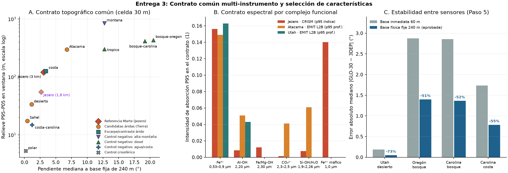
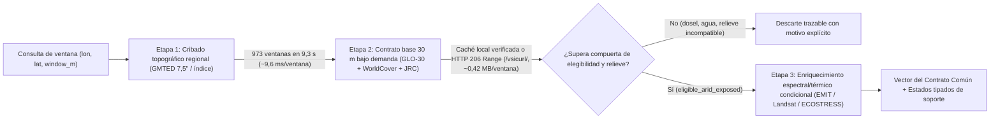

# Tercera entrega: contrato común multi-instrumento, selección cuantitativa de características y consulta bajo demanda

**Pregunta científica.** ¿Cómo comparar observaciones de la Tierra y Marte obtenidas por instrumentos con física y productos nativos distintos, seleccionar características no redundantes sin sesgo por cercanía geográfica y habilitar la evaluación global bajo demanda sin almacenar el planeta completo en disco?

**Conclusión.** La comparación entre cuerpos no puede realizarse enfrentando directamente las salidas crudas de los sensores (p. ej., identificadores discretos de biblioteca Tetracorder de EMIT frente a parámetros continuos de banda de CRISM, o temperatura superficial instantánea de Landsat frente a inercia térmica de THEMIS). En esta entrega se define, implementa y materializa el **Contrato Común de Características (`contrato-comun-superficie-v1`)**, en el que cada instrumento cuenta con un **adaptador independiente** que transforma sus mediciones nativas a un espacio físico y funcional compartido antes de comparar. Sobre este contrato se completa la partición espacial en bloques de desarrollo y reserva (*holdout*), se cuantifica la colinealidad y la relación señal/ruido entre sensores (Paso 5), se formaliza la matriz de comparabilidad entre cuerpos (Paso 6) y se establece el protocolo de **consulta y procesamiento bajo demanda (`consulta-bajo-demanda-v1`)** mediante lecturas parciales HTTP 206 sobre activos *Cloud-Optimized GeoTIFF* (COG) y enriquecimiento condicional por franja.

- Especificación formal: [`specs/analysis/contrato-comun-entrega3.json`](../../../specs/analysis/contrato-comun-entrega3.json)
- Script reproducible: [`scripts/contrato_comun_y_seleccion.py`](../../../scripts/contrato_comun_y_seleccion.py)
- Pruebas automatizadas: [`tests/test_contrato_comun_entrega3.py`](../../../tests/test_contrato_comun_entrega3.py)
- Evidencia generada: [`contrato-features.json`](../../evidencia-entrega-3/contrato-features.json) · [`seleccion-y-redundancia.json`](../../evidencia-entrega-3/seleccion-y-redundancia.json) · [`comparabilidad-e-instrumentos.png`](../../evidencia-entrega-3/comparabilidad-e-instrumentos.png) · [`manifest.json`](../../evidencia-entrega-3/manifest.json)



---

## 1. Arquitectura de comparabilidad: adaptadores por instrumento hacia un contrato común (Paso 6)

Los instrumentos orbitales de Marte y la Tierra difieren en resolución espacial, muestreo espectral, condiciones atmosféricas y nivel de procesamiento del proveedor. Por ello, el sistema desacopla la **extracción específica por instrumento** de la **comparación en el contrato común**, clasificando cada característica en cuatro niveles de comparabilidad (`comparability_tier`):

| Nivel en el contrato (`comparability_tier`) | Regla metodológica | Módulos y características que lo implementan |
|---|---|---|
| **`direct_metric`** | Misma magnitud física, unidad y operador matemático sobre soporte espacial equivalente (`celda = 30/60/120 m`, `base de pendiente = 240 m`, `radio de rugosidad = 360 m`, `ventana = 1,8 o 3 km`). | **Módulo topográfico (`topography_contract`):** `relief_p95_p05_m`, `slope_240m_p50_deg`, `slope_240m_p90_deg`, `roughness_360m_p50_m`, calculados de forma independiente por el adaptador marciano (`HiRISE DTM`) y el terrestre (`GLO-30` / `3DEP` / `SRTM`). |
| **`functional_contract_bridge`** | Adaptadores independientes por instrumento que proyectan productos nativos distintos hacia el mismo complejo físico de absorción electrónica o vibracional, reportando intensidad (`p50`, `p95`) y fracción activa con umbrales explícitos de calidad y soporte. | **Módulo espectral (`spectral_absorption_contract`):** 5 complejos de absorción activos en VNIR–SWIR (`abs_fe3_oxide_0p53_0p90um`, `abs_al_oh_2p20um`, `abs_fe_mg_oh_2p30um`, `abs_carbonate_2p30_2p50um`, `abs_hydrated_sioh_so4_1p9_2p26um`). |
| **`requires_on_demand_product`** | La característica forma parte del contrato común y está medida en un cuerpo, pero requiere consultar bajo demanda un producto adicional en el otro cuerpo para habilitar la comparación directa sin confundir magnitudes. | 1) Complejo máfico `abs_mafic_fe2_1p0um` (medido en Marte por `CRISM OLINDEX3`; requiere reflectancia `EMIT L2A` a `1,0 µm` en Tierra). 2) Respuesta térmica intrínseca (`THEMIS TI` frente a inercia térmica aparente `ATI` derivada de pares día–noche `ECOSTRESS`/`MODIS` + albedo). |
| **`planet_specific_constraint`** | Condición de contorno o compuerta de elegibilidad propia de la Tierra (vegetación, urbanización, agua superficial actual o temperatura radiométrica instantánea de escena). En Marte actúa como condición de contorno conocida (`0` para vegetación/agua líquida/construido). | **Módulo de elegibilidad e hidrología (`eligibility_and_water_contract`):** `bare_or_sparse_fraction`, `trees_fraction`, `built_fraction`, `permanent_water_fraction`, `water_occurrence_mean_pct`, `water_extent_gt0_fraction`, `ndvi_p50` y `landsat_lst_p50_k`. |

---

## 2. Resultados materializados del contrato común en Marte y Tierra

### 2.1 Contrato topográfico y de elegibilidad superficial (`celda = 30 m`)

Al aplicar el adaptador topográfico con los mismos parámetros físicos (`celda = 30 m`, `base de derivada = 240 m`, `radio de rugosidad = 360 m`) sobre el DTM HiRISE de Jezero y los 10 sitios terrestres de referencia y control, el abanico deltaico de Jezero (`54,82 m` de relieve y `2,65°` de pendiente a `1,8 km`; `120,27 m` y `3,07°` a `3 km`) queda situado directamente dentro de la envolvente de las cuencas y márgenes áridos terrestres (`Sahel` → `Utah desierto` → `costa árida` → `Atacama`), mientras las compuertas de elegibilidad y la geometría separan sin ambigüedad todos los controles negativos:

| Sitio (`site_id`) | Cuerpo y estrato | Relieve 1,8 / 3 km (`m`) | Pendiente `240 m` P50, 1,8 / 3 km (`°`) | Pendiente `240 m` P90, 3 km (`°`) | Rugosidad `360 m` P50, 1,8 / 3 km (`m`) | Suelo desnudo / árboles / agua WC (`%`) | Compuerta de elegibilidad (`analog_surface_eligibility`) |
|---|---|---:|---:|---:|---:|---:|---|
| `mars-jezero-fan` | Marte · abanico deltaico | 54,82 / 120,27 | 2,65 / 3,07 | 9,24 | 5,08 / 7,57 | 100,0 / 0,0 / 0,0 | `mars_reference_surface` |
| `desierto` (Utah) | Tierra · cuenca sedimentaria árida | 27,36 / 33,65 | 1,37 / 1,14 | 2,81 | 1,90 / 1,68 | 99,7 / 0,0 / 0,0 | `eligible_arid_exposed` |
| `costa` (Atacama) | Tierra · margen hiperárido | 80,32 / 126,15 | 3,60 / 3,41 | 6,75 | 6,59 / 5,98 | 100,0 / 0,0 / 0,0 | `eligible_arid_exposed` |
| `atacama-materiales` | Tierra · cuenca evaporítica/aluvial | 199,80 / 296,67 | 7,85 / 6,75 | 9,89 | 8,47 / 6,48 | *(bajo demanda)* | `pending_on_demand_cover_check` |
| `sahara-sahel` | Tierra · llanura eólica árida | 16,01 / 17,37 | 0,57 / 0,47 | 0,97 | 1,02 / 0,73 | *(bajo demanda)* | `pending_on_demand_cover_check` |
| `montana` (Alpes) | Tierra · relieve alpino | 634,21 / 845,40 | 18,06 / 12,73 | 39,62 | 23,72 / 22,90 | 0,2 / 79,4 / 1,7 | `excluded_dense_canopy` |
| `bosque-oregon` | Tierra · bosque templado | 287,06 / 431,23 | 17,75 / 20,52 | 31,84 | 30,88 / 35,67 | 0,0 / 92,4 / 0,0 | `excluded_dense_canopy` |
| `bosque-carolina` | Tierra · bosque montañoso | 363,51 / 416,76 | 19,02 / 19,20 | 26,22 | 31,01 / 30,99 | 0,0 / 99,6 / 0,0 | `excluded_dense_canopy` |
| `tropico` (Borneo) | Tierra · selva tropical | 217,62 / 301,43 | 11,53 / 12,73 | 24,22 | 23,98 / 24,73 | 0,0 / 99,8 / 0,0 | `excluded_dense_canopy` |
| `costa-carolina` | Tierra · estuario costero (`tierra_95`) | 14,21 / 14,82 | 1,31 / 1,22 | 2,50 | 3,23 / 3,41 | 0,9 / 27,8 / 33,4 | `excluded_permanent_water` |
| `polar` (Antártida) | Tierra · meseta criosférica | 3,12 / 5,28 | 0,22 / 0,21 | 0,39 | 0,51 / 0,48 | *(fuera de dominio WC)* | `pending_on_demand_cover_check` |

### 2.2 Contrato espectral por complejos funcionales de absorción (`CRISM MTR3` vs. `EMIT L2B`)

En lugar de comparar los 295 códigos de Tetracorder con las 60 bandas de CRISM, ambos adaptadores proyectan sus mediciones válidas hacia **6 complejos funcionales de absorción**:

1. **Adaptador CRISM (`adaptador_espectral_crism`):** evalúa el cubo `frt000047a3_07_sr166j_mtr3.img` con máscara `IN = 0` sobre toda la huella (`87,23 %` de cobertura en `1,8 km` → `measured`; `72,26 %` en `3 km` → `insufficient_coverage`), extrayendo `p50`, `p95` y la fracción de píxeles activos por encima del piso de detección para `BD530_2` ($\text{Fe}^{3+}$), `D2200` ($\text{Al-OH}$), `D2300` ($\text{Fe/Mg-OH}$), `MIN2295_2480` ($\text{CO}_3^{2-}$), `BD1900R2` ($\text{Si-OH}/\text{H}_2\text{O}/\text{SO}_4$) y `OLINDEX3` ($\text{Fe}^{2+}$ máfico).
2. **Adaptador EMIT (`adaptador_espectral_emit`):** deduplica por muestra original del sensor `(ix, iy)`, exige `2 × fit ≥ 0,80` y `profundidad > 2σ`, **separa explícitamente las coincidencias no minerales** (`Orgánico o sintético`: `861` muestras en Atacama correspondientes a pasto seco, madera y vinilo en la biblioteca USGS) de las muestras minerales (`707` muestras minerales en el Grupo 2 de Atacama y `1.596` en Utah), calcula la fracción mineral y los cuantiles de profundidad de banda (`p50`, `p95`) específicos de cada complejo y aplica el umbral de muestra mínima por complejo (`n ≥ 30`; cuando `0 < n < 30`, el estado se tipa como `insufficient_complex_sample` y no se publica un cuantil ruidoso).

| Complejo funcional en el contrato (`complex_id`) | Mecanismo físico y rango | Jezero · `CRISM` (`1,8 km`, `n = 8.897`) | Atacama · `EMIT L2B` (`3 km`, escena `20230130`) | Utah · `EMIT L2B` (`3 km`, escena `20230609`) | Interpretación comparativa bajo el contrato |
|---|---|---|---|---|---|
| `abs_fe3_oxide_0p53_0p90um` | Óxidos/oxihidróxidos de $\text{Fe}^{3+}$ (`0,53–0,90 µm`) | `BD530_2`: `p50 = 0,1439`, `p95 = 0,1561` (`100 %` activo `> 0,05`) | `100,0 %` Grupo 1 (`n = 1.928` hematita), `p50 = 0,1059`, `p95 = 0,1490` | `100,0 %` Grupo 1 (`n = 2.057` hematita), `p50 = 0,1412`, `p95 = 0,1627` | **Afinidad alta en los tres sitios:** fuerte componente de óxido férrico tanto en el polvo/sustrato de Jezero como en las cuencas de Utah y Atacama. |
| `abs_al_oh_2p20um` | Filosilicatos dioctaédricos $\text{Al-OH}$ (`2,16–2,22 µm`) | `D2200`: `p50 = 0,0037`, `p95 = 0,0084` (`30,0 %` activo `> 0,005`) | `29,8 %` mineral Grupo 2 (`n = 211` montmorillonita + caolinita), `p50 = 0,0392`, `p95 = 0,0510` | `99,6 %` mineral Grupo 2 (`n = 1.590` moscovita + illita + caolinita), `p50 = 0,0353`, `p95 = 0,0431` | **Presente en los tres sitios:** Utah actúa como miembro extremo dominado por illita/moscovita, mientras Atacama combina montmorillonita/caolinita en proporción (`29,8 %`) cercana a la fracción espacial activa en Jezero (`30,0 %`). |
| `abs_carbonate_2p30_2p50um` | Carbonatos $\text{CO}_3^{2-}$ (`2,30–2,53 µm`) | `MIN2295_2480`: `p50 = −0,0061`, `p95 = +0,0013`, `máx = +0,0087` (`7,3 %` activo `> 0`) | `43,1 %` mineral Grupo 2 (`n = 305` aragonito + dolomita + calcita), `p50 = 0,0353`, `p95 = 0,0412` | `insufficient_complex_sample` (`n = 5 < 30`, `0,3 %`, `p95` no publicado) | **Atacama reproduce la asociación carbonatada** que en Jezero aparece concentrada en parches marginales y del abanico (`p95 > 0`), mientras en Utah es apenas traza (`n = 5`). |
| `abs_hydrated_sioh_so4_1p9_2p26um` | Sílice hidratada, sulfatos y $\text{H}_2\text{O}$ (`1,90–2,26 µm`) | `BD1900R2`: `p50 = 0,0024`, `p95 = 0,0074`, `máx = 0,0302` (`18,5 %` activo `> 0,005`) | `25,2 %` mineral Grupo 2 (`n = 178` calcedonia/vidrio basáltico hidratado + jarosita), `p50 = 0,0392`, `p95 = 0,0608` | `measured_absent` (`n = 0`, `0,0 %`, `p95 = 0,0`) | **Atacama comparte la fase hidratada amorfa/sulfatada** (`25,2 %`) con los parches hidratados de Jezero (`18,5 %`), ausente en la ventana de Utah. |
| `abs_fe_mg_oh_2p30um` | Filosilicatos $\text{Fe/Mg-OH}$ (`2,28–2,35 µm`) | `D2300`: `p50 = 0,0058`, `p95 = 0,0121` (`26,6 %` activo `> 0,008`) | `insufficient_complex_sample` (`n = 13 < 30` esmectita, `1,84 %`, `p95` sin máscara `= 0,0314`) | `insufficient_complex_sample` (`n = 1 < 30` paligorskita, `0,06 %`) | **Diferencia diagnóstica clave:** el abanico de Jezero presenta una firma intensa de esmectita rica en Fe/Mg (`D2300`), mientras en Atacama solo aparece de forma incipiente (`n = 13`) y en Utah está prácticamente ausente, orientando la búsqueda bajo demanda hacia abanicos saporíticos/nontroníticos en terrenos basálticos. |
| `abs_mafic_fe2_1p0um` | Silicatos máficos $\text{Fe}^{2+}$ (`0,90–1,30 µm`, olivino/piroxeno) | `OLINDEX3`: `p50 = 0,1206`, `p95 = 0,1403` (`21,8 %` activo `> 0,13`) | `unobserved_by_product` (requiere `EMIT L2A RFL` a `1,0 µm`) | `unobserved_by_product` (requiere `EMIT L2A RFL` a `1,0 µm`) | **Tipado explícito sin falsa ausencia:** EMIT L2B no parametriza olivino/piroxeno en estas escenas; el contrato conserva el estado `unobserved_by_product` hasta evaluar reflectancia `L2A` bajo demanda. |

---

## 3. Partición espacial por bloques reservados y selección cuantitativa de características (Paso 5)

### 3.1 Partición determinista en bloques de desarrollo y reserva (*holdout*)

Para evitar que la autocorrelación espacial entre ventanas cercanas sesgue la selección de variables o los pesos de similitud, las **973 ventanas de 3 km** del cribado regional (`Utah`, `Mojave`, `Atacama`) se agruparon en **13 bloques geográficos de ~100 × 100 km (`1° × 1°`)**, separando **10 bloques de desarrollo (`716` ventanas, `73,59 %`)** y **3 bloques reservados de validación (`257` ventanas, `26,41 %`)**:

- **Separación entre cuencas:** `662,17 km` entre Utah y Mojave, `8.239,80 km` entre Utah y Atacama y `8.317,08 km` entre Mojave y Atacama (superando ampliamente el mínimo de `250 km`).
- **Aislamiento estricto:** ningún bloque reservado (`utah:-110_+39` con `70` ventanas, `mojave:-116_+35` con `70` ventanas y `atacama:-068_-24` con `117` ventanas) se utilizó para calcular correlaciones, ajustar transformaciones ni decidir el catálogo de características; permanecen congelados para la evaluación ciega del método de búsqueda (Paso 7).

### 3.2 Análisis cuantitativo de redundancia y estabilidad entre sensores

Sobre las **716 ventanas de desarrollo** y las **168 configuraciones pareadas** de validación topográfica (`3DEP` vs. `GLO-30` vs. `SRTM`) se obtuvieron tres resultados decisivos para depurar el vector de características:

1. **Estabilidad frente a cambio de escala y sensor (`SNR_sensor`):**
   - Entre escalas regionales (`300 m` vs. `600 m` en las `716` ventanas de desarrollo), la correlación de rango de Spearman es $\rho = 0,9974$ para el relieve y $\rho = 0,9850$ para la pendiente mediana (`p50`), confirmando que el orden relativo de las ventanas es altamente invariante al paso de celda cuando se fija la huella de `3 km`.
   - A resolución de `30 m`, sustituir la pendiente inmediata (`base = 60 m`) por la **pendiente a base física fija de `240 m`** reduce el error absoluto mediano frente a lidar `3DEP` en **73,7 % en Utah (`0,197° → 0,052°`)**, **51,1 % en el bosque de Oregón (`2,870° → 1,403°`)**, **52,1 % en el bosque de Carolina (`2,852° → 1,367°`)** y **54,7 % en la costa de Carolina (`1,734° → 0,786°`)**, elevando la relación señal inter-estrato / ruido de sensor (`SNR_sensor`) a **390,1 en pendiente** y **2.999,6 en relieve** sobre terreno árido.
2. **Estructura de colinealidad y complementariedad topográfica:**
   - En las `716` ventanas de desarrollo, `slope_p10` presenta alta colinealidad con `slope_p50` ($\rho = 0,9258$, $r = 0,9066$) sin aportar discriminación adicional de formas abruptas, mientras que la pareja **`slope_240m_p50_deg` + `slope_240m_p90_deg`** distingue terrenos suavemente inclinados de ventanas con escarpes o márgenes de canal (como Jezero a `3 km`, donde `p50 = 3,07°` pero `p90 = 9,24°`, o los Alpes, donde `p50 = 12,73°` y `p90 = 39,62°`).
   - A `30 m`, el relieve `relief_p95_p05_m` y la pendiente mediana `slope_240m_p50_deg` muestran correlación lineal moderada ($r = 0,7628$), confirmando que miden aspectos geométricos complementarios (desnivel total de la cuenca frente a gradiente local).
3. **Reducción de entropía espectral mediante el contrato común:**
   - En EMIT Grupo 2 de Atacama (`20230130T135427`), pasar de identificadores crudos de biblioteca (`library_entropy = 2,392 bits`, contaminados por `861` muestras de clases orgánicas/sintéticas) a los **complejos funcionales minerales del contrato** reduce la ambigüedad a `3` complejos minerales estadísticamente soportados (`CO₃²⁻ = 43,1 %`, `Al-OH = 29,8 %`, `Si-OH/H₂O/SO₄ = 25,2 %`, todos con `n ≥ 178`), evitando que variaciones instrumentales entre sub-muestras de una misma especie mineral fragmenten la señal.

### 3.3 Decisiones finales de selección de características

| Característica (`feature_id`) | Módulo del contrato | Decisión en Entrega 3 | Justificación cuantitativa |
|---|---|---|---|
| `relief_p95_p05_m` | `topography_contract` | **`approved_for_ranking`** | Error inter-sensor `0,28 m` en desierto (`SNR_sensor = 2.999,6`); separa abanicos sedimentarios (`27–126 m`) de alta montaña (`845 m`) y meseta polar (`5,3 m`). |
| `slope_240m_p50_deg` | `topography_contract` | **`approved_for_ranking`** | Reduce entre `51,1 %` y `73,7 %` la discrepancia frente a 3DEP respecto a la derivada inmediata de `60 m` (`Δ = 0,052°` en Utah). |
| `slope_240m_p90_deg` | `topography_contract` | **`approved_for_ranking`** | Captura la asimetría de frentes deltaicos y paredes de canal (`9,24°` en Jezero `3 km` frente a `2,81°` en Utah y `9,89°` en Atacama). |
| `roughness_360m_p50_m` | `topography_contract` | **`approved_conditional`** | Alta precisión en suelo expuesto (`Δ = 0,03 m` en Utah; `5,08 m` en Jezero `1,8 km`), pero cae a `3,24 %` de soporte en costas recortadas y se infla `>2 m` bajo dosel. Se activa solo si `roughness_coverage ≥ 0,80` y `trees_fraction ≤ 0,05`. |
| `slope_immediate_60m_deg`, `slope_p10` | `topography_contract` | **`reformulated_into_contract`** | Sustituidas por `slope_240m_p50_deg` y `slope_240m_p90_deg` por colinealidad ($\rho = 0,926$) y mayor sensibilidad al ruido de sensor (`2×` a `3,8×`). |
| `laplacian_curvature` | `topography_contract` | **`discarded`** | Segunda derivada discreta de 4 vecinos dominada por el paso de rejilla (`30/60/120 m`) y el ruido de cuantización de cada DEM. |
| `topographic_position_tpi` | `topography_contract` | **`reformulated_into_contract`** | Su mediana en ventana tiende a `0 m` por construcción; su dispersión local ya queda representada por `roughness_360m_p50_m` e `iqr`. |
| `abs_fe3_oxide_0p53_0p90um`, `abs_al_oh_2p20um`, `abs_fe_mg_oh_2p30um`, `abs_carbonate_2p30_2p50um`, `abs_hydrated_sioh_so4_1p9_2p26um` | `spectral_absorption_contract` | **`approved_for_ranking`** | Puente funcional validado entre `CRISM MTR3` y `EMIT L2B` con umbral `n ≥ 30` muestras minerales y cobertura de huella `≥ 80 %`. |
| `abs_mafic_fe2_1p0um` | `spectral_absorption_contract` | **`approved_conditional`** | Medido en Jezero (`OLINDEX3 p95 = 0,1403`); tipado como `unobserved_by_product` en `EMIT L2B` hasta consultar reflectancia `EMIT L2A` (`1,0 µm`) bajo demanda. |
| `emit_library_match_fraction_raw_ids` | `spectral_absorption_contract` | **`reformulated_into_contract`** | Sustituida para búsqueda por los complejos funcionales minerales tras excluir `861` ajustes orgánicos/sintéticos en Atacama; se conserva solo para auditoría. |
| `worldcover_bare_trees_built_water_fractions`, `jrc_water_occurrence_and_extent` | `eligibility_and_water_contract` | **`approved_as_eligibility_filter`** | Compuerta dura de elegibilidad terrestre (`bare_or_sparse ≥ 0,85`, `trees ≤ 0,05`, `built ≤ 0,02`, `permanent_water == 0` para análogos de superficie marciana). |
| `hls_ndvi_p50`, `themis_ti_and_landsat_lst` | `eligibility_and_water_contract` / `thermal_contract` | **`approved_as_context_only`** | `NDVI` verifica ausencia de pulso vegetativo por fecha; `THEMIS TI` (`253,2 J m⁻² K⁻¹ s⁻¹/²`) y `Landsat LST` (`Δ = 38,1 K` estacional) se mantienen separados hasta disponer de `ATI` diurna bajo demanda. |
| `hls_ndmi_p50` | `eligibility_and_water_contract` | **`discarded`** | En superficies áridas responde a absorción mineral en `SWIR1` e invierte el orden entre costa hiperárida y desierto interior. |

---

## 4. Arquitectura de disponibilidad global y procesamiento bajo demanda (`consulta-bajo-demanda-v1`)

Para que la ausencia de archivos precargados en disco nunca bloquee la exploración global ni obligue a descargar terabytes de rásters, la evaluación del contrato común opera bajo un esquema de **tres etapas bajo demanda** respaldado por el lector `Rasters(stack, mode='auto' | 'range' | 'cache')` de [`pipelines/atlas_topography.py`](../../../pipelines/atlas_topography.py) y el evaluador `evaluate_on_demand_window_contract` de [`scripts/contrato_comun_y_seleccion.py`](../../../scripts/contrato_comun_y_seleccion.py):



1. **Principio de cero descarga global previa:** las fuentes globales continuas a `10–30 m` (`Copernicus GLO-30`, `ESA WorldCover`, `JRC Surface Water`, `HLS`, `Landsat Collection 2`) se publican como *Cloud-Optimized GeoTIFF* (COG). En modo `'auto'`, si la tesela figura en la caché local verificada (`CACHE_LIMIT = 100 GB`), se lee en disco (`5,15–5,70 s` por bloque de `100 × 100 km`); si no está en disco, GDAL `/vsicurl/` descarga mediante peticiones parciales `HTTP 206` únicamente los bloques internos que intersecan la ventana más su margen (`4,44 × 4,44 km` para una ventana de `3 km` con halo de `720 m`), requiriendo **~0,42 MB por ventana** (`38,46 MB` y `16,35 s` medidos empíricamente para un bloque completo de `100 × 100 km` en `23` rangos HTTP).
2. **Enriquecimiento condicional para sensores por franja (`EMIT`, `ECOSTRESS`, `3DEP`):** dado que los sensores hiperespectrales y térmicos de alta resolución adquieren franjas discretas y no cubren el 100 % del globo, el contrato trata sus salidas como módulos condicionales. Si una ventana candidata supera las etapas 1 y 2 pero no cuenta aún con una escena local, el evaluador devuelve el estado tipado `on_demand_fetchable` (o `no_swath_coverage` cuando la consulta al catálogo CMR/STAC confirma ausencia de pasadas orbitales) **sin imputar ceros ni penalizar la distancia topográfica**.
3. **Persistencia ligera y verificable:** en lugar de almacenar recortes ráster intermedios, el flujo persiste únicamente los vectores del contrato común por ventana junto con el tamaño, fecha o `SHA-256`/`ETag` del recurso consultado.

---

## 5. Reproducibilidad y verificación

Todo el procesamiento de esta tercera entrega se ejecuta de manera determinista y verifica las identidades `SHA-256` de entradas y salidas mediante los siguientes comandos:

```sh
bash scripts/ejecutar_minerales.sh scripts/contrato_comun_y_seleccion.py
bash scripts/ejecutar_minerales.sh tests/test_contrato_comun_entrega3.py -v
```

Con el contrato común (`contrato-comun-superficie-v1`), las características aprobadas, la arquitectura bajo demanda y los bloques reservados congelados (`257` ventanas de *holdout*), el proyecto queda listo para ejecutar el **Paso 7 (búsqueda de similitud interpretable y validación ciega sobre bloques reservados)**.
