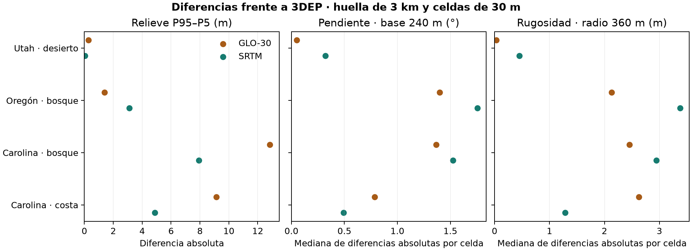
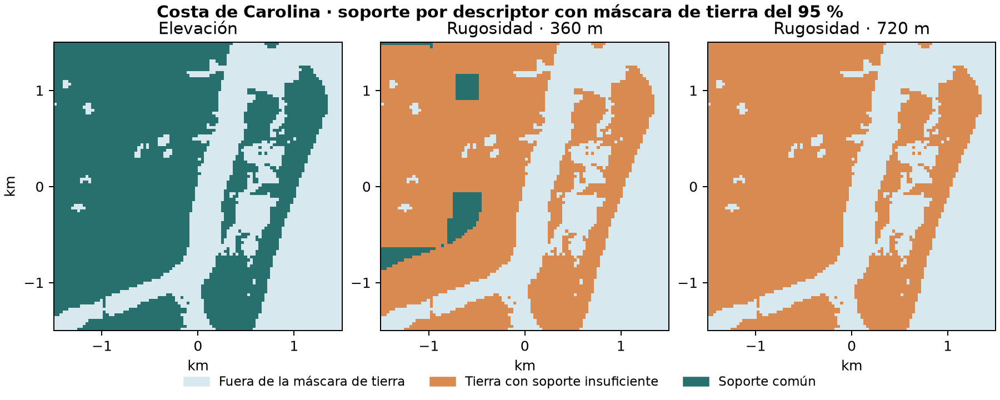

# Validación de la armonización topográfica en desierto, bosque y costa

**Pregunta científica.** ¿Cuánto cambia una descripción de terreno al sustituir el modelo de elevación, modificar su escala o restringir la medición a tierra, y qué características conservan una interpretación comparable?

**Conclusión.** En estos controles, el relieve P95–P5 distingue terrenos con amplitudes verticales muy diferentes cuando se fija la huella. Las diferencias pequeñas entre sitios pueden quedar dentro del cambio que introduce el producto. La pendiente a 240 m reduce las discrepancias entre fuentes en los cuatro controles, incluso sobre las mismas celdas costeras. La rugosidad requiere validar el vecindario antes de utilizar su valor. Con el criterio costero del 95 % de tierra por celda, el radio de 720 m quedó sin soporte a las tres resoluciones.

## Controles y método

Se amplió el control desértico de Utah con dos ventanas boscosas en regiones separadas, Oregón y Carolina del Norte, y una transición costera en Carolina del Norte. Se eligieron las ventanas por disponibilidad de 3DEP y por cobertura de superficie comprobada antes de observar los descriptores topográficos. El primer centro costero se desplazó de 77,865° O a 77,889° O tras comprobar que la huella original de 1,8 km caía íntegramente sobre agua. WorldCover clasifica árboles y agua permanente, entre otras coberturas. [ESA WorldCover 2021 v200](https://doi.org/10.5281/zenodo.7254221)

| Control | Centro (longitud, latitud) | Referencia | Comparados |
|---|---|---|---|
| Utah, desierto | −110,600°, 38,600° | 3DEP de 1 m | GLO-30, SRTM GL1 |
| Oregón, bosque | −123,550°, 45,550° | 3DEP de 1/3″, aproximadamente 10 m | GLO-30, SRTM GL1 |
| Carolina del Norte, bosque | −82,810°, 35,370° | 3DEP de 1 m | GLO-30, SRTM GL1 |
| Carolina del Norte, costa | −77,889°, 34,067° | 3DEP de 1 m | GLO-30, SRTM GL1 |

La referencia 3DEP mide terreno desnudo. Copernicus GLO-30 representa una superficie que puede incluir vegetación, construcciones y zonas editadas. Se conservaron los datums verticales de origen. Los descriptores se calculan sobre elevación relativa o diferencias locales y se comparan en los mismos centros por configuración. Esta estrategia controla un desplazamiento vertical constante y deja como posibles contribuciones las diferencias espaciales del datum, el corregistro, la adquisición y el tipo de superficie. [USGS 3DEP de 1 m](https://data.usgs.gov/datacatalog/data/USGS%3A77ae0551-c61e-4979-aedd-d797abdcde0e) · [USGS 3DEP de 1/3″](https://pubs.usgs.gov/tm/11b9/tm11B9.pdf) · [Copernicus DEM](https://dataspace.copernicus.eu/explore-data/data-collections/copernicus-contributing-missions/collections-description/COP-DEM) · [NASA SRTM GL1](https://search.earthdata.nasa.gov/search?q=SRTMGL1)

Se agregaron las observaciones nativas a celdas de 30, 60 y 120 m. Las huellas de 1,8 y 3 km comparten centro y margen exterior de 720 m. La pendiente se evaluó con vecinos inmediatos y con una base física de 240 m. La rugosidad corresponde al RMS residual respecto a un plano ajustado en un vecindario cuadrado de radio 360 o 720 m. La matriz usa 28 configuraciones por sitio y política, porque a 120 m los vecinos inmediatos ya están separados 240 m. [Método y evidencia del control en Utah](Plan%20y%20experimento%20de%20armonizacion%20topografica%20en%20Utah.md)

Para costa se compararon tres políticas, sin máscara de cobertura y con un mínimo de 50 % o 95 % de tierra por celda. Se estimó esa fracción agregando WorldCover y excluyendo el agua permanente de la elegibilidad terrestre. La máscara se aplica antes de calcular los descriptores, por lo que también afecta a sus vecindarios. Se registran celdas de la huella completa, celdas elegibles y celdas con soporte común para cada descriptor.

## Efecto de sustituir la fuente

Se completaron **168 configuraciones** entre las cuatro ventanas y las tres políticas costeras. Los dos bosques tienen 92,4 % y 99,6 % de árboles, respectivamente. Los tres controles interiores conservaron soporte común completo en todos los descriptores. La tabla resume la huella de 3 km a 30 m y utiliza la máscara de tierra del 95 % en costa.

| Control | Relieve 3DEP / GLO-30 / SRTM (m) | Diferencia mediana de pendiente frente a 3DEP, GLO-30 / SRTM (°), base 240 m | Diferencia mediana de rugosidad frente a 3DEP, GLO-30 / SRTM (m), radio 360 m |
|---|---:|---:|---:|
| Utah, desierto | 33,93 / 33,65 / 33,89 | 0,05 / 0,32 | 0,03 / 0,45 |
| Oregón, bosque | 432,63 / 431,23 / 429,51 | 1,40 / 1,75 | 2,13 / 3,38 |
| Carolina, bosque | 429,61 / 416,76 / 421,69 | 1,37 / 1,52 | 2,46 / 2,95 |
| Carolina, costa | 5,69 / 14,83 / 10,58 | 0,79 / 0,49 | 2,63 / 1,28 |

Las dos últimas columnas toman la mediana de las **diferencias absolutas por celda**. La comparación de rugosidad costera se limita a 324 centros terrestres comunes.



- **Relieve y huella.** En Utah, cambiar de 1,8 a 3 km modificó el relieve de 3DEP en 6,12 m. Con la huella fija de 3 km, la mayor diferencia entre productos fue 0,28 m en Utah. Frente a 3DEP llegó a 12,85 m en el bosque de Carolina y a 9,13 m en la costa. Los dos bosques están separados por solo 3,02 m de relieve en sus referencias 3DEP. El descriptor distingue el bosque montañoso del desierto y la costa en estos casos, pero diferencias de pocos metros entre candidatos requieren controlar la fuente.
- **Base de pendiente.** En las mismas celdas de cada sitio, pasar de una base de 60 a 240 m redujo entre 51 % y 73 % la diferencia absoluta mediana por celda frente a 3DEP, según sitio y producto. En costa, con las mismas 3.936 celdas, la diferencia GLO-30–3DEP pasó de 2,14° a 0,79°. En los dos bosques, el P90 de las diferencias absolutas todavía quedó entre 3,11° y 4,26° a 240 m. La base de 240 m caracteriza pendientes a una escala física explícita con menor sensibilidad a la fuente en esta muestra.
- **Tamaño de celda con base fija.** A base de 240 m, el P90 de pendiente de 3DEP en los dos bosques disminuyó aproximadamente 1,30° al pasar de celdas de 30 a 120 m. Fijar la distancia de la derivada reduce la confusión entre escala de celda y base, y el promedio inicial sigue afectando el resultado.
- **Radio de rugosidad.** En el bosque de Carolina, ampliar el radio de 360 a 720 m elevó la mediana de 3DEP de 33,07 a 57,90 m. La distancia de observación define qué variación cuenta como rugosidad. Registrar radio, celda y cuantiles permite distinguir efectos de escala y fuente.

## Efecto de medir solo en tierra

En la huella costera de 3 km, el 33,4 % del área se clasifica como agua permanente. A 30 m, las tres fuentes aportan elevación en las 10.000 celdas al incluir agua. Los vecindarios de los descriptores exigen soporte adicional.

| Política | Celdas elegibles | Elevación válida | Pendiente válida, base 240 m | Rugosidad válida, radio 360 m | Rugosidad válida, radio 720 m |
|---|---:|---:|---:|---:|---:|
| Sin máscara | 10.000 | 10.000 | 9.982 | 9.632 | 8.514 |
| ≥50 % de tierra por celda | 6.680 | 6.680 | 4.476 | 626 | 0 |
| ≥95 % de tierra por celda | 6.206 | 6.206 | 3.936 | 324 | 0 |

Con la máscara del 95 %, la elevación cubre todas las celdas elegibles, pero la rugosidad de 360 m cubre **el 5,2 % de esas celdas y el 3,24 % de la huella**. Con la máscara del 50 % llega al 9,4 % de las elegibles a 30 m. El radio de 720 m queda sin soporte con la máscara del 95 % a las tres resoluciones y para ambas huellas. Con el 50 % reaparece a 60 y 120 m en la huella de 3 km, con 108 y 96 centros respectivamente. A 120 m eso equivale al 22,7 % de las celdas elegibles. La disponibilidad depende tanto de la escala como del criterio para admitir celdas con mezcla de tierra y agua. Incluir agua devuelve un valor de rugosidad de 720 m sobre 8.514 centros a 30 m, con una superficie medida distinta a la del terreno terrestre.



## Sensibilidad a la referencia y alcance

La lectura de la tesela de 1 m de Oregón falló en un bloque remoto. Se utilizó 3DEP de 1/3″ con un paso local aproximado de 7,23 × 10,29 m. En las dos ventanas de Carolina se probaron ambas referencias sobre las mismas celdas a 30 m. Al cambiar la referencia, el relieve varió 0,18 m en el bosque y 0,01 m en la costa. La mediana de las diferencias de pendiente a base de 240 m cambió como máximo 0,05° en ambos casos. Este control respalda la interpretación de las diferencias observadas en Carolina y deja abierta la magnitud del efecto en Oregón.

Para una búsqueda por **forma topográfica regional**, el ensayo respalda conservar el relieve a huella fija y la pendiente a base explícita como características candidatas. Para distinguir pendientes finas o superficies muy planas, se necesita evidencia de que la discrepancia local entre fuentes es menor que la diferencia que interesa distinguir. La rugosidad costera requiere un indicador de disponibilidad por descriptor. Conservar el denominador de toda la huella y el de tierra elegible permite detectar cuándo un valor describe solo parches aislados. Las magnitudes observadas corresponden a cuatro lugares y sirven como diagnóstico de sensibilidad para diseñar esa validación.

## Evidencia reproducible

Las entradas locales incluyen recortes en rejilla nativa. La especificación registra URL pública, ventana en píxeles para cada recorte y SHA-256 del archivo empleado. Los recortes y las teselas se conservan en `data/raw/validacion-topografica/`. Los resultados incluyen cuantiles, diferencias pareadas, denominadores y controles de referencia y base. [Especificación de entradas](../../../specs/analysis/validacion-armonizacion-topografica.json) · [Resultados](../../evidencia-validacion-topografica/resultados.json) · [Manifiesto](../../evidencia-validacion-topografica/manifest.json)

```sh
bash scripts/ejecutar_minerales.sh scripts/validar_armonizacion_topografica.py
```

© ESA WorldCover project 2021 / Contains modified Copernicus Sentinel data (2021) processed by ESA WorldCover consortium.
