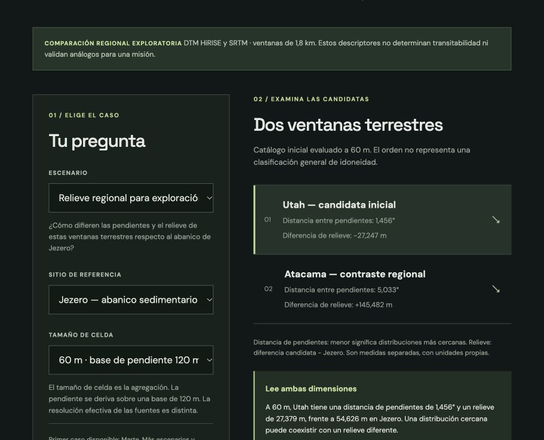

# Fase 3 — recorrido mínimo en la aplicación

**Estado:** implementada y verificada para el primer caso, el 7 de noviembre de 2026.  
**Base:** [hallazgos de fase 2](Primer%20analisis%20reproducible%20-%20Jezero%20y%20candidatas%20terrestres.md) y [plan por escenarios](Plan%20de%20implementacion%20orientado%20a%20escenarios.md).

La aplicación permite seguir la pregunta sobre pendientes y relieve del abanico de Jezero, consultar las dos ventanas terrestres analizadas e inspeccionar semejanzas, diferencias y evidencia pendiente. Es una comparación regional exploratoria para preparar preguntas de exploración robótica; no determina transitabilidad ni certifica análogos.

## Recorrido disponible

1. Abrir la aplicación en [localhost:5173](http://localhost:5173). El selector presenta el escenario de relieve regional y la referencia Jezero, los únicos evaluados. No ofrece referencias lunares sin implementar.
2. Elegir celdas de **60 o 120 m**; se informa también la base de pendiente de **120 o 240 m**, respectivamente. Todas las ventanas miden **1800 × 1800 m**.
3. Elegir **Utah** o **Atacama**. Las tarjetas muestran distancia de distribuciones de pendiente en grados y diferencia de relieve en metros. Mantienen el orden del catálogo, sin clasificación global ni porcentaje combinado.
4. Revisar percentiles de pendiente y relieve p95−p5. El gráfico acumulado usa los intervalos guardados en fase 2; su interpolación gráfica no recalcula la distancia de Wasserstein, que procede de las muestras originales. La tabla de sensibilidad permite consultar ambas escalas para la candidata seleccionada.
5. Consultar los paneles de elevación/pendiente del área medida o el recorte nativo con margen. Cada imagen conserva sus leyendas, ejes y unidades y puede ampliarse. Los colores se ajustan por panel.
6. Abrir la ficha de fuente para ver enlace al producto concreto, versión, fechas, paso nativo aproximado, referencia vertical, SHA-256 del original, cobertura por variable y límites por sitio. Los globos opcionales muestran ubicación y contorno de la ventana de fase 2 sobre fondos globales. No dibujan la cuadrícula histórica de 10 km ni representan terreno 3D de alta resolución.
7. Revisar las cinco dimensiones **no evaluadas**: geología/materiales, térmica, rocas/obstáculos, polvo y agua/hielo. Se conservan como `null` en la API; no cuentan como cero ni como semejanza. La sección de método enlaza los registros y muestra los gráficos y la ortoimagen de inspección de fase 2.

El hallazgo de fase 2 queda visible sin simplificarlo en un porcentaje: a 60 m Utah tiene una distancia de pendientes de **1,456°** y un relieve de **27,379 m**, frente a **54,626 m** en Jezero. Atacama tiene una distancia de **5,033°** y un relieve de **200,109 m**. La comparación a 120 m está disponible y confirma que las magnitudes dependen de la escala. Estos resultados describen únicamente las ventanas estudiadas.

## Implementación y contrato

| Ruta | Función |
|---|---|
| `GET /api/scenarios` | Escenarios, referencias y escalas implementados. |
| `GET /api/scenarios/relieve-regional/comparison?reference_id=mars-jezero-fan&cell_m=60` | Caso, referencia, candidatas, métricas, diferencias, sensibilidad, geometrías, procedencia, método y dimensiones pendientes. Acepta también `cell_m=120`. |
| `GET /api/evidence/{filename}` | Lista cerrada de PNG y registros JSON/GeoJSON revisados, además del manifiesto. No expone originales, rásteres ni carpetas arbitrarias. |

La ruta principal reúne la configuración y cuatro registros existentes: `resultados.json`, `procesamiento.json`, `areas-marte.json` y `areas-tierra.geojson`. Los valores se sirven completos; el redondeo a tres decimales es de presentación y no representa exactitud científica. Las coordenadas de Marte y su esfera local permanecen explícitas; las geometrías terrestres no sustituyen a las planetarias.

Se comprueban tamaños y SHA-256 de los registros y la configuración contra el manifiesto de fase 2; se verifica además la correspondencia de caso, ventana y escalas. Los archivos de evidencia se comprueban al solicitarlos. Un registro o imagen ausente o modificado devuelve **503**, con un mensaje visible en el recorrido o en el panel de imagen. Escenarios inexistentes devuelven **404** y referencias/escalas no evaluadas **422**. No existe respaldo automático en los porcentajes históricos. Los hashes son controles de identidad local: el manifiesto no está firmado y no certifica autenticidad externa ni exactitud.

No se descargan originales ni se ejecuta GDAL al consultar la API. Se requieren los registros y figuras revisados de fase 2 junto con el código. Si se recalcula el análisis con cambios, se debe revisar la nueva evidencia antes de actualizar el manifiesto; no basta con regenerar hashes para validar resultados.

El frontend gestiona carga, errores, reintento y cancelación de consultas al cambiar escala. La comparación anterior se oculta mientras carga la nueva, para evitar mezclar medidas de dos escalas. Los globos se crean solo al desplegarlos.

Se mantienen `/api/regions`, `/api/regions/{id}` y `/api/search` por compatibilidad con el prototipo histórico. `/api/search` está marcada como obsoleta e ilustrativa en OpenAPI; el nuevo frontend no la llama. No se modificó el catálogo `data/regions.json` ni la evidencia revisada de fase 2.

## Verificación

Ejecutar desde la raíz:

```sh
make check
make test-analysis
./.tools/pixi/bin/pixi run python -m unittest discover -s tests -v
```

Se ejecutaron **26 pruebas**: 10 de backend (7 nuevas del recorrido y 3 históricas), 7 científicas de fase 2 y 9 de recolección. Los controles nuevos comparan los valores completos de las tres áreas a ambas escalas con los resultados revisados, verifican geometrías y dimensiones nulas, rechazan referencias/escalas no implementadas, comprueban enlaces y aislamiento de archivos, y simulan evidencia/configuración modificada o ausente. La compilación TypeScript/Vite finalizó correctamente.

La comprobación interactiva en navegador cubrió la carga inicial a 60 m, cambio a 120 m, selección de Atacama, recorte nativo, fuente/cobertura, globo terrestre y acercamiento al polígono de 1,8 km. Se restableció Utah a 60 m. No se observaron errores ni advertencias en la consola durante ese recorrido. No se realizó una prueba exhaustiva en todos los navegadores o dispositivos ni una validación científica nueva.

Los hashes del manifiesto de fase 2 se comprobaron sin discrepancias. Los controles y la captura se conservan en [evidencia de fase 3](../../evidencia-fase-3/README.md).



## Cierre y siguiente fase

El primer caso permite completar la selección, revisar candidatas y entender su evidencia y sus límites. Se cumple el criterio de salida funcional de fase 3 para este caso; la validación de análogos y movilidad permanece abierta.

La fase 4 deberá comprobar integridad, metadatos y cobertura de GMTED2010 antes de ampliar la generación regional de candidatas. Este recorrido conserva la distinción entre áreas evaluadas y dimensiones pendientes; no introduce una búsqueda global ni ML.
