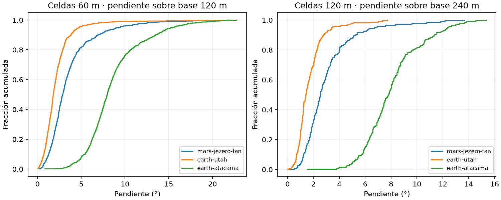

# Primer análisis reproducible — Jezero y candidatas terrestres

**Estado:** fase 2 implementada y ejecutada; comparación regional exploratoria.  
**Base:** [ficha de viabilidad](Ficha%20de%20viabilidad%20-%20primer%20caso.md).  
**Resultado:** dentro de las ventanas seleccionadas, Utah tiene una distribución de pendientes más cercana a Jezero que Atacama, pero presenta aproximadamente la mitad de su relieve relativo. Esto no valida un análogo para movilidad.

## 1. Qué se calculó y con qué datos

La pregunta es comparar pendiente y relieve relativo regionales de un sector del abanico sedimentario de Jezero con dos candidatas terrestres. Se conservaron centros y productos de la fase 1: Jezero 18,49° N/77,41° E, Utah 38,6° N/−110,6° E y Atacama −23,8° N/−67,9° E.

Se ejecutó una línea base interpretable con ventanas de **1800 × 1800 m**, celdas de **60 m** y una repetición a **120 m**. Las geometrías exactas se generan en la proyección métrica local de cada cuerpo y quedan en [áreas de Marte](../../evidencia-fase-2/areas-marte.json) y [áreas terrestres](../../evidencia-fase-2/areas-tierra.geojson). Se densifican sus bordes al volver a coordenadas geográficas. Sustituyen para este experimento los cuadrados geodésicos nominales de fase 1; no cambian el catálogo de la aplicación.

| Sitio | Entrada preservada | Referencia y límites |
|---|---|---|
| Jezero | `DTEEC_002387_1985_003798_1985_A01.IMG`, producto 1.0, 320 045 704 bytes | Elevación estéreo en metros respecto a Mars 2000; esfera local de radio 3 394 839,8133163 m; paso proyectado 1,0096476466229 m. Imágenes fuente de enero y mayo de 2007. |
| Utah | `N38W111.tif`, 14 938 692 bytes | SRTM GL1 distribuido por OpenTopography, WGS84 horizontal. La documentación SRTM establece metros EGM96; la copia TIFF no incorpora CRS vertical ni número de versión. |
| Atacama | `S24W068.tif`, 16 464 310 bytes | Mismas convenciones de colección y limitaciones que Utah. Las fechas de adquisición de los posibles rellenos son desconocidas. |

El DTM completo de Jezero coincide byte a byte con el prefijo y las 17 franjas de fase 1. Se verificaron tres muestras del recorte mediante **dos lectores**, GDAL/PDS y acceso binario Float32 little-endian, además del origen calculado independientemente a partir de los offsets de la etiqueta. Esto controla decodificación y georreferencia declarada; no mide exactitud física contra puntos de campo.

Se descargó también `PSP_002387_1985_RED_C_01_ORTHO.JP2`, 30 941 086 bytes, para inspección visual. Su etiqueta tiene la misma cuadrícula que el DTM en dimensiones, escala, offsets y parámetros geométricos comprobados. Se decodifica con Pillow; la georreferencia procede de PDS. La imagen participa en la revisión, **no en una puntuación ni en una detección de rocas**. Véase [registro de imagen](../../evidencia-fase-2/ortoimagen-qa.json).

Los originales permanecen en `data/raw/`. [La configuración](../../../specs/analysis/primer-caso-fase2.json) fija URL, tamaño, SHA-256, centros, escalas, referencias y limitaciones. Los hashes verifican identidad local; no autenticidad externa ni calidad científica. La política de uso y atribución por producto se conserva en la ficha de fase 1. Este trabajo genera derivados locales, sin publicar los originales.

## 2. Método, máscaras y conflictos resueltos

1. Leer un recorte nativo que cubra la ventana y **240 m de margen por lado**, más dos píxeles de seguridad. Las áreas exteriores al archivo y los valores nodata permanecen inválidos. En Jezero también se aplica el intervalo válido de su etiqueta.
2. Usar AEQD local con WGS84 para Tierra y la esfera local del producto para Marte. No se reproyecta Marte a un CRS terrestre ni se transforma entre datums verticales planetarios.
3. Agregar elevación por promedio espacial mediante GDAL. Reproyectar por separado una máscara numérica 0/1 **sin excluir los ceros** para conservar la fracción de soporte válido. Una celda se acepta solo con soporte completo, con tolerancia numérica de 10⁻⁶.
4. Calcular pendiente por diferencias centrales después de agregar. Centro y cuatro vecinos deben ser válidos. Celdas de 60 m implican una base de derivación de **120 m**; a 120 m, la base es **240 m**. La escala de la pendiente no se reduce al tamaño de un píxel.
5. Describir la distribución de pendiente mediante percentiles lineales p10/p50/p90, histograma y distribución acumulada. Calcular relieve relativo como p95−p5 de elevaciones agregadas válidas, en metros. No comparar elevación absoluta entre planetas.
6. Comparar las distribuciones mediante distancia de Wasserstein unidimensional, en grados: cero indica distribuciones iguales en esta métrica. Se informa separadamente la diferencia de relieve candidata−referencia. No se normalizan ni combinan en porcentaje o índice general.

| Discrepancia o riesgo | Resolución aplicada | Límite restante |
|---|---|---|
| El prototipo usaba 10 km, celdas de 500 m y otra referencia marciana | Pipeline separado con ventanas y CRS explícitos; geometrías finales guardadas | Sus resultados no sustituyen las cifras del prototipo. |
| Imagen de unos 25 cm confundible con DTM de aproximadamente 1 m | Se usa DTM con escala de etiqueta y ortoimagen C con etiqueta propia; no se transfiere resolución entre productos | No hay resolución efectiva ni precisión local cuantificadas. |
| Un promedio que ignora nodata podría aparentar cobertura completa | Máscara de soporte independiente; ceros participan en agregación; pruebas de huecos y padding exterior | Cobertura de valores no equivale a observación directa. |
| Referencia vertical/unidades ausentes en TIFF SRTM | Asignación documental de metros EGM96 según [USGS EROS](https://www.usgs.gov/centers/eros/science/usgs-eros-archive-digital-elevation-shuttle-radar-topography-mission-srtm), coherente con procedencia registrada | No se inventó un CRS vertical embebido; la versión exacta y procedencia de rellenos siguen sin certificar. |
| Cabeceras MOLA incompatibles con etiquetas de recuentos | MOLA y sus recuentos quedan excluidos de la ruta nueva; se lee PDS del DTM seleccionado | La inconsistencia histórica de MOLA no se reparó ni se utiliza como evidencia en este análisis. |
| GDAL local carece de plugin JPEG2000 | Pillow decodifica JP2; coincidencia geométrica comprobada con etiqueta PDS | No se afirma corregistro independiente de precisión a partir del decodificador. |
| Sitios famosos tratados como análogos verdaderos | Atacama se usa como contraste regional; no se identifica el polígono con ARADS | No hay pares exactos revisados por expertos ni un conjunto de verdad de referencia. Mojave continúa pendiente de análisis. |

El paso físico nativo aproximado se registra por eje en [procesamiento.json](../../evidencia-fase-2/procesamiento.json). Es distinto del soporte efectivo. La cuadrícula común de 60 m hace coherente el cálculo propuesto, pero no iguala las respuestas de sensores, los rellenos ni su resolución efectiva.

## 3. Resultados y sensibilidad

Todas las celdas interiores de elevación y pendiente resultaron válidas: **900/900 por sitio a 60 m** y **225/225 a 120 m**. Los márgenes permiten calcular pendientes en el borde sin recortar silenciosamente el área interior. Estos conteos son celdas de análisis correlacionadas espacialmente, no observaciones independientes.

| Sitio | Celda | Pendiente p10 | Pendiente mediana | Pendiente p90 | Relieve p95−p5 |
|---|---:|---:|---:|---:|---:|
| Jezero | 60 m | 1,288° | 2,883° | 6,918° | 54,626 m |
| Utah | 60 m | 0,737° | 1,814° | 3,847° | 27,379 m |
| Atacama | 60 m | 5,430° | 7,974° | 13,488° | 200,109 m |
| Jezero | 120 m | 1,248° | 2,542° | 5,211° | 53,211 m |
| Utah | 120 m | 0,696° | 1,403° | 2,752° | 26,877 m |
| Atacama | 120 m | 5,733° | 7,810° | 11,334° | 199,200 m |

Las cifras completas y los conteos por intervalo están en [resultados.json](../../evidencia-fase-2/resultados.json). Los decimales describen el cálculo, no su exactitud científica.

| Comparación | Celda | Distancia entre pendientes | Diferencia de relieve candidata−Jezero |
|---|---:|---:|---:|
| Utah–Jezero | 60 m | 1,456° | −27,247 m |
| Atacama–Jezero | 60 m | 5,033° | +145,482 m |
| Utah–Jezero | 120 m | 1,344° | −26,334 m |
| Atacama–Jezero | 120 m | 5,034° | +145,989 m |

**Interpretación:** entre estas dos ventanas terrestres, Utah muestra una diferencia menor en distribución de pendientes a ambas escalas. Sin embargo, su relieve relativo es aproximadamente la mitad del marciano y sus pendientes suelen ser menores. El polígono actual de Atacama resulta mucho más inclinado y tiene mayor relieve: pertenecer a una región conocida por sus analogías marcianas no garantiza una correspondencia local para esta pregunta.

Al pasar a 120 m, la mediana de pendiente baja aproximadamente 12 % en Jezero, 23 % en Utah y 2 % en Atacama; también cambian las colas. El orden relativo observado se conserva para estas dos métricas, pero su magnitud depende de la escala. El relieve cambia menos que la pendiente. No se generaliza a otros polígonos ni a obstáculos de escala de rover.

La distancia entre distribuciones no evalúa la disposición espacial de laderas, canales o obstáculos. Dos áreas pueden compartir una distribución y organizar el terreno de formas diferentes; no se interpreta esta distancia como equivalencia morfológica completa.



### Inspección visual y límites de calidad

Se revisaron el [DTM y sombreado nativos de Jezero](../../evidencia-fase-2/mars-jezero-fan-qa.png), la [ortoimagen del mismo recorte](../../evidencia-fase-2/jezero-ortoimagen-qa.png), los [paneles nativos de Utah](../../evidencia-fase-2/earth-utah-qa.png) y [Atacama](../../evidencia-fase-2/earth-atacama-qa.png), además de las distribuciones y la cuadrícula marciana de 60 m.

En Jezero las depresiones y bordes principales de la imagen corresponden visualmente con cambios del DTM. No se observaron huecos ni una discontinuidad rectangular dominante a escala del panel revisado. El sombreado muestra superficies más suaves y texturas que requieren cautela: esta inspección no distingue exhaustivamente terreno real, interpolación y artefactos. Los SRTM muestran el detalle grueso de sus celdas y no permiten revisar obstáculos. Las escalas de color de los paneles individuales se ajustan a cada sitio; no comparar colores entre paneles como valores iguales.

La inspección no es una validación experta ni una estimación de incertidumbre. No se dispone de puntos de control físicos independientes en los polígonos, máscaras de rellenos SRTM ni errores verticales locales verificados. Por eso se conserva el carácter exploratorio. Geología, térmica, rocas, polvo y agua/hielo permanecen **no evaluados**, como indica también el JSON de resultados; no se asigna un cero a esas dimensiones.

## 4. Reproducir, comprobar y continuar

Desde la raíz del proyecto, con el entorno existente:

```sh
make test-analysis
make analysis
```

En otra instalación, inicializar primero el entorno según el README. Si faltan los originales, este comando descarga únicamente los cuatro archivos específicos del caso, aproximadamente **381 MB decimales** en total:

```sh
./.tools/pixi/bin/pixi run python scripts/analizar_primer_caso.py --download
```

Cada entrada requiere tamaño y hash esperados. Las descargas se escriben en `.part` y se publican localmente tras verificación; un original existente con identidad distinta provoca error y no se sobrescribe. No se realizan búsquedas o descargas globales. Una descarga interrumpida puede repetirse; en este script comienza de nuevo el archivo faltante.

El script genera GeoTIFF nativos recortados, elevación/pendiente/soporte por escala, geometrías, gráficos, metadatos y resultados bajo `docs/evidencia-fase-2/`. Son derivados de investigación separados del catálogo de la API. Los archivos de datos originales continúan excluidos de Git. El manifiesto de la entrega permite verificar su identidad local; si se cambian configuración o código, se necesita una nueva revisión de resultados y del manifiesto.

Los siete controles específicos cubren: pendiente de un plano conocido; invariancia ante desplazamiento vertical; elevación cero válida; centro y vecinos nodata; soporte parcial sin renormalización falsa; invariancia del gradiente de un plano al agregar a dos escalas; datos completamente ausentes; conservación de originales; y padding inválido fuera de cobertura. Algunos controles agrupan más de una propiedad. También se ejecutaron las pruebas existentes de recolección y backend. La comprobación de repetición está en [verificacion.json](../../evidencia-fase-2/verificacion.json).

**Criterio de salida:** análisis reproducible y trazable, con comparación desglosada, sensibilidad a escala y límites visibles. Está listo para preparar el recorrido de fase 3 mostrando estos resultados como exploratorios, sin reutilizar el porcentaje ilustrativo del prototipo. Antes de ampliar afirmaciones sobre materiales, obstáculos o movilidad se necesitan fuentes compatibles y validación adicionales. La revisión del reto y sus condiciones sigue pendiente porque no se proporcionó uno específico.
