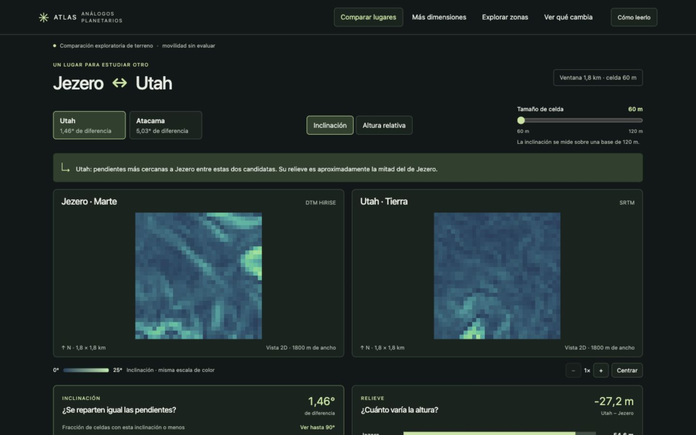
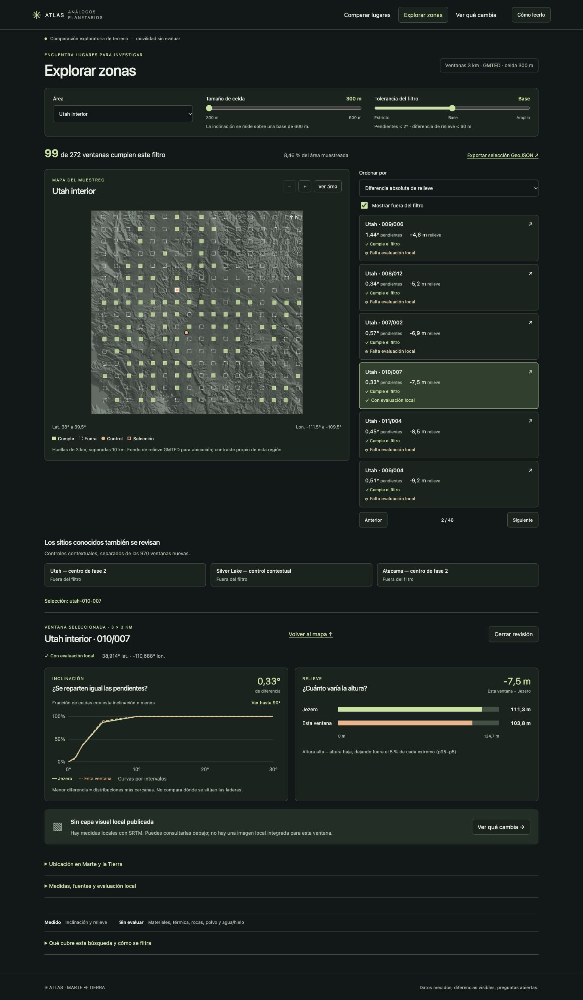
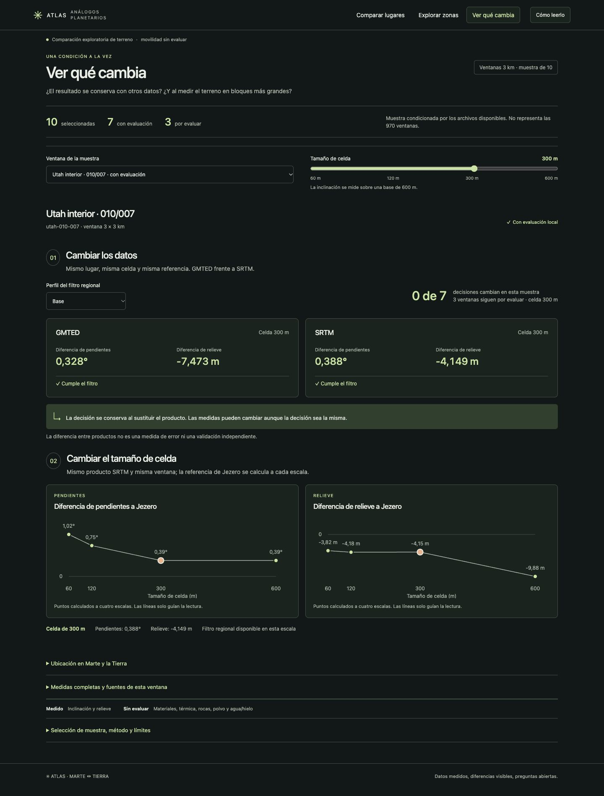
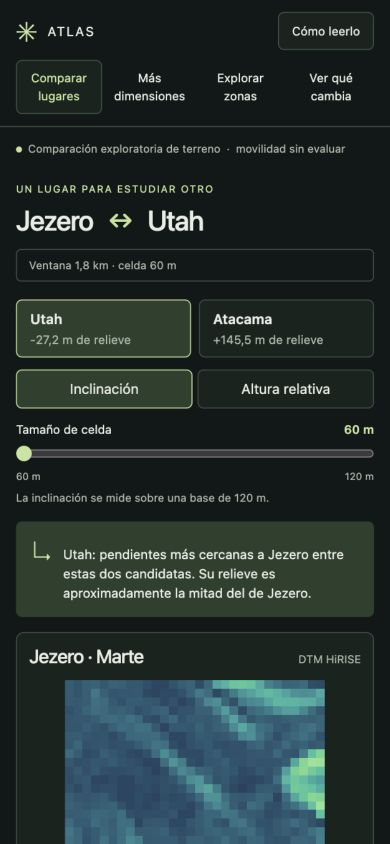

# Refactor visual del frontend — entrega

Fecha: 7 de noviembre de 2026, America/Managua.

Implementado el recorrido funcional de las etapas A–E del [plan](Plan%20de%20refactorizacion%20visual%20del%20frontend.md). Las sesiones con cinco personas de la etapa F siguen pendientes; las comprobaciones técnicas y visuales no sustituyen esa evaluación de comprensión.

## Cambios visibles

- **Comparar lugares:** Jezero y la candidata aparecen juntos, con cuadrículas reales de fase 2, leyenda común, cambio de capa, candidata y celda. Una frase explica la semejanza y la diferencia principal antes de los gráficos.
- **Explorar zonas:** mapa sobre contexto de relieve GMTED, huellas reales, lista sincronizada, ordenación del conjunto completo, filtros discretos, controles y ficha de cada ventana. El perfil base de Utah a 300 m muestra 99 de 272 ventanas y 8,46 % del área muestreada.
- **Ver qué cambia:** contraste GMTED/SRTM a escala común y cambios de escala con SRTM en gráficos separados. La muestra conserva diez ventanas, siete evaluadas y tres pendientes. Una ventana ajena a la muestra se identifica sin sustituirla silenciosamente.
- Navegación por tareas, ayuda breve, fuentes y tablas bajo demanda; encabezado accesible al desplazarse. Selecciones y parámetros se conservan en la URL y al usar el historial.
- Globos Cesium cargados al abrir ubicación, con tamaños de ventana explícitos de 1,8 o 3 km; los viewers se destruyen al cerrar. Las cuadrículas y los gráficos iniciales funcionan sin cargar Cesium.

No se añadieron porcentajes de analogía ni ranking ponderado. Los pesos continuos y el terreno de detalle en 3D son ampliaciones posteriores, según el plan. El zoom y desplazamiento de las cuadrículas están vinculados; no se incorporó un modo de cámaras independientes.

## Organización del código

`frontend/src/app` contiene navegación y estado de enlace; `domain` define medidas y estados; `data` contiene peticiones cancelables y adaptadores; `components` reúne gráficos, controles, estado de evidencia y ubicación. Los recorridos están en `features/compare`, `features/explore` y `features/sensitivity`. Los estilos quedaron separados en tokens, layout y componentes.

Las peticiones conservan una clave de consulta y señal de cancelación. Una respuesta de otra selección no se presenta bajo los controles nuevos. Cero y dato faltante se mantienen distintos. Los errores incluyen reintento, y las capas de comparación se muestran solo si su identidad de resultados coincide con la de la API.

El mapa consume la exportación completa del área con todas sus ventanas. Filtrado visible, ordenación y paginación se realizan sobre ese conjunto, con desempates por ID. No se ordena solo una página. La lista usa el estado de evaluación local del resumen verificado; cumplir un filtro y tener evaluación local son estados distintos.

Se mantuvieron las rutas científicas y sus métricas. La única ampliación propia del contrato del primer caso es `evidence_identity`, el SHA-256 de sus resultados, para vincular las capas visuales. El escenario de dimensiones incorporado en paralelo se preservó junto con su navegación y sus archivos; sus resultados y método no forman parte de esta entrega de refactorización.

## Capas y procedencia

Los nuevos archivos están en [frontend/public/analysis](../../../frontend/public/analysis/manifest.json). `terrain.json` conserva orden de filas, máscara y valores visuales de los rásteres publicados de fase 2. La altura relativa resta la mediana de cada ventana; no compara altitudes absolutas entre cuerpos. Las cifras científicas provienen de la API, sin recalcularse en el navegador.

Los fondos regionales son derivados visuales del archivo GMTED cuya identidad se verifica antes de leerlo. Usan las extensiones exactas del catálogo y contraste propio por región. Son contexto, sin escala cuantitativa común entre regiones.

Reproducir los derivados, sin descargas:

```sh
./.pixi/envs/default/bin/python scripts/generar_visuales.py
```

Requiere los rásteres publicados de fase 2 y el archivo GMTED original local. No se necesita ejecutar este comando para consultar las capas ya incluidas. La generación escribe sus propios assets y manifiesto; no sobrescribe la evidencia revisada. Una comparación de SHA-256 antes/después conservó los 120 archivos inspeccionados de `docs/evidencia-fase-*`, incluido el detalle regional.

## Comprobaciones ejecutadas

| Comprobación | Resultado |
|---|---|
| TypeScript + build Vite | Correcto, incluido el escenario añadido en paralelo |
| Tests de API | 23 aprobados |
| Análisis, adquisición y derivados visuales | 31 aprobados |
| Tests nuevos de frontend | 7 aprobados |
| CRS IAU para Marte y Luna | Correctos en el entorno existente |
| Preservación de evidencia anterior | 120 archivos, sin modificaciones |

Los tests visuales comprueban identidad, orientación norte-arriba, correspondencia con las celdas de origen, máscara, mediana relativa, rangos comunes y extensiones de los fondos. Los de frontend comprueban ordenación global, diferencia absoluta de relieve, nulos, ceros, parámetros incompatibles, selección de muestra, mensajes y propagación de cancelación de peticiones.

Comandos utilizados:

```sh
# Desde la raíz
./.pixi/envs/default/bin/npm test --prefix frontend
./.pixi/envs/default/bin/npm run build --prefix frontend
./.pixi/envs/default/bin/python -m unittest discover -s tests -v

# Desde backend/
../.pixi/envs/default/bin/python -m unittest discover -s tests -v
```

Revisión interactiva sobre la aplicación local y su compilación de producción:

- Utah/Atacama, inclinación/altura relativa y escalas 60/120 m, con cifras revisadas.
- Cambios rápidos 60→120→60: se conservan la selección correcta, las 1800 celdas visibles entre ambos paneles y el foco del slider.
- Apertura de ubicación en producción: cero scripts Cesium en la vista inicial; un script y dos visores al abrir; cero visores al cerrar.
- Filtros base/estricto en Utah: 99/272 y 30/272. El muestreo sigue en 8,46 %.
- Mostrar ventanas excluidas: 272 huellas; ordenar por relieve afecta al conjunto completo.
- Seleccionar `utah-010-007` desde una huella actualiza también la fila y su página. Sus medidas regionales y su estado local coinciden.
- Fuente/escala: valores GMTED y SRTM, 0/7 cambios en la muestra; escalas finas sin filtro regional.
- `control-mojave`: falta evaluación local, sin gráficos de valores inventados.
- `utah-015-010`: mensaje de no pertenencia a la muestra de sensibilidad.
- Recuperación de un asset visual malformado en una copia de `dist`: error legible, medidas conservadas, reintento correcto tras restaurarlo. El asset original permaneció intacto.
- Vistas con datos cargados a 1440×900, 1024×768, 390×844 y 320×844: sin desbordamiento horizontal del documento. Las tablas completas conservan su desplazamiento interno dentro de los detalles.

La matriz de anchos se conserva en [responsive.json](../../evidencia-refactor-frontend/responsive.json). No se declara una matriz exhaustiva de navegadores ni una prueba forzada de fallo de WebGL.

## Capturas









## Lo que queda por validar

Las sesiones con personas sin contexto deben medir si identifican el par y las dos variables en diez segundos y explican una semejanza y una diferencia en treinta. Esos tiempos siguen siendo objetivos, no resultados obtenidos. La validación científica independiente, nuevas capas locales para las demás ventanas y la evaluación de movilidad mantienen el alcance de sus entregas originales.
