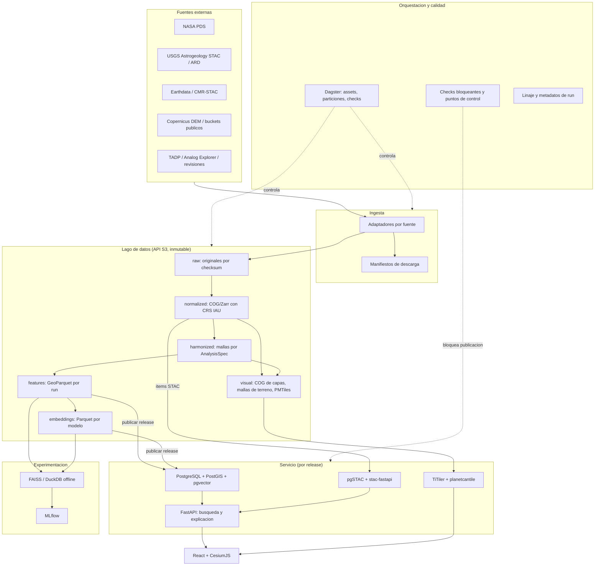
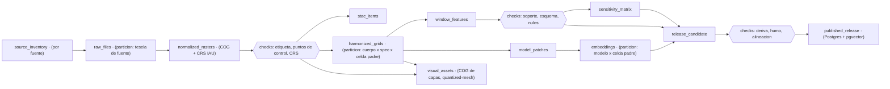
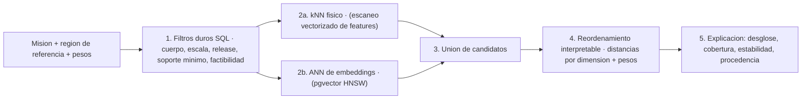
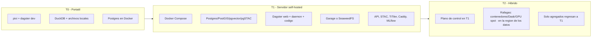

# Arquitectura objetivo y plataforma de datos

**Fecha:** 5 de noviembre de 2026  
**Estado:** propuesta de arquitectura objetivo. Toma decisiones concretas, pero cada una debe registrarse como ADR (*Architecture Decision Record*) y revisarse con mediciones reales.  
**Alcance:** arquitectura a largo plazo. Para lo que se construye con los recursos actuales del equipo, ver `Arquitectura para el hackathon.md`.  
**Relación con otros documentos:** concreta la dirección técnica de `Arquitectura y estrategia de implementacion.md` y aplica las correcciones de `Diagnostico y arquitectura despues del prototipo.md`. Si hay contradicciones, prevalece este documento en lo técnico y el diagnóstico en lo científico.

---

## 1. Resumen de decisiones

| Área | Decisión recomendada | Alternativa / cuándo cambiar |
|---|---|---|
| Despliegue | **Self-hosted primero** (portátil → un servidor con Docker Compose), con **ráfagas de cómputo en la nube cerca de los datos** solo para trabajos concretos. | Pasar a nube administrada si hay usuarios públicos con tráfico sostenido o cómputo global recurrente (§3.4). |
| Orquestación | **Dagster** (OSS), con modelo de *assets*, particiones y *asset checks* bloqueantes. | Prefect si se prefieren flujos imperativos; Airflow 3 si una institución ya lo opera. |
| Cómputo | Python + GDAL/Rasterio/xarray; ejecución multiproceso local y **Dask** para rásteres por bloques. | Dask distribuido / Coiled / AWS Batch para trabajos de escala global. Spark no aporta valor aquí. |
| Almacenamiento | **Lago de archivos con API S3**: sistema de archivos en desarrollo; **Garage** o **SeaweedFS** self-hosted; S3/GCS/R2 si se migra. | Evitar adoptar MinIO nuevo: su edición comunitaria dejó de distribuir binarios y entró en modo mantenimiento. |
| Formatos | **COG** (ráster 2D), **Zarr v3** (series temporales/multidimensionales), **GeoParquet** (geometrías y features), **Parquet** (embeddings). | Lance para conjuntos de entrenamiento grandes; Iceberg/DuckLake si aparecen muchas escrituras concurrentes sobre tablas. |
| Catálogo de productos | **STAC** (pgSTAC + stac-fastapi) con extensiones `proj`, `ssys`, `file`, `raster` y `processing`. | — |
| Modelo de dominio | **PostgreSQL + PostGIS** (regiones, ejecuciones, features publicadas, revisiones, *releases*). | — |
| Vectores | **pgvector** en el mismo Postgres para servir; **FAISS** para experimentación offline. | **Qdrant** si se superan ~20–50 M vectores activos, alta concurrencia o multivector (§7). |
| Análisis ad hoc | **DuckDB** + extensión `spatial` sobre GeoParquet. | — |
| Teselas | **TiTiler + planetcantile** (teselas dinámicas en TMS planetarios); **PMTiles** para capas vectoriales; *quantized-mesh* generado offline con elipsoide del cuerpo. | Cesium ion solo para la Tierra, verificando condiciones. |
| Malla de ventanas | **HEALPix por cuerpo** para centros (área igual, agnóstico al planeta) + ventana cuadrada en proyección local IAU. | H3/S2 son terrestres por diseño; usarlos solo en la Tierra no permite un contrato común. |
| ML | MLflow self-hosted, partición geográfica por celda HEALPix padre, embeddings como *asset* versionado. | GPU en la nube (spot) para entrenamiento/inferencia masiva. |
| Entorno | **pixi** (conda-forge) para fijar GDAL/PROJ; imágenes Docker fijadas por *digest*. | uv para servicios sin dependencias nativas pesadas. |

**Principio central:** la base de datos vectorial **no es la fuente de verdad**. Es un índice de servicio derivado y reconstruible. La verdad vive en el lago (archivos inmutables + manifiestos) y en el catálogo relacional versionado. Así un error de lectura, como el de endianidad de MOLA, se corrige reprocesando y republicando, sin "parchar" un índice.

## 2. Del diagnóstico a mecanismos de arquitectura

Cada problema del diagnóstico debe tener un mecanismo que lo haga **detectable, bloqueante o visible**, no solo una buena intención.

| Problema (diagnóstico §3) | Mecanismo arquitectónico | Dónde vive |
|---|---|---|
| Comparabilidad y resolución efectiva | `AnalysisSpec` versionado (ventana, malla, remuestreo, soporte mínimo, productos permitidos). Métrica `soporte_efectivo` por ventana y variable. Elección del DEM de entrada **según la escala de análisis** (p. ej. un DEM de 90 m basta para analizar a ~500 m). | `specs/`, pipeline de armonización, tabla `feature` |
| Falta de validación de relevancia | Tabla `review` y `relevance_set` congelados por misión; pipeline de evaluación que compara línea base vs embedding con los mismos casos; partición geográfica forzada. | Postgres, pipeline de evaluación, MLflow |
| Cobertura ≠ observación | Cada feature guarda `cobertura_valida`, `fraccion_observada` (p. ej. recuentos MOLA > 0 en resolución **nativa**, antes de remuestrear) y `clase_evidencia`. | Asset `features`, checks de calidad |
| Significado del puntaje | La API devuelve rango, desglose, cobertura y estabilidad; **no** un porcentaje aislado. El contrato de respuesta no tiene un campo "probabilidad". | Esquema de API |
| CRS / datum / longitudes | Contrato `body_reference` con códigos IAU_2015 (PROJ/GDAL), dominio de longitud y referencia vertical. Check bloqueante: todo COG normalizado declara CRS WKT2 y coincide con el registro. | Registro de fuentes, checks |
| Error de lectura (endianidad MOLA) | **Pruebas con valores de referencia** (puntos de control conocidos por producto) como *asset check* bloqueante; *fixtures* doradas en CI. | `analogos_core` + Dagster |
| Fragilidad del script central | Separación en: biblioteca pura (`analogos_core`), adaptadores por fuente, specs declarativas, orquestador. Escrituras a rutas nuevas por `run_id`; publicación atómica por *release*. | Estructura del repositorio |
| Escala operativa / 400 polígonos | Capas analíticas como COG → teselas ráster; búsqueda física en columnas vectorizadas; índice ANN solo para embeddings. | Tiles, Postgres/DuckDB |
| Múltiples dimensiones | Ficha `DimensionSpec` obligatoria (pregunta, producto, unidad, soporte, QA, armonización, ejemplo validado). Sin ficha aprobada, el pipeline no publica la dimensión. | `specs/dimensions/` |
| Dependencias externas | Adaptadores con caché, límites de concurrencia por fuente, secretos fuera del repositorio, manifiesto de descarga con fecha, URL, checksum y licencia. | Capa de ingesta |
| Sensibilidad no medida | **Matriz de sensibilidad como pipeline de primera clase** (ventana, desplazamiento, remuestreo, producto) con métricas de estabilidad del ranking guardadas y mostradas. | Asset `sensitivity`, API, UI |

## 3. Dimensionamiento y veredicto local vs nube

Las cifras son **órdenes de magnitud** para decidir infraestructura, no mediciones.

### 3.1. Número de ventanas

Usando HEALPix (12·nside² celdas de igual área sobre la esfera de cada cuerpo):

| Cuerpo | nside | Lado aprox. de celda | Celdas analizables |
|---|---|---|---|
| Tierra (solo tierra firme, ~29 %) | 1024 | ~6,4 km | ~3,6 M |
| Marte (superficie completa) | 512 | ~6,8 km | ~3,1 M |
| Luna (superficie completa) | 256 | ~6,9 km | ~0,8 M |

Con centros a ~6,5 km y ventanas de 10 km hay solapamiento, útil para estabilidad. **Por escala de análisis: ~7,5 M ventanas en total**; con tres escalas (5/10/20 km, ajustando nside) el orden se mantiene en decenas de millones de filas de features.

### 3.2. Volumen de datos

| Elemento | Estimación | Implicación |
|---|---|---|
| Tabla de features (7,5 M ventanas × ~60 variables × 3 escalas) | ~5 GB sin comprimir; ~1–2 GB en Parquet | Trivial para DuckDB/Postgres en un solo equipo. |
| MOLA MEGDR 128 px/°, una variable | ~46 080 × 23 040 int16 ≈ 2 GB | Local sin problema. |
| LOLA 128 px/° (512 px/° es ~16× mayor) | ~2 GB (~34 GB) | Local sin problema. |
| Tierra a 500 m, una variable global | ~80 000 × 40 000 float32 ≈ 13 GB | Local sin problema. |
| DEM terrestre de 30 m global (Copernicus GLO-30) | Varios TB | **Umbral de nube**: descargarlo con conexión doméstica tomaría días. Leerlo por rangos COG en la región del bucket o usar un DEM de 90 m si la escala de análisis lo permite. |
| Imágenes HLS / mosaicos CTX globales | Decenas de TB a PB | **Solo cerca de los datos** (Earthdata Cloud en AWS us-west-2, buckets públicos). Nunca replicarlos localmente. |
| Embeddings de la Tierra para una escala, 512 dimensiones, `halfvec` | 3,6 M × 1 KB ≈ 3,7 GB + índice HNSW ~0,5–1 GB | Cabe holgadamente en un servidor de 64 GB con pgvector. |

### 3.3. Cómputo

- **Features de relieve a ≥ 500 m:** cada ventana tiene ~20 × 20 celdas; millones de ventanas se calculan en minutos u horas en un portátil moderno. **No requiere nube.**
- **Agregar DEM de 30 m a escala global:** limitado por E/S (varios TB). Es el primer trabajo que justifica una ráfaga en la nube.
- **Embeddings:** inferencia de un modelo pequeño sobre millones de parches es viable con GPU local (incluida Apple Silicon por MPS) pero lenta; entrenar o usar modelos fundacionales (p. ej. Prithvi, cientos de millones de parámetros) sobre millones de parches requiere **GPU en la nube**.

### 3.4. Veredicto

**Para las Fases 0–2 (relieve Tierra–Marte, catálogo regional amplio, hasta escala global a ≥ 500 m), una plataforma local/self-hosted es suficiente y preferible**: menor costo, iteración rápida, control total de la procedencia.

**Se recomienda una arquitectura híbrida desde el diseño** (mismas imágenes Docker, misma API S3, mismo orquestador) porque hay tres trabajos que sí necesitan más potencia:

1. Agregación global de DEM de alta resolución o productos de imágenes (cómputo **junto a los datos**, regresando solo agregados).
2. Entrenamiento e inferencia de ML a escala.
3. Servicio público con tráfico sostenido.

Indicadores para dar el salto (medirlos, no suponerlos):

| Señal | Umbral orientativo | Acción |
|---|---|---|
| Datos de entrada por trabajo | > ~500 GB o fuente solo disponible en la nube | Ejecutar ese *asset* en la nube cerca del bucket. |
| Tiempo de un *backfill* completo | > 24 h en el servidor local | Ejecutor Dask distribuido / Coiled / Batch. |
| Vectores activos en servicio | > ~20–50 M o p95 de búsqueda filtrada inaceptable | Evaluar Qdrant con cuantización. |
| Usuarios concurrentes / disponibilidad exigida | Producto público con SLA | Postgres administrado + contenedores administrados + CDN. |

## 4. Arquitectura lógica



### 4.1. Zonas del lago

| Zona | Contenido | Regla |
|---|---|---|
| `raw/` | Archivos originales + etiquetas PDS/metadatos, ruta `raw/{source}/{sha256}/archivo`. | Escritura única; nunca se modifica. Se puede borrar solo si es re-descargable y el manifiesto conserva el checksum. |
| `normalized/` | Mismo dato, convertido a COG/Zarr, con escala/offset aplicados, nodata explícito, CRS WKT2 IAU y orientación verificada. | Sin remuestreo espacial. Un ítem STAC por producto. |
| `harmonized/` | Rásteres en la malla de un `AnalysisSpec` (escala, filtro, remuestreo), más capas de soporte (recuentos, máscaras). | Ruta incluye `spec_hash`. |
| `features/` | GeoParquet: una fila por ventana × variable × spec, con calidad y procedencia. | Ruta incluye `run_id`. |
| `embeddings/` | Parquet: `window_id`, `model_id`, vector, máscara usada. | Ruta incluye `model_id` y `run_id`. |
| `visual/` | COG de capas para teselar, mallas *quantized-mesh*, PMTiles, leyendas. | Separado de lo analítico; documenta CRS y datum de visualización. |
| `releases/` | Manifiesto JSON que enumera exactamente qué `run_id` componen un release. | Inmutable; es lo que se carga a servicio. |

### 4.2. Releases y publicación atómica

Resuelve "sobrescribe salidas" y "catálogo a medias":

1. Un pipeline produce features/embeddings bajo un `run_id` nuevo.
2. Los *asset checks* bloqueantes pasan (o el release no se crea).
3. Se genera `releases/{release_id}.json` y se carga en Postgres con ese `release_id`.
4. Se ejecutan checks de servicio (conteos, consultas de humo, comparaciones con release anterior).
5. Un único `UPDATE current_release` dentro de una transacción activa el release. Revertir = apuntar al anterior.

La API siempre consulta `WHERE release_id = current_release()` y devuelve ese identificador en cada respuesta, lo que hace las búsquedas reproducibles.

## 5. Plataforma de procesamiento: componentes y alternativas

### 5.1. Orquestador

| Criterio | Dagster | Prefect | Airflow 3 | Kestra |
|---|---|---|---|---|
| Modelo | *Assets* declarativos | Flujos Python | DAG de tareas + Assets | YAML declarativo |
| Particiones (cuerpo × tesela × spec) | Nativas, multidimensionales y dinámicas | Manuales | Parciales | Manuales |
| Checks de calidad bloqueantes | `asset_check(blocking=True)` | Manual | Manual | Manual |
| Linaje de datos sin servicios extra | Sí, en la UI | Limitado en OSS | Vía OpenLineage + Marquez | Flujo de ejecución, no datos |
| Detección de "desactualizado" al cambiar código/parámetros | `code_version` y estado de materialización | No nativo | No nativo | No nativo |
| Huella self-hosted | Webserver + daemon + Postgres | Server + Postgres | Varios servicios + Postgres | Ligera |

**Recomendación: Dagster.** El proyecto es esencialmente un grafo de **productos de datos** (DEM normalizado → malla armonizada → features → embeddings → release), y la pregunta frecuente será "¿qué está desactualizado tras corregir un lector o cambiar un spec?". Dagster responde eso de forma nativa. Corre con `dagster dev` en un portátil y con Docker Compose en un servidor; si más tarde se necesita, el *run launcher* puede enviar trabajos a Kubernetes/ECS sin cambiar el código de los *assets*.

**Riesgo a vigilar:** la granularidad de particiones. No crear una partición por ventana (millones); particionar por tesela de fuente para la ingesta y por **celda HEALPix padre** (p. ej. nside 8 → 768 particiones por cuerpo) para features y embeddings.

### 5.2. Motor de cómputo

- **Biblioteca pura `analogos_core`** (sin dependencias del orquestador): lectores, validadores, transformaciones, features. Probable con pytest y *fixtures* doradas. Esto permite cambiar de orquestador sin reescribir ciencia.
- **Paralelismo local:** ejecutor multiproceso de Dagster por partición + `rioxarray`/`xarray` con Dask para rásteres grandes por bloques.
- **Escalado:** el mismo código con Dask distribuido (self-hosted o Coiled) o con trabajos en contenedores en la nube.
- **No usar Spark/Sedona** salvo que aparezcan cargas vectoriales masivas; el ecosistema ráster planetario está en Python/GDAL.

### 5.3. Entorno reproducible

GDAL y PROJ determinan qué códigos IAU y transformaciones están disponibles; dos versiones pueden dar resultados distintos.

- Fijar entornos con **pixi** (conda-forge) y `pixi.lock`; construir imágenes Docker fijadas por *digest*.
- Registrar en cada `processing_run`: versión de GDAL, PROJ, base de datos PROJ, Python, `analogos_core`, *commit* git, `spec_hash`.
- CI: ejecutar las pruebas de lectura y puntos de control en la misma imagen que producción.

### 5.4. Almacenamiento

- **Abstracción única:** `fsspec`/`obstore` con URIs (`file://` en desarrollo, `s3://` en servidor/nube). El código no conoce el backend.
- **Self-hosted S3:** *Garage* (ligero, binario único, AGPL) para un servidor; *SeaweedFS* (Apache-2.0) si se necesita más escala o montaje POSIX. MinIO ya no es una base recomendable para instalaciones nuevas.
- **Respaldo:** Postgres con `pgBackRest` o `pg_dump` programado; lago con `restic`/`rclone` hacia un segundo disco o almacenamiento externo. `raw/` re-descargable puede excluirse del respaldo si los manifiestos se respaldan.

### 5.5. Catálogo STAC

STAC unifica productos terrestres y planetarios bajo un mismo modelo y ya lo usan fuentes del proyecto (CMR-STAC de Earthdata, STAC de USGS Astrogeology con DTM/ortoimágenes CTX y HiRISE).

- **pgSTAC** en el mismo Postgres + **stac-fastapi** para consultar.
- Extensiones: `ssys` (cuerpo objetivo), `proj` (código `IAU_2015:*` y WKT2), `file` (checksum), `raster` (nodata, escala, tipo), `processing` (software y nivel), `classification` (máscaras).
- Un ítem por producto normalizado y por activo visual. Las features no son ítems STAC; se enlazan por `run_id`.

### 5.6. Calidad: checks bloqueantes

| Check | Etapa | Bloquea |
|---|---|---|
| Lectura de etiqueta: tipo, endianidad, escala/offset, nodata coinciden con el registro de fuente | `normalized` | Sí |
| **Puntos de control**: valores en coordenadas conocidas dentro de tolerancia (p. ej. cumbres y cuencas marcianas, cotas terrestres de referencia) | `normalized` | Sí |
| Rango físico plausible por variable y cuerpo | `normalized` | Sí |
| CRS WKT2 presente y coincide con `body_reference`; dominio de longitud y orientación norte | `normalized` | Sí |
| Fracción observada nativa (p. ej. recuentos MOLA > 0) calculada **antes** de remuestrear | `harmonized` | No; se guarda como métrica |
| Soporte mínimo del `AnalysisSpec` (muestras nativas por ventana, vecinos válidos para pendiente) | `features` | Marca la feature como `insuficiente` |
| Esquema de GeoParquet (Pandera): tipos, unidades, nulos explícitos, sin ceros en lugar de nulos | `features` | Sí |
| Deriva frente al release anterior (distribuciones, conteos) | `release` | Sí, si supera umbral acordado |
| Consulta de humo y alineación: geometría de ventanas cae sobre el cuerpo correcto | `release` | Sí |

### 5.7. Linaje y procedencia

- Dagster registra entradas, salidas, metadatos y logs por materialización.
- Cada archivo derivado lleva en sus metadatos (`tags` COG / metadatos Parquet) el `run_id` y las URIs + checksums de entradas.
- Opcional: emitir eventos OpenLineage a Marquez si se necesita un catálogo de linaje independiente del orquestador.

## 6. Pipelines

### 6.1. Grafo de *assets*



### 6.2. Ingesta

- **Adaptador por fuente** con interfaz común: `discover(aoi, product) → items`, `fetch(item) → raw_uri + manifiesto`, `describe(raw) → metadatos de producto`.
- Prioridad de acceso: STAC/COG por rangos HTTP → descarga completa → acceso con autenticación (Earthdata por token/`.netrc` como secreto del orquestador, nunca en el repositorio).
- **Pools de concurrencia** por fuente en Dagster para respetar límites y no saturar servidores PDS.
- Reintentos con *backoff*; descarga a archivo temporal, verificación de checksum/tamaño y luego movimiento atómico a `raw/`.
- El manifiesto guarda URL, fecha de acceso, versión de producto, licencia/atribución y checksum.

### 6.3. Registro declarativo de fuentes

```yaml
# specs/sources/mola_megdr_128.yaml
id: mola-megdr-128ppd-topo
body: mars
provider: NASA PDS Geosciences
instrument: MGS MOLA
product_version: "MEGDR (PDS4)"   # verificar identificador exacto
variable: topography
units: m
vertical_reference: areoid          # alturas respecto al areoide
crs: IAU_2015:49900                 # verificar código y convención
lon_domain: "0-360 E"
format:
  type: raw_binary
  dtype: int16
  byte_order: big                   # el error del prototipo: debe ser explícito y probado
nominal_resolution: "128 px/deg (~463 m en el ecuador)"
support_layers: [counts]            # recuentos para fracción observada
control_points:
  - {name: "punto_ref_1", lat: 0.0, lon: 0.0, expected_m: null, tol_m: null}  # completar con valores verificados
license: "dominio público NASA; citar producto"
```

Los valores marcados como "verificar" deben llenarse leyendo la etiqueta del producto, no de memoria.

### 6.4. Armonización: `AnalysisSpec`

```yaml
# specs/analysis/relieve_regional_v1.yaml
id: relieve-regional
version: 1
window:
  shape: square
  size_m: 10000
  projection: local_azimuthal_equidistant   # por cuerpo, con CRS IAU
  centers: {grid: healpix, nside: {earth: 1024, mars: 512, moon: 256}}
grid_spacing_m: 500
resampling:
  continuous: area_mean_after_lowpass       # a justificar y medir
inputs:
  earth: [copernicus-dem-glo90]             # 90 m basta para analizar a 500 m
  mars: [mola-megdr-128ppd-topo]
min_support:
  native_samples_per_window: TBD            # acordar tras examinar datos, antes de evaluar
  valid_neighbors_for_slope: 8
features: [slope_hist, slope_p50, slope_p90, relief_p95_p5, roughness_multiscale]
sensitivity:
  window_size_m: [5000, 10000, 20000]
  center_offset_m: [0, 2500]
  resampling: [area_mean, gaussian_then_mean]
```

El hash del spec forma parte de la ruta y del `run_id`. Cambiar un parámetro produce un dataset nuevo, nunca sobrescribe el anterior.

**Por qué HEALPix + ventana local:** HEALPix da celdas de igual área sobre cualquier esfera, por lo que el mismo contrato sirve para la Tierra, Marte y la Luna. El índice HEALPix se usa solo para ubicar centros y particionar; la medición se hace en una ventana cuadrada en una proyección local métrica del cuerpo, que preserva distancias y pendientes. Esta combinación debe validarse cerca de los polos y del antimeridiano (experimento E1).

### 6.5. Features y sensibilidad

- Features guardadas como **distribuciones** (histograma de pendientes con bordes fijos) además de escalares; permiten distancias entre distribuciones (Wasserstein, por ejemplo) en la línea base.
- Cada fila: `window_id, body, spec_id, variable, value | histogram, unit, support_native, valid_fraction, observed_fraction, evidence_class, status ∈ {disponible, insuficiente, ausente, no_comparable}, run_id`.
- `sensitivity_matrix` recalcula un subconjunto estratificado de ventanas con las variantes del spec y guarda por par referencia–candidato: τ de Kendall entre rankings, solapamiento top-k y variación de cada feature. La API expone esa estabilidad junto al resultado.

### 6.6. Embeddings

- `model_patches`: parches por ventana desde `harmonized/` (elevación relativa, pendiente, máscara), **nunca** desde texturas de contexto.
- `embeddings`: particionado por `model_id × celda padre`; cada modelo tiene ficha (entradas, normalización ajustada **solo** con entrenamiento, versión de pesos, licencia).
- Check obligatorio de "atajo": un clasificador lineal que intenta predecir cuerpo/sensor/resolución desde el embedding; su resultado se registra en MLflow y en el release.

## 7. Almacenamiento de servicio y búsqueda vectorial

### 7.1. Cómo se busca realmente

La búsqueda no es "una consulta a la base vectorial". Es un proceso en etapas:



**Detalle importante:** la línea base física **no necesita índice ANN**. Con pesos definidos por el usuario en tiempo de consulta, una distancia ponderada no se puede pre-indexar sin reescalar todo el corpus; pero escanear ~4 M filas × ~20 columnas con DuckDB o Postgres es del orden de segundos o menos y es exacto. El índice ANN se reserva para embeddings, cuya métrica es fija por modelo.

### 7.2. Comparativa de motores vectoriales

| Criterio | pgvector (≥ 0.8) | Qdrant | LanceDB | FAISS | Milvus |
|---|---|---|---|---|---|
| Despliegue | Extensión en el Postgres existente | Servicio adicional | Biblioteca embebida sobre archivos | Biblioteca | Clúster pesado |
| Filtros relacionales y joins con PostGIS/release | Nativos (SQL); escaneos iterativos desde 0.8 | Payload filters, sin joins | Filtros columnares | No | Limitados |
| Transacciones y publicación atómica con el resto | Sí | No (coordinación externa) | No | No | No |
| Escala cómoda en un nodo | ~1–20+ M | Decenas a cientos de M con cuantización | Grande, en disco | Grande (IVF-PQ) | Muy grande |
| Uso propuesto | **Servicio** | Plan B de servicio | Datasets de entrenamiento | **Experimentación y evaluación** | No recomendado |

**Recomendación:** pgvector con `halfvec`, índice HNSW **parcial por cuerpo y escala** (o tablas particionadas por `body, spec_id`) para que el filtro principal no degrade el ANN. Mantener en servicio solo el release actual y el anterior. FAISS offline para barridos de evaluación (exacto vs aproximado, recall del ANN).

### 7.3. Esquema de servicio (extracto)

```sql
CREATE EXTENSION IF NOT EXISTS postgis;
CREATE EXTENSION IF NOT EXISTS vector;

CREATE TABLE release (
  release_id   text PRIMARY KEY,
  manifest_uri text NOT NULL,
  created_at   timestamptz NOT NULL DEFAULT now(),
  status       text NOT NULL CHECK (status IN ('loading','validated','active','retired'))
);

CREATE TABLE window_ (
  window_id  text,
  release_id text REFERENCES release,
  body       text NOT NULL,              -- earth | mars | moon
  spec_id    text NOT NULL,
  healpix    bigint NOT NULL,
  geom       geometry(Polygon) NOT NULL, -- coordenadas geográficas del cuerpo; SRID propio por cuerpo
  PRIMARY KEY (window_id, release_id)
);

CREATE TABLE feature (
  window_id   text,
  release_id  text,
  variable    text,
  value       double precision,          -- NULL si no disponible; nunca 0 por defecto
  histogram   real[],
  unit        text NOT NULL,
  status      text NOT NULL CHECK (status IN ('disponible','insuficiente','ausente','no_comparable')),
  support_native   integer,
  observed_fraction real,
  evidence_class   text NOT NULL,        -- O | D | I | R | modelo
  run_id      text NOT NULL,
  PRIMARY KEY (window_id, release_id, variable)
);

CREATE TABLE embedding (
  window_id  text,
  release_id text,
  model_id   text,
  body       text NOT NULL,
  spec_id    text NOT NULL,
  vec        halfvec(512) NOT NULL,
  PRIMARY KEY (window_id, release_id, model_id)
);

-- Índice parcial por cuerpo/escala/modelo: el filtro principal queda resuelto por el índice
CREATE INDEX emb_earth_relieve_m1 ON embedding
  USING hnsw (vec halfvec_cosine_ops)
  WHERE body = 'earth' AND spec_id = 'relieve-regional@1' AND model_id = 'topo-ssl-v1';
```

Los SRID planetarios deben registrarse en `spatial_ref_sys` a partir de las definiciones IAU de PROJ; PostGIS no impide almacenar geometrías de otros cuerpos, pero las funciones que asumen la Tierra (`geography`, distancias esferoidales) **no deben usarse** con Marte o la Luna sin parámetros explícitos del cuerpo.

## 8. Servicio y visualización

### 8.1. Servicios

| Servicio | Responsabilidad | Notas |
|---|---|---|
| `api` (FastAPI) | Misiones, regiones, búsqueda, explicación, procedencia, estado de trabajos. Solo lectura sobre el release activo. | El motor de búsqueda es un módulo importable y probado sin HTTP. |
| `stac` (stac-fastapi + pgSTAC) | Descubrimiento de productos y activos visuales. | Expone qué datos existen por región y cuerpo. |
| `tiles` (TiTiler + planetcantile) | Teselas dinámicas desde COG en TMS de la Tierra, Marte y la Luna; leyendas y escalas fijas por variable. | Sustituye las 400 entidades poligonales por una capa ráster. |
| Estáticos (Caddy/nginx) | PMTiles, mallas *quantized-mesh*, `layer.json`, frontend. | Caché HTTP agresiva: los activos son inmutables por release. |

Búsquedas pesadas (p. ej. con sensibilidad en vivo) pasan a trabajo asíncrono: `POST /search-runs` → `202` + id → resultado consultable. Al principio basta ejecutar la búsqueda síncrona porque todo está precalculado.

### 8.2. Terreno 3D

- Generar *quantized-mesh* **offline** por región con `pydelatin` + `quantized-mesh-encoder`, pasando el elipsoide del cuerpo (radios IAU), y configurar el `Globe` de Cesium con el mismo elipsoide.
- Las alturas de *quantized-mesh* son relativas al elipsoide: para Marte, derivarlas del **radio planetario** (MEGDR incluye capas de radio y areoide; verificar producto) y no de la topografía referida al areoide.
- No enviar DEM planetarios a servicios terrestres que reproyecten a WGS84.
- Registrar cada malla como activo STAC con CRS, datum, fuente y exageración vertical aplicada.

### 8.3. Frontend

- Una máquina de estados por capa (`cargando`, `lista`, `sin_cobertura`, `error`, `no_comparable`) alimentada por la API y TiTiler; resuelve la ambigüedad de la captura de Marte.
- Medir (E4) un único `Viewer` con cambio de cuerpo frente a dos visores simultáneos antes de decidir.
- Leyendas con escala común de **elevación relativa** cuando se compare relieve.

## 9. Topologías de despliegue



| Topología       | Para qué fase                                                             | Recursos orientativos                                                                                                            |
| --------------- | ------------------------------------------------------------------------- | -------------------------------------------------------------------------------------------------------------------------------- |
| **T0 Portátil** | Fase 0 (auditar prototipo, pruebas de lectura, specs).                    | El equipo actual.                                                                                                                |
| **T1 Servidor** | Fases 1–2 (catálogo regional → global a ≥ 500 m, servicio a evaluadores). | 8–16 núcleos, 64 GB RAM, 2–4 TB NVMe + disco de respaldo. Puede ser una estación de trabajo, un mini-servidor o un VPS dedicado. |
| **T2 Híbrido**  | Fase 3 (imágenes, DEM de 30 m global, ML a escala).                       | Cómputo efímero en la nube en la región del bucket; presupuesto acotado por trabajo.                                             |
| T3 Administrado | Solo si hay producto público con SLA.                                     | Postgres administrado, contenedores administrados, CDN.                                                                          |

En T2, el principio es **mover el cómputo a los datos**: Earthdata Cloud y varios buckets públicos están en regiones concretas de AWS; leer desde otra región o descargar a casa genera costos de egreso y tiempo. Regresar solo GeoParquet/COG agregados (GB, no TB).

## 10. Estructura de repositorio propuesta

```text
analogos/
├── packages/analogos_core/      # ciencia pura: lectores, validadores, armonización, features
│   └── tests/fixtures/          # recortes pequeños con valores de referencia conocidos
├── pipelines/                   # proyecto Dagster: assets, particiones, checks, recursos
├── specs/
│   ├── bodies/                  # body_reference: CRS IAU, radios, longitud, vertical
│   ├── sources/                 # registro declarativo de productos
│   ├── analysis/                # AnalysisSpec versionados
│   ├── dimensions/              # fichas DimensionSpec
│   └── scenarios/               # misiones: variables obligatorias/opcionales, filtros
├── services/
│   ├── api/                     # FastAPI + motor de búsqueda
│   └── tiles/                   # TiTiler + planetcantile
├── frontend/                    # React + CesiumJS
├── infra/compose/               # docker-compose por topología
└── docs/adr/                    # decisiones registradas
```

## 11. Hoja de ruta de la plataforma

Alineada con las fases del diagnóstico; son dependencias, no duraciones.

| Fase | Entregables de plataforma | Criterio de salida |
|---|---|---|
| **0 — Auditoría** | `analogos_core` extraído del script; *fixtures* doradas de MOLA/SRTM con puntos de control; registro de fuentes y `body_reference`; Dagster local con `raw → normalized → harmonized → features` para las 3 ventanas actuales; checks bloqueantes; escritura por `run_id`. | Reprocesar desde cero reproduce cifras; un error de endianidad introducido a propósito **falla** el pipeline. |
| **1 — Producto mínimo de relieve** | `AnalysisSpec` v1 y HEALPix; ventanas en cientos/miles de regiones; GeoParquet + DuckDB; Postgres/PostGIS con releases; TiTiler con capas ráster; API con desglose y estado por dimensión; servidor T1. | Release activo reproducible; publicación y reversión atómicas; capa marciana verificada visualmente. |
| **2 — Evaluación y 3D** | `sensitivity_matrix`; `relevance_set` y pipeline de evaluación; MLflow; primer embedding y pgvector; FAISS offline; malla 3D regional por cuerpo. | Comparación línea base vs embedding con los mismos casos y tamaño de muestra reportado; recall del ANN medido. |
| **3 — Dimensiones y escala** | Segunda dimensión con ficha aprobada; ráfagas T2 para DEM de 30 m/imágenes; GPU en la nube para ML; Luna con su `body_reference`. | Costos y tiempos instrumentados; decisión pgvector vs Qdrant basada en mediciones. |

## 12. ADRs a registrar primero

1. **ADR-001** Lago inmutable + releases como fuente de verdad; índice vectorial derivado.
2. **ADR-002** Dagster como orquestador y particionado por tesela de fuente / celda HEALPix padre.
3. **ADR-003** HEALPix por cuerpo + ventana en proyección local IAU como unidad espacial.
4. **ADR-004** STAC (pgSTAC) para productos y activos visuales; Postgres para dominio.
5. **ADR-005** pgvector para servicio, FAISS para evaluación; criterio de migración a Qdrant.
6. **ADR-006** Self-hosted con ráfagas a la nube junto a los datos; umbrales de §3.4.
7. **ADR-007** Elección del DEM terrestre por escala de análisis (p. ej. 90 m para 500 m; 30 m solo si el spec lo requiere).

## 13. Riesgos y preguntas abiertas

- **Sobreingeniería temprana:** Dagster + Postgres + STAC + TiTiler es más que un script. Mitigación: Fase 0 en T0 solo con Dagster y archivos; añadir servicios cuando un entregable los necesite.
- **Planetcantile, IAU en PostGIS y *quantized-mesh* planetario** son piezas menos transitadas que sus equivalentes terrestres. Validarlas con una región por cuerpo antes de comprometer la UI.
- **HEALPix cerca de polos** y ventanas que cruzan el antimeridiano requieren pruebas específicas.
- **Licencias:** Copernicus DEM, HLS y productos derivados tienen condiciones de redistribución; el manifiesto debe registrarlas y la publicación debe respetarlas.
- **Equipo y operación:** un servidor self-hosted requiere respaldos, actualizaciones y monitoreo mínimos (Dagster alerts + un panel básico). Si nadie puede asumirlo, T3 administrado a pequeña escala puede ser más barato en tiempo.
- **Pendiente de decisión del proyecto:** misión y audiencia de la primera versión; extensión geográfica de la Fase 1; disponibilidad de evaluadores; presupuesto para ráfagas en la nube.

## 14. Referencias

- Documentos del proyecto: [Diagnóstico](Diagnostico%20y%20arquitectura%20despues%20del%20prototipo.md), [Arquitectura inicial](Arquitectura%20y%20estrategia%20de%20implementacion.md), [Fuentes y cruces](Investigacion%20de%20fuentes%20de%20datos%20y%20cruces.md).
- Dagster: [assets](https://docs.dagster.io/guides/build/assets), [particiones](https://docs.dagster.io/guides/build/partitions-and-backfills), [asset checks](https://docs.dagster.io/guides/test/asset-checks).
- STAC: [especificación](https://stacspec.org/), [extensión ssys](https://github.com/stac-extensions/ssys), [pgSTAC](https://github.com/stac-utils/pgstac), [stac-fastapi](https://github.com/stac-utils/stac-fastapi); [USGS Astrogeology STAC](https://stac.astrogeology.usgs.gov/docs/); [NASA CMR-STAC](https://cmr.earthdata.nasa.gov/stac).
- CRS planetarios: [PROJ, autoridad IAU_2015](https://proj.org/); [GDAL](https://gdal.org/).
- Teselas: [TiTiler](https://developmentseed.org/titiler/), [planetcantile](https://github.com/AndrewAnnex/planetcantile), [PMTiles](https://docs.protomaps.com/pmtiles/), [quantized-mesh-encoder](https://github.com/kylebarron/quantized-mesh-encoder), [pydelatin](https://github.com/kylebarron/pydelatin).
- Vectores: [pgvector](https://github.com/pgvector/pgvector), [Qdrant](https://qdrant.tech/documentation/), [FAISS](https://github.com/facebookresearch/faiss), [LanceDB](https://lancedb.github.io/lancedb/).
- Formatos: [COG](https://cogeo.org/), [GeoParquet](https://geoparquet.org/), [Zarr](https://zarr.dev/); [DuckDB spatial](https://duckdb.org/docs/extensions/spatial/overview).
- Almacenamiento: [Garage](https://garagehq.deuxfleurs.fr/), [SeaweedFS](https://github.com/seaweedfs/seaweedfs).
- Datos: [Copernicus DEM en AWS](https://registry.opendata.aws/copernicus-dem/), [Earthdata Cloud](https://www.earthdata.nasa.gov/technology/cloud-computing), [MOLA MEGDR](https://pds-geosciences.wustl.edu/missions/mgs/megdr.html), [HEALPix](https://healpix.sourceforge.io/).

Las estimaciones de volumen y cómputo son de orden de magnitud y deben reemplazarse por mediciones en la Fase 0–1. Las herramientas recomendadas reflejan el estado conocido a noviembre de 2026; verificar versiones y licencias al instalarlas.
