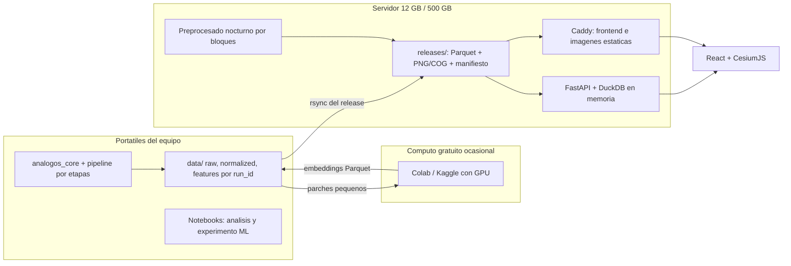

# Arquitectura para el hackathon (escala reducida)

**Fecha:** 5 de noviembre de 2026  
**Estado:** propuesta de alcance y arquitectura para un equipo de estudiantes con cómputo limitado.  
**Relación:** `Arquitectura objetivo y plataforma de datos.md` queda como **referencia a largo plazo**. Este documento define lo que se construye para el hackathon y qué se pospone. Mantiene los mismos principios y casi las mismas tecnologías; cambia la escala y el número de piezas en funcionamiento.

**Recursos supuestos:** portátiles del equipo, un servidor dedicado de **12 GB de RAM y 500 GB de disco**, conexión doméstica o universitaria, cómputo gratuito ocasional (Colab/Kaggle) y sin presupuesto de nube.

---

## 1. Veredicto honesto

**El cómputo no es el cuello de botella. El tiempo de las personas y la validación científica sí lo son.**

- Con datos a ~500 m, el relieve de Marte completo y una búsqueda sobre **toda la tierra firme del planeta** caben en ese servidor: MOLA ocupa pocos GB y ~1,5 M ventanas de 10 km con ~20 variables son ~120 MB.
- Lo que **no** cabe en un hackathon es la visión completa: varias dimensiones (minerales, temperatura, agua), la Luna, ML validado, terreno 3D planetario, un conjunto de relevancia revisado por expertos y una plataforma de datos con siete servicios. Eso son meses de trabajo de varias personas.

| Elemento de la propuesta | ¿Realista para el hackathon? | Decisión |
|---|---|---|
| Búsqueda Tierra–Marte por relieve, con desglose y límites | **Sí** | Núcleo del producto. |
| Catálogo terrestre global a ~500 m | **Sí, si se preprocesa antes** del evento | Objetivo ampliado; regional como respaldo. |
| Visualización en dos globos con capas analíticas 2D | **Sí** | Sustituir polígonos por imágenes georreferenciadas. |
| Fichas con procedencia, cobertura y advertencias | **Sí** | Es el diferenciador del proyecto; barato de hacer. |
| Pruebas de lectura (endianidad, puntos de control) | **Sí** | Imprescindible; pocas horas. |
| Sensibilidad básica (2–3 variantes de ventana) | **Sí** | Reutiliza el mismo código. |
| ML: embeddings comparados con la línea base | **Parcial** | Como experimento acotado y presentado como tal. |
| Interpretación de misión con LLM | **Parcial** | Escenarios predefinidos; LLM solo si sobra tiempo. |
| Terreno 3D real de Marte | **Riesgoso** | Una sola región como extra, o relieve sombreado 2D. |
| Luna (relieve) | **Sí, si el código es agnóstico al cuerpo** | Segundo destino con el mismo pipeline (§9). |
| Geología, temperatura/termofísica, hielo | **Solo como contexto** | Capas contextuales en la ficha y filtros explícitos; fuera de la puntuación (§9). |
| Minerales espectrales (CRISM, M³) | **No** | Trabajo futuro; requieren procesamiento especializado. |
| Validación por expertos | **No** | Usar análogos documentados (NASA Analog Explorer, TADP) como **prueba de plausibilidad**, sin llamarlo validación. |
| Postgres + pgSTAC + TiTiler + almacenamiento S3 + MLflow + Dagster en servidor | **No** | Sobra para este volumen. |

**Recomendación:** presentar un producto pequeño y riguroso ("buscamos análogos de relieve con estas fuentes, con esta incertidumbre y estos límites") en lugar de uno grande y frágil. En un hackathon de NASA, la honestidad sobre la evidencia es un argumento fuerte.

## 2. Tres niveles de alcance

Elegir uno según el tiempo real disponible. **Verificar en las reglas del evento qué preparación previa está permitida** (pendiente en la arquitectura inicial, §18).

| Nivel | Tiempo | Alcance |
|---|---|---|
| **A — Solo el evento** (~48 h) | Sin preparación previa | Prototipo actual corregido; 3–5 regiones de referencia en Marte; 200–1 000 ventanas terrestres en 5–10 zonas (desiertos, volcánicas, de impacto); línea base física; capas 2D; fichas; sin ML. |
| **B — Recomendado** | 2–4 semanas a tiempo parcial + evento | Nivel A + catálogo terrestre global a ~500 m preprocesado; 10–20 regiones marcianas; sensibilidad básica; pruebas automáticas; experimento pequeño de embeddings; despliegue en el servidor. |
| **C — Visión completa** | Meses, varias personas | Arquitectura objetivo. No es un objetivo para el hackathon. |

## 3. Arquitectura reducida



Dos procesos en el servidor (API y servidor web) y un directorio de releases. Nada más es obligatorio.

### 3.1. Qué se mantiene, qué se simplifica y qué se pospone

| Pieza de la arquitectura objetivo | Hackathon | Motivo |
|---|---|---|
| Biblioteca pura `analogos_core` con pruebas | **Mantener** | Arregla la fragilidad del script; es lo más rentable. |
| Registro de fuentes y `AnalysisSpec` en YAML | **Mantener** (versión corta) | Hace explícitos endianidad, CRS, ventana y remuestreo. |
| Checks con puntos de control | **Mantener** | Evita repetir el error de MOLA. |
| Datos originales inmutables + `run_id` + carpeta de release | **Mantener** como convención de carpetas | Cuesta minutos y da reproducibilidad. |
| Dagster | **Simplificar**: script `pipeline.py` con etapas (`fetch`, `normalize`, `features`, `release`) y un `Makefile`. Usar `dagster dev` en un portátil solo si alguien ya lo conoce. | Curva de aprendizaje y RAM; el grafo es pequeño. |
| PostgreSQL + PostGIS | **Posponer**. Parquet + DuckDB. | 1,5 M filas caben en memoria; sin concurrencia de escritura. |
| pgvector / Qdrant | **Posponer**. Búsqueda exacta con NumPy. | 100 000 × 128 floats ≈ 50 MB; búsqueda exacta en milisegundos. |
| STAC + pgSTAC | **Simplificar**: `manifest.json` por release con fuentes, checksums, licencias y versiones. | Mismo propósito de procedencia sin servicio. |
| TiTiler / teselas dinámicas | **Simplificar**: una imagen PNG georreferenciada por región y capa (`SingleTileImageryProvider` de Cesium, que acepta un rectángulo en cualquier elipsoide). | Sustituye los 400 polígonos con mucho menos trabajo y sin problemas de CRS terrestres. |
| Terreno *quantized-mesh* | **Extra opcional** para una región. | Riesgo técnico alto en Marte. |
| Garage/SeaweedFS, MLflow, Marquez | **Posponer** | Disco local + `rsync`; métricas de ML en un CSV/notebook. |
| HEALPix | **Opcional**. Para regiones: malla regular en proyección local. Para el escaneo global terrestre: HEALPix (`healpy`) o una malla en proyección de igual área. | Simplicidad. |
| pixi para fijar GDAL/PROJ | **Mantener** | Evita "en mi máquina sí funciona" entre varios portátiles. |

## 4. Datos y presupuesto de disco y memoria

### 4.1. Fuentes

| Uso | Producto propuesto | Tamaño orientativo | Nota |
|---|---|---|---|
| Marte, relieve | MOLA MEGDR 128 px/° (topografía + recuentos) | ~2 GB por capa global; menos si se recortan teselas | Ya integrado en el prototipo. |
| Luna, relieve | LOLA GDR 64 o 128 px/° (o teselas SLDEM2015) | ~0,5–2 GB | Mismo pipeline de lectura que MOLA, cambiando `body_reference` (§9.1). |
| Tierra, escaneo global | **GMTED2010 a 7,5″** (~230 m) | Pocos GB por estadística (verificar) | Producto global único, adecuado para analizar a 500 m y más parecido en escala a MOLA/LOLA que un DEM de 30 m. Su origen varía por región (mayoritariamente SRTM); registrarlo. |
| Tierra, zonas de detalle | SRTM 1″ o Copernicus DEM GLO-90/GLO-30 solo en las zonas candidatas | Cientos de MB a pocos GB | Para fichas, comparación con el producto global y fuera de la cobertura SRTM (> 60° N). |
| Contexto multidimensional (geología, clima, hielo) | Mapas globales resumidos: USGS SIM 3292 (Marte), Unified Lunar Map v2, GLiM, Köppen/WorldClim, inercia térmica TES, glaciares GLIMS, hidrógeno GRS/LEND | De pocos MB a ~500 MB en total | Se cruzan por coordenada al generar `features.parquet` para filtros y fichas (§9.2). |
| Contexto visual | Mosaico global de cada cuerpo (Tierra, Marte, Luna) | — | Etiquetar como contexto, no como evidencia. |
| Plausibilidad | NASA Planetary Analog Explorer, TADP | Kilobytes | Lista de 10–20 análogos documentados. |

Evitar descargar Copernicus GLO-30 global o imágenes HLS/CTX: son TB y no aportan a una comparación a 500 m.

### 4.2. Presupuesto del servidor

| Recurso | Uso previsto | Margen |
|---|---|---|
| Disco (500 GB) | Originales < 30 GB, derivados < 20 GB, 3–5 releases < 10 GB | Holgado; no requiere almacenamiento externo. |
| RAM (12 GB) | API + DuckDB ~1–2 GB; servidor web < 100 MB; preprocesado por bloques ~2–4 GB | Suficiente si **nunca** se carga un ráster global entero. |

Reglas para no quedarse sin memoria:

- Leer rásteres por ventanas/bloques con Rasterio y escribir resultados por bloque.
- Usar `int16`/`float32`, no `float64`, en los arrays grandes.
- Fijar `memory_limit` en DuckDB y procesar regiones en paralelo con pocos procesos (2–3).
- Ejecutar el escaneo global de noche en el servidor y guardar puntos de control para reanudar.

### 4.3. Cómputo estimado (órdenes de magnitud, a medir)

- Features de relieve para 1 000 ventanas: segundos o minutos en un portátil.
- Escaneo terrestre global (~1,5 M ventanas de 10 km sin solapamiento a partir de GMTED): horas en el servidor procesando por bloques. Es la razón principal para preprocesar **antes** del evento.
- Autoencoder pequeño sobre ~50 000 parches de 20 × 20 celdas: minutos en CPU o GPU gratuita.

## 5. Pipeline reducido

```text
specs/bodies/*.yaml + specs/sources/*.yaml + specs/analysis/relieve_v1.yaml
        │
fetch      → data/raw/{fuente}/{sha256}/...        (+ manifiesto de descarga)
normalize  → data/normalized/*.tif (COG, CRS explícito)   ← check: puntos de control, rango, CRS
features   → data/features/{run_id}/features.parquet       ← relieve + cruce con capas de contexto (geología, clima, hielo)
sensitivity→ data/features/{run_id}/sensitivity.parquet    (ventanas 5/10/20 km en un subconjunto)
layers     → data/visual/{region}/{capa}.png + rectángulo + leyenda fija
release    → releases/{release_id}/ (copia de lo anterior + manifest.json)
```

- Cada etapa lee de la anterior y **escribe en una carpeta nueva**; nada se sobrescribe.
- `release` solo se genera si todos los checks pasan; el servidor apunta a `releases/current` (enlace simbólico) y revertir es cambiar el enlace.
- `pytest` con un recorte pequeño de MOLA y SRTM y sus valores esperados; ejecutarlo antes de cada release.

## 6. Búsqueda y ML a escala hackathon

**Línea base física (núcleo):** filtros por cobertura y soporte → distancia por dimensión (histograma de pendientes, percentiles de relieve, rugosidad) → ranking con pesos del escenario → desglose. Todo en memoria con DuckDB/NumPy.

**Experimento de ML (nivel B, opcional):**

1. Parches de elevación relativa y pendiente a la misma escala para la Tierra y Marte.
2. Autoencoder pequeño o un extractor preentrenado, entrenado en Colab/Kaggle o en CPU.
3. Partición geográfica antes de cortar parches.
4. Comparar con la línea base: ¿recupera los análogos documentados? ¿el embedding permite adivinar si el parche es de la Tierra o de Marte (atajo)?
5. Mostrar en la interfaz como "señal experimental", separada de la puntuación principal.

Esto cumple la intención de "ML central" de la visión de forma honesta: se demuestra la tubería y se mide su aporte, sin afirmar que identifica análogos.

**Misión:** 2–3 escenarios predefinidos (p. ej. "movilidad regional en pendientes", "planicies extensas"), cada uno con variables y pesos explícitos. Un LLM que traduzca texto libre a uno de esos escenarios es un extra de bajo costo si el tiempo sobra; nunca debe generar mediciones.

## 7. Plan de ejecución: 2 semanas previas + 48 h de hackathon (con agentes de IA)

Contar con **2 semanas previas + 2 días y 2 noches completas**, apoyándose en agentes de IA, permite aspirar al **Nivel B completo con Luna y contexto multidimensional**, siempre que se respete qué hacen bien los agentes y dónde fallan.

### 7.1. Dónde aceleran los agentes de IA y dónde son peligrosos

| Los agentes de IA multiplican velocidad (×3–×5) | Los agentes de IA inducen errores silenciosos (auditar siempre) |
|---|---|
| Refactorizar el prototipo a `analogos_core`, crear CLI, `Makefile` y esquemas Pydantic/Pandera. | **Geodesia planetaria:** inventan códigos EPSG para Marte/Luna, asumen WGS84, confunden longitud $0\text{–}360^\circ\text{E}$ con $-180\text{–}180^\circ$ o mezclan latitud planetocéntrica y planetográfica. |
| Escribir tests de `pytest`, *fixtures* binarias y validadores de rangos/nulos. | **Formatos PDS crudos:** adivinan mal `SCALING_FACTOR`, `OFFSET`, signo o endianidad si no se les pasa el archivo `.lbl`/`.xml` real en el contexto. |
| Construir endpoints en FastAPI, consultas en DuckDB y componentes React/TypeScript (fichas, filtros, gráficos de distribución). | **CesiumJS con otros cuerpos:** suelen usar configuraciones que reproyectan silenciosamente a WGS84 o rompen la cámara al cambiar el `Ellipsoid`. |
|Escribir scripts de cruce espacial (*point/zonal lookup*) y el boilerplate del autoencoder en PyTorch. | **Fugas de datos en ML:** si no se les exige explícitamente partición geográfica previa, harán un `train_test_split` aleatorio con ventanas solapadas. |

**Regla de oro para trabajar con agentes:** congelar primero los contratos (`specs/bodies/*.yaml`, esquema de `features.parquet` y JSON de la API) y los tests de puntos de control; luego dejar que los agentes generen código contra esos contratos y tests.

### 7.2. Qué puede estar terminado al final del hackathon

Con este tiempo, el producto realista y sólido al cerrar las 48 h incluye:

1. **Tres cuerpos operativos (Tierra, Marte, Luna):** 10–15 regiones marcianas, 5–8 regiones lunares y búsqueda terrestre en dos modos: **catálogo curado rico** (300–500 sitios procesables en < 5 min) + **barrido global terrestre** (~100 000–300 000 ventanas sobre GMTED2010).
2. **Motor de relieve robusto:** distribuciones de pendiente, relieve relativo P95−P5 y rugosidad multiescala; distancia entre distribuciones; análisis de sensibilidad (ventanas de 5/10/20 km) visible en la interfaz.
3. **Tres dimensiones adicionales como filtro y contexto:** unidad geológica/litológica, régimen climático/inercia térmica e indicadores de criosfera/hidrógeno integrados en `features.parquet` y en las fichas comparativas.
4. **Visualización 2D sólida en doble globo (Tierra + Marte/Luna):** capas PNG georreferenciadas por ventana (pendiente, elevación relativa, máscara de observación) sobre CesiumJS sin los 400 polígonos, con estados de carga claros y leyendas honestas. *(Opcional: 1 escena 3D local en Three.js o Cesium para el sitio seleccionado si sobra tiempo).*
5. **Señal experimental de ML:** autoencoder convolucional ligero entrenado sobre parches de relieve (elevación relativa + pendiente), comparado contra la línea base física en análogos conocidos (TADP / Analog Explorer) y con prueba de detector de cuerpo/sensor.
6. **Integración en vivo de los datos sorpresa de NASA:** incorporados durante el Día 1 del evento mediante los adaptadores tabulares/ráster.

### 7.3. Cronograma detallado

#### Semana 1 (Días 1–7): Cimientos, contratos y corrección científica
- **Días 1–2 (Contratos y tests base):** extraer `analogos_core`; definir `earth.yaml`, `mars.yaml`, `moon.yaml` y esquemas de datos. Crear *fixtures* diminutas de MOLA, LOLA y SRTM/GMTED con puntos de control reales (p. ej. Monte Olimpo / fondo de Jezero, cráter Tycho, Atacama).
- **Días 3–4 (Pipeline reproducible):** implementar comandos `fetch → normalize → features → layers → release` con escritura por `run_id`. Verificar lectura de MOLA y LOLA (escalas, offsets, endianidad, recuentos).
- **Días 5–7 (Visor Cesium y bug de Marte):** corregir el visor marciano del prototipo; cambiar los 400 polígonos por `SingleTileImageryProvider` (PNG georreferenciado); probar el cambio dinámico de elipsoide Marte ↔ Luna en el frontend.

#### Semana 2 (Días 8–14): Contexto multidimensional, ML y preparación para datos sorpresa
- **Días 8–9 (Cruces de otras dimensiones):** escribir el enriquecedor espacial que cruza centros/ventanas con mapas globales ligeros (GLiM/USGS geológico, Köppen/WorldClim, inercia térmica TES, glaciares/permafrost).
- **Días 10–11 (Motor de búsqueda y API):** consultas DuckDB con filtros duros + distancia de distribuciones de relieve + cálculo de sensibilidad; endpoints FastAPI listos y tipados; diseño de la UI de fichas y comparador con agentes.
- **Días 12–13 (Pipelines de ML y adaptadores en caliente):** dejar listo el notebook/script de PyTorch para entrenar el autoencoder en < 15 min y el script `ingest_custom_dataset.py` para tragar CSV/GeoJSON/GeoTIFF nuevos en minutos.
- **Día 14 (Simulacro y despliegue base):** levantar Caddy + FastAPI en el servidor de 12 GB; dejar descargados los datos públicos base en disco para no depender de la red durante el fin de semana.

#### Hackathon — 48 horas (2 días y 2 noches)
- **Día 1 · Mañana:** analizar los datos liberados por NASA; decidir cómo entran (nuevas regiones de referencia, nuevas columnas de contexto o benchmark de evaluación) y conectarlos con el adaptador.
- **Día 1 · Tarde:** correr el pipeline completo sobre el catálogo curado + datos de NASA y lanzar el barrido terrestre en el servidor; generar las capas PNG de todas las regiones.
- **Noche 1:** correr el entrenamiento del autoencoder con las particiones finales y calcular la tabla de sensibilidad; publicar el `release` en el servidor.
- **Día 2 · Mañana:** conectar el frontend al release definitivo; pulir las fichas de evidencia, los filtros por misión y los gráficos comparativos de distribuciones.
- **Día 2 · Tarde:** congelar código pesado; preparar 3 recorridos de demostración guiados (p. ej. movilidad de rover en Marte, aterrizaje en tierras altas lunares, búsqueda con filtro hiperárido/volcánico) y grabar el video.
- **Noche 2:** pruebas de estrés suaves en el servidor, corrección de detalles visuales, redacción final de límites/atribuciones y entrega.

**Recorte de emergencia** si algo se retrasa en el Día 2, en este orden: ML → barrido global (quedarse con los 500 sitios curados + datos NASA) → sensibilidad → escena 3D local. Nunca recortar las pruebas de lectura ni las advertencias en las fichas.

## 8. Qué presentar como trabajo futuro

Mostrar la arquitectura objetivo como diagrama de "hacia dónde va": armonización cuantitativa de nuevas dimensiones con fichas de calidad, minerales espectrales, catálogo STAC, orquestación, índice vectorial y revisión experta. Demuestra que el equipo entiende la escala real del problema sin prometer haberla resuelto.

## 9. Cómo incluir la Luna y otras dimensiones de forma ligera

El problema con la Luna y las dimensiones adicionales no es el espacio en disco, sino tratar de **armonizarlas científicamente para meterlas en la fórmula del puntaje** o construirles visores complejos. Si se separan los roles, sí caben en el hackathon:

- **El relieve** hace el ranking cuantitativo.
- **Las demás dimensiones** actúan como **filtros duros** (p. ej. "solo zonas áridas o frías") o como **etiquetas e indicadores de contexto en la ficha** (cruces rápidos por coordenada al construir el catálogo), sin entrar al promedio del score ni requerir capas 3D.

### 9.1. La Luna con el mismo pipeline (relieve)

Si `analogos_core` no tiene el radio ni el CRS de Marte codificados a fuego, sino que lee un archivo `body_reference` (`earth`, `mars`, `moon`), añadir la Luna para relieve cuesta muy poco:

- **Fuente:** LOLA GDR a 64 o 128 píxeles/grado (~473 m a ~237 m en el ecuador; pocos GB) o un par de teselas de SLDEM2015 para latitudes medias.
- **Trabajo real:** escribir `specs/bodies/moon.yaml` (radio lunar $1737,4\text{ km}$, CRS `IAU_2015:30100`), `specs/sources/lola_gdr.yaml` (aplicando el `SCALING_FACTOR` y `OFFSET` de la etiqueta PDS), un punto de control conocido (p. ej. fondo de Tycho o cuenca Aitken) y extraer 3–5 ventanas lunares de referencia (un mar basáltico, tierras altas rugosas, borde de cráter).
- **Visualización:** en Cesium, cambiar los radios del `Ellipsoid` al elegir "Luna" y cargar una textura global lunar (USGS/LROC WMS o mosaico estático). Las ventanas se pintan igual que en Marte con `SingleTileImageryProvider`.

### 9.2. Otras dimensiones como contexto y filtros (sin frenar el proyecto)

En lugar de procesar terabytes de imágenes o espectros crudos, usar **productos globales ya resumidos de baja resolución**. Durante la etapa `features`, a cada ventana se le hace un muestreo puntual o zonal (*point/zonal lookup*) sobre estos mapas y el valor se guarda como columna adicional en `features.parquet`:

| Dimensión | Fuente ligera en Tierra | Fuente ligera en Marte / Luna | Cómo se usa en el producto (sin entrar al score de relieve) |
|---|---|---|---|
| **Geología / litología** | Mapa litológico global ([GLiM](https://www.geo.uni-hamburg.de/en/geologie/forschung/aquatische-geochemie/glim.html) o USGS Geologic Maps en zonas candidatas) | Mapa geológico global de Marte ([USGS SIM 3292](https://www.usgs.gov/maps/geologic-map-mars)) y de la Luna ([Unified Geologic Map v2](https://astrogeology.usgs.gov/search/map/Moon/Geology/Unified_Geologic_Map_of_the_Moon_GIS_v2/)) — ambos son *shapefiles/GeoPackage* de pocos cientos de MB | **Etiqueta en ficha + filtro opcional:** cruzar el polígono con la ventana. En Tierra permite filtrar "solo unidades volcánicas / basálticas / sedimentarias"; en Marte/Luna muestra qué unidad geológica es la referencia. |
| **Clima / temperatura / aridez** | [WorldClim](https://www.worldclim.org/) o [CHELSA](https://chelsa-climate.org/) (climatologías mensuales en un par de GeoTIFF globales) + mapa de aridez/climas Köppen-Geiger (pocos MB) | Mapa global de **inercia térmica TES** en Marte (pocos MB en PDS) y rango térmico de **Diviner** en la Luna (resúmenes globales) | **Filtro en Tierra + ficha comparativa:** en Tierra filtra por régimen (p. ej. hiperárido, polar/periglaciar). En la ficha se muestra lado a lado con la inercia térmica o rango lunar, advirtiendo que no son la misma variable física. |
| **Agua / hielo / criosfera** | Polígonos de glaciares ([GLIMS](https://www.glims.org/) / Randolph Glacier Inventory) o mapa de zonación de permafrost ([Obu et al. / NSIDC](https://nsidc.org/)) | Mapas regionales de **exceso de hidrógeno** (Mars Odyssey GRS/MONS, LRO LEND), que son mallas gruesas de pocos MB | **Indicador contextual con advertencia:** marca si la región marciana/lunar tiene señal regional de hidrógeno (indicador indirecto a escala de decenas de km) y permite filtrar en Tierra zonas con glaciar o permafrost. |
| **Logística terrestre** | Polígonos de áreas protegidas ([WDPA](https://www.protectedplanet.net/)) o distancia precalculada a red vial (OSM) | No aplica | **Insignia informativa en la ficha:** indica si cae en área protegida o a cuántos km está el acceso más cercano, separado de la similitud física. |

**Lo que sí conviene dejar fuera del hackathon:** procesar espectros hiperespectrales crudos (CRISM o $\text{M}^3$) o series temporales diarias de MODIS/Landsat. Eso requiere calibración atmosférica, corrección fotométrica y mucho tiempo.

## 10. Estrategia ante la incertidumbre de las reglas y los datos sorpresa de NASA

Si no es seguro cuánto preprocesamiento previo se permite —y además la NASA publicará datos propios al iniciar el evento—, el diseño no puede depender de un único cálculo de 12 horas hecho semanas antes. La solución es separar **el motor y los adaptadores** (que se preparan antes como software reutilizable) de **los datos generados durante el evento**:

1. **Preparar el código, no atarse al catálogo precalculado:** llegar con `analogos_core`, los lectores, los checks de puntos de control y el comando `python pipeline.py build --spec ...` probados y rápidos.
2. **Modo rápido en dos escalas (plan para correr en vivo durante las 48 h):**
   - **Catálogo curado instantáneo (< 5 min de cómputo):** una lista de 300–500 ventanas terrestres alrededor de sitios análogos conocidos (TADP, Analog Explorer, campos volcánicos, desiertos, cráteres de impacto terrestres) y 10–15 sitios en Marte y la Luna. Se puede recalcular desde cero durante el hackathon cuantas veces sea necesario.
   - **Escaneo global por niveles (15–30 min):** si se quiere barrer toda la Tierra dentro del evento, hacer un primer pase grueso (p. ej. ventanas cada 25–50 km sobre GMTED2010, ~100 000 ventanas) que tarda pocos minutos, y calcular el detalle fino solo en las mejores regiones.
3. **Interfaz de "adaptador en caliente" para los datos que publique NASA:**
   - Si NASA entrega **tablas o catálogos de sitios** (CSV, GeoJSON, Parquet con campañas de campo, propiedades de rocas o sitios candidatos), se integran en minutos como una capa de referencia o como nuevas filas en el catálogo curado mediante una función `ingest_tabular_catalog()`.
   - Si entrega **rásteres regionales** (DEM de alta resolución, mapas térmicos o mineralógicos ya procesados de zonas concretas), se registran con un archivo YAML en `specs/sources/` y entran por el mismo paso `normalize → features` sin tocar el resto del sistema.
   - Si son **variables puntuales nuevas** que no existen en toda la Tierra, entran automáticamente como **atributos de contexto en la ficha** o filtros para ese subconjunto, sin romper el motor de búsqueda principal.

