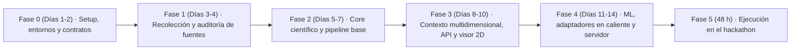

# Plan maestro de arranque y construcción desde cero

> **Nota de vigencia:** este documento conserva propuestas técnicas e históricas. Para la dirección y el orden de trabajo actuales, consulta el [Plan de implementación orientado a escenarios](../02-versiones-anteriores/etapa-1-mvp-escenarios/Plan%20de%20implementacion%20orientado%20a%20escenarios.md). Los parámetros, fases y tecnologías de este plan anterior no son obligaciones del nuevo plan.

**Fecha:** 5 de noviembre de 2026  
**Propósito:** guía operativa paso a paso para levantar la arquitectura de `Arquitectura para el hackathon.md` desde cero, cubriendo configuración de entornos, credenciales, recolección y auditoría de fuentes, contratos de datos y fases de desarrollo con agentes de IA.  
**Equipo supuesto:** 4–5 estudiantes, portátiles + 1 servidor dedicado (12 GB RAM, 500 GB disco), 2 semanas de preparación + 48 h de hackathon.

---

## 0. Visión general de las fases



---

## Fase 0: Setup de repositorio, entornos y credenciales (Días 1–2)

El objetivo de esta fase es que **ningún miembro del equipo sufra problemas de instalación de GDAL/PROJ** y que los contratos estén congelados antes de pedir código a los agentes de IA.

### 0.1. Estructura inicial del repositorio

Crear la siguiente estructura de carpetas y archivos desde el primer commit:

```text
analogos-planetarios/
├── pixi.toml                    # Entorno reproducible (Python, GDAL, PROJ, DuckDB, Node)
├── Makefile                     # Comandos únicos para todo el equipo
├── .env.example                 # Plantilla de variables y rutas (sin secretos)
├── .gitignore                   # Ignorar data/, releases/, .env, node_modules/
├── specs/
│   ├── bodies/                  # Definición física y geodésica de cada cuerpo
│   │   ├── earth.yaml
│   │   ├── mars.yaml
│   │   └── moon.yaml
│   ├── sources/                 # Registro de cada dataset (URLs, formato, endianidad, escala)
│   ├── analysis/                # Parámetros de ventana, malla y remuestreo
│   │   └── relieve_10km_v1.yaml
│   └── scenarios/               # Escenarios de misión predefinidos
├── packages/
│   └── analogos_core/           # Biblioteca científica pura (sin FastAPI ni UI)
│       ├── pyproject.toml
│       ├── src/analogos_core/
│       │   ├── __init__.py
│       │   ├── bodies.py        # Carga y validación de CRS / elipsoides
│       │   ├── ingest.py        # Descarga con checksums y manifiesto
│       │   ├── normalize.py     # Lectura PDS/GeoTIFF -> COG normalizado
│       │   ├── harmonize.py     # Proyección local métrica y remuestreo
│       │   ├── features.py      # Cálculo de relieve y cruces de contexto
│       │   ├── layers.py        # Generación de PNGs georreferenciados y leyendas
│       │   └── schemas.py       # Esquemas Pydantic / Pandera
│       └── tests/
│           ├── fixtures/        # Recortes reales diminutos (< 1 MB) para tests
│           └── test_readers.py  # Tests bloqueantes de endianidad y puntos de control
├── pipelines/
│   ├── pipeline.py              # CLI por etapas: fetch, normalize, features, layers, release
│   └── ingest_custom.py         # Adaptador en caliente para datos sorpresa de NASA
├── backend/
│   └── app/
│       ├── main.py              # FastAPI (solo lectura sobre releases/current)
│       ├── search.py            # Consultas DuckDB + distancia de distribuciones + NumPy ANN
│       └── models.py            # Contratos JSON de entrada/salida
├── ml/
│   ├── dataset.py               # Extracción de parches con partición geográfica
│   ├── autoencoder.py           # Modelo ligero en PyTorch
│   └── evaluate.py              # Comparación contra línea base y detector de atajos
├── frontend/                    # React + TypeScript + Vite + CesiumJS
├── data/                        # (Ignorado en Git) raw/, normalized/, features/, visual/
└── releases/                    # (Ignorado en Git) v0.1/, v0.2/, symlink current -> v0.x
```

### 0.2. Entorno reproducible con `pixi` (Conda-Forge)

No instalar GDAL, PROJ ni Rasterio con `pip` suelto: las bibliotecas en C cambian según el sistema operativo (macOS, Linux, Windows/WSL) y provocan errores con los códigos planetarios `IAU_2015`.

1. Instalar [pixi](https://pixi.sh) en todos los portátiles y en el servidor de 12 GB.
2. Definir `pixi.toml` usando el canal `conda-forge`:
   ```toml
   [project]
   name = "analogos-planetarios"
   channels = ["conda-forge"]
   platforms = ["osx-arm64", "osx-64", "linux-64"]

   [dependencies]
   python = "3.11.*"
   gdal = ">=3.8"
   proj = ">=9.3"
   proj-data = "*"
   rasterio = ">=1.3"
   rioxarray = "*"
   xarray = "*"
   geopandas = ">=1.0"
   pyproj = ">=3.6"
   numpy = ">=1.26,<2.0"
   scipy = "*"
   duckdb = ">=1.1"
   pyarrow = "*"
   pandera = "*"
   pydantic = ">=2.7"
   pyyaml = "*"
   fastapi = "*"
   uvicorn = "*"
   httpx = "*"
   pytest = "*"
   matplotlib = "*"
   pillow = "*"
   ```
3. **Verificación obligatoria de entorno (`make check-env`):**
   Ejecutar un comando que compruebe que PROJ conoce los sistemas planetarios antes de escribir una sola línea del proyecto:
   ```bash
   pixi run python -c "from pyproj import CRS; print(CRS.from_string('IAU_2015:49900').name); print(CRS.from_string('IAU_2015:30100').name)"
   ```
   Si imprime los nombres de Marte y la Luna sin error, el entorno geoespacial está listo.

### 0.3. Credenciales y cuentas necesarias (hacer el Día 1)

| Servicio | ¿Para qué se necesita? | Cómo configurarlo |
|---|---|---|
| **NASA Earthdata Login** | Descargar SRTM, ASTER, MODIS o HLS desde LP DAAC / Earthdata. | Crear cuenta gratuita en `urs.earthdata.nasa.gov`. Guardar usuario y token en `~/.netrc` (permisos `0600`) o en `.env` (`EARTHDATA_TOKEN`). |
| **USGS EROS / EarthExplorer** | Descargar GMTED2010 o teselas SRTM adicionales si no se bajan por HTTP directo. | Cuenta gratuita en `ers.cr.usgs.gov`. |
| **NASA PDS / USGS Astrogeology** | MOLA, LOLA, mapas geológicos de Marte y Luna, inercia térmica TES. | **No requiere cuenta** (acceso HTTP directo o vía STAC en `stac.astrogeology.usgs.gov`). |
| **Cesium ion (opcional)** | Solo si se usa imagen base terrestre de Cesium. | Token gratuito en `.env` (`VITE_CESIUM_TOKEN`). Para Marte y Luna no se usa Cesium ion. |

---

## Fase 1: Recolección y auditoría de fuentes de datos (Días 3–4)

Antes de programar el pipeline completo, una o dos personas deben descargar los archivos base al servidor (o a un disco compartido), inspeccionar sus etiquetas reales y llenar `specs/sources/*.yaml`.

### 1.1. Lista exacta de compras de datos (Check-list de descarga)

#### A. Cuerpos planetarios (Referencia)

1. **Marte — Relieve (MOLA MEGDR 128 px/°):**
   - **Origen:** [PDS Geosciences Node — MOLA MEGDR](https://pds-geosciences.wustl.edu/missions/mgs/megdr.html).
   - **Archivos a bajar:** teselas o mapa global de `megt` (topografía referida al areoide), `megr` (radio planetario, útil si se hace malla 3D), `megc` (recuentos de disparos láser por celda) y sus etiquetas `.lbl`.
   - **Qué auditar en el `.lbl`:** `SAMPLE_TYPE = MSB_INTEGER` (big-endian, `>i2`), `LINE_SAMPLES`, `LINES`, dominio de longitud ($0^\circ\text{ a }360^\circ\text{E}$), unidad (metros).
2. **Luna — Relieve (LOLA GDR 64 o 128 px/°):**
   - **Origen:** [PDS Geosciences Node — LOLA GDR](https://pds-geosciences.wustl.edu/missions/lro/lola.htm) (carpeta `imb` / `gdr`).
   - **Archivos a bajar:** DEM global a 64 px/° (~473 m/px en el ecuador, ligero y directo para comparar con 500 m) o teselas a 128 px/°, capa de recuentos y archivo `.lbl`.
   - **Qué auditar en el `.lbl`:** en LOLA los enteros suelen requerir aplicar `height_m = (pixel_value * SCALING_FACTOR) + OFFSET` (en muchos productos `SCALING_FACTOR = 0.5` respecto al radio de $1737,4\text{ km}$). **No asumir que el entero ya está en metros.**
3. **Marte y Luna — Mapas de contexto ligeros:**
   - **Geología de Marte:** [USGS SIM 3292](https://www.usgs.gov/maps/geologic-map-mars) (descargar el paquete GIS / Shapefile de unidades geológicas).
   - **Geología de la Luna:** [Unified Geologic Map of the Moon v2](https://astrogeology.usgs.gov/search/map/Moon/Geology/Unified_Geologic_Map_of_the_Moon_GIS_v2/) (Shapefile/GeoPackage).
   - **Inercia térmica de Marte:** mapa global TES Thermal Inertia (PDS Geosciences, pocos MB).
   - **Hidrógeno / criosfera planetaria (opcional):** mapa grueso de Mars Odyssey MONS/GRS o LRO LEND (PDS, pocos MB).
   - **Texturas visuales para los globos:** mosaico global Viking/MOLA coloreado para Marte y mosaico WAC de LROC para la Luna (en formato JPEG/PNG o GeoTIFF reducido a 4096×2048 o 8192×4096 para carga rápida en el navegador).

#### B. Tierra (Búsqueda de candidatos)

1. **Tierra — Relieve para barrido global:**
   - **Producto principal:** **GMTED2010 a 7,5 segundos de arco (~230 m)** ([USGS GMTED2010](https://www.usgs.gov/coastal-changes-and-impacts/gmted2010)). Descargar los archivos GeoTIFF globales de media (`mean`) y desviación estándar/rango (`std`/`median`). Ocupa ~1,5–2 GB por capa y cubre casi todo el globo en un solo archivo.
   - **Alternativa:** Copernicus DEM GLO-90 en zonas seleccionadas desde el bucket público de AWS (`s3://copernicus-dem-90m/`, acceso sin cuenta con `--no-sign-request`).
2. **Tierra — Relieve de mayor detalle en zonas curadas:**
   - Teselas SRTM 1 arc-second (~30 m) o Copernicus GLO-30/90 únicamente sobre los 15–20 polígonos regionales de interés (Atacama, Utah, Islandia, Mojave, Antártida/Valles Secos, Hawaii, Lanzarote, Río Tinto, Devon Island, etc.).
3. **Tierra — Capas globales de contexto (para filtros y fichas):**
   - **Clima / Aridez:** mapa global de clasificación climática **Köppen-Geiger** a 1 km (GeoTIFF de < 50 MB, [Beck et al.](https://www.gloh2o.org/koppen/)) y/o temperatura media anual de **WorldClim v2.1** a 2,5 minutos o 30 segundos.
   - **Litología / Geología:** **GLiM** (Global Lithological Map) o mapas geológicos de USGS para Norteamérica/zonas curadas.
   - **Hielo / Permafrost:** polígonos del **Randolph Glacier Inventory (RGI)** / GLIMS o el mapa de probabilidad de permafrost en el hemisferio norte/sur ([Obu et al., PANGAEA](https://doi.pangaea.de/10.1594/PANGAEA.888600), pocos MB).
4. **Catálogo de semillas (Plausibilidad):**
   - Armar un archivo `specs/seed_sites.csv` con 30–50 coordenadas documentadas de **NASA Planetary Analog Explorer**, **USGS TADP**, cráteres e campos volcánicos conocidos. Alrededor de cada semilla se generarán varias ventanas para conformar el catálogo curado de 300–500 ventanas.

### 1.2. Protocolo de auditoría al descargar cada fuente

Cada vez que se descargue un archivo, correr este check manual antes de darlo por bueno:

1. Calcular `sha256sum` y anotarlo en `specs/sources/<fuente>.yaml`.
2. Inspeccionar con `gdalinfo <archivo>`: verificar tamaño, tipo de dato (`Int16`, `Float32`), valor `NoData`, `Scale`/`Offset` y sistema de coordenadas.
3. Extraer **dos puntos de control conocidos** por cuerpo (ej. cumbre del Monte Olimpo $\approx +21\,200\text{ m}$ y llanura de Jezero $\approx -2\,500\text{ m}$ en Marte; fondo del cráter Tycho en la Luna; Salar de Atacama $\approx +2\,300\text{ m}$ en Tierra) y anotarlos en el YAML de la fuente.

---

## Fase 2: Contratos base y `analogos_core` (Días 5–7)

Con los archivos auditados, se congelan los contratos. **Estos archivos son la ley que ningún agente de IA puede cambiar sin permiso.**

### 2.1. Contrato de cuerpos (`specs/bodies/*.yaml`)

```yaml
# specs/bodies/mars.yaml
body_id: mars
name: Marte
crs_geographic: "IAU_2015:49900"
semi_major_axis_m: 3396190.0
semi_minor_axis_m: 3376200.0
lon_convention: "0_360_E"          # Normalizar a [-180, 180] al exportar COG/PNG para Cesium
vertical_datum_name: "MOLA Areoid"
gravity_m_s2: 3.721
```

```yaml
# specs/bodies/moon.yaml
body_id: moon
name: Luna
crs_geographic: "IAU_2015:30100"
semi_major_axis_m: 1737400.0
semi_minor_axis_m: 1737400.0
lon_convention: "-180_180"
vertical_datum_name: "LOLA Sphere 1737.4 km"
gravity_m_s2: 1.625
```

```yaml
# specs/bodies/earth.yaml
body_id: earth
name: Tierra
crs_geographic: "EPSG:4326"
semi_major_axis_m: 6378137.0
semi_minor_axis_m: 6356752.3142
lon_convention: "-180_180"
vertical_datum_name: "EGM96 / WGS84 Geoid"
gravity_m_s2: 9.807
```

### 2.2. Esquema congelado de `features.parquet`

Una fila por ventana analizada (`window_id`). Esto permite que el equipo de Backend/UI y el de Datos trabajen en paralelo desde el Día 3:

| Columna | Tipo | Descripción |
|---|---|---|
| `window_id` | `string` | Identificador único (p. ej. `mars_jezero_001` o `earth_hpx_1024_048291`). |
| `body` | `string` | `earth` \| `mars` \| `moon`. |
| `region_group` | `string` | Nombre de la zona o provincia (para partición geográfica de ML y UI). |
| `is_reference` | `bool` | `true` si es sitio de referencia o semilla documentada. |
| `center_lat`, `center_lon` | `float32` | Coordenadas en dominio $[-180, 180]$ del cuerpo. |
| `bbox_west`, `bbox_south`, `bbox_east`, `bbox_north` | `float32` | Rectángulo geográfico para `SingleTileImageryProvider` en Cesium. |
| `window_size_m`, `grid_spacing_m` | `int32` | Ej. `10000` y `500`. |
| `valid_fraction` | `float32` | Fracción de celdas con dato no nulo en la ventana ($0\text{–}1$). |
| `observed_fraction` | `float32` | Fracción con observación directa nativa (p. ej. recuento MOLA/LOLA $> 0$). `NULL` si la fuente no separa interpolación. |
| `elev_rel_p95_p5_m` | `float32` | Rango de elevación relativa $P_{95} - P_5$ en metros (nunca elevación absoluta entre planetas). |
| `elev_std_m` | `float32` | Desviación estándar de la elevación dentro de la ventana. |
| `slope_mean_deg`, `slope_p50_deg`, `slope_p90_deg` | `float32` | Estadísticos de pendiente en grados a escala de 500 m. |
| `slope_hist_bins` | `list<float32>` | Proporción de celdas en 8 intervalos fijos de pendiente: $[0\text{–}1^\circ, 1\text{–}2^\circ, 2\text{–}5^\circ, 5\text{–}10^\circ, 10\text{–}15^\circ, 15\text{–}20^\circ, 20\text{–}30^\circ, >30^\circ]$. |
| `roughness_index` | `float32` | Desviación media local respecto a ventana suavizada (TRI / rugosidad a escala de malla). |
| `flat_fraction_5deg` | `float32` | Proporción de la ventana con pendiente $< 5^\circ$ (útil para aterrizaje/movilidad). |
| `ctx_geology_unit` | `string` | Etiqueta de unidad geológica/litológica (o `sin_datos`). |
| `ctx_climate_class` | `string` | Clase Köppen en Tierra (`BWh` hiperárido, `ET` tundra, etc.); `NULL` en Marte/Luna. |
| `ctx_thermal_metric` | `float32` | Temp. media anual (°C) en Tierra; inercia térmica ($\text{J m}^{-2}\text{ K}^{-1}\text{ s}^{-1/2}$) en Marte; `NULL` si no aplica. |
| `ctx_cryo_flag` | `string` | `glacier` \| `permafrost` \| `hydrogen_enriched` \| `none` \| `unknown`. |
| `source_dem_id` | `string` | ID de la fuente en `specs/sources/` para trazabilidad. |
| `quality_status` | `string` | `ok` \| `low_support` \| `interpolated_heavy`. |
| `run_id` | `string` | Identificador de la ejecución que creó la fila. |

### 2.3. Algoritmo exacto de preparación de cada ventana (`harmonize.py` + `features.py`)

Para evitar distorsiones por latitud:

1. Dado un centro $(\text{lat}_0, \text{lon}_0)$ en el cuerpo $B$, construir una proyección **Azimutal Equidistante local** (o Estereográfica local) centrada en $(\text{lat}_0, \text{lon}_0)$ usando los semiejes `semi_major_axis_m` y `semi_minor_axis_m` de `specs/bodies/<B>.yaml`:
   ```python
   proj_str = (
       f"+proj=aeqd +lat_0={lat0} +lon_0={lon0} +x_0=0 +y_0=0"
       f" +a={a} +b={b} +units=m +no_defs"
   )
```
2. Recortar el DEM normalizado alrededor del centro y reproyectar a una malla cuadrada en metros de $[-L/2, +L/2]$ con paso $\Delta = 500\text{ m}$ (para $L=10\,000\text{ m}$, es una matriz de $20 \times 20$ píxeles):
   - Si el DEM de origen es más fino que $500\text{ m}$ (ej. GMTED 230 m o SRTM 30 m), usar **remuestreo por promedio de área (`Resampling.average`)** para no inventar pendientes de alta frecuencia.
   - Si el DEM tiene resolución similar (MOLA/LOLA ~463 m), usar `Resampling.bilinear` para la elevación y `Resampling.nearest` o suma sobre la capa de recuentos para saber qué celdas tienen observación directa.
3. Restar la mediana de la ventana para obtener **elevación relativa**: $z_{\text{rel}} = z - \text{mediana}(z)$.
4. Calcular pendientes en grados con diferencias finitas de Horn ($3\times 3$) sobre la malla métrica ($\Delta x = \Delta y = 500\text{ m}$), exigiendo que los 8 vecinos sean válidos.
5. Guardar tanto las métricas en `features.parquet` como el parche numpy de $(2, 20, 20)$ (`[z_rel, slope]`) en `data/features/{run_id}/patches.npz` (que servirá directo para el autoencoder y para generar los PNG).

---

## Fase 3: Visualización, API y cruces de contexto (Días 8–10)

### 3.1. Generación de capas visuales sin polígonos (`layers.py`)

En vez de enviar 400 polígonos JSON a Cesium:

1. Para cada ventana de referencia y para las candidatas principales, convertir la matriz de $20\times 20$ (o re-muestreada a $200\times 200$ con `nearest` para que los bordes de píxel se vean nítidos y honestos en pantalla, no difuminados) en un archivo PNG con transparencia (`RGBA`).
2. Usar **escalas de color fijas y documentadas**, no re-escaladas arbitrariamente en cada sitio sin avisar:
   - Capa `slope.png`: rampa fija de $0^\circ\text{ a }25^\circ$ (ej. *viridis* o *magma*).
   - Capa `elev_rel.png`: rampa divergente simétrica respecto a la mediana de la ventana (p. ej. $-200\text{ m a }+200\text{ m}$, indicando el rango en la leyenda).
   - Capa `support.png`: semáforo claro (observación directa vs interpolado vs sin dato).
3. En CesiumJS, cargarla con `SingleTileImageryProvider`:
   ```ts
   const layer = new Cesium.SingleTileImageryProvider({
     url: `/releases/current/visual/${windowId}/slope.png`,
     rectangle: Cesium.Rectangle.fromDegrees(west, south, east, north),
   });
   ```

### 3.2. Motor de búsqueda en el Backend (`search.py`)

Al arrancar FastAPI, carga `releases/current/features.parquet` en una conexión DuckDB en memoria y `embeddings.parquet` en un array de NumPy:

1. **Filtros duros (SQL en DuckDB):** filtra `body = 'earth'`, `valid_fraction >= min_cov`, y cualquier filtro contextual activo (p. ej. `ctx_climate_class IN ('BWh', 'BWk', 'EF')` o `ctx_geology_unit = 'volcanic'`).
2. **Distancia física interpretable:**
   - Distancia de Wasserstein (o $L_1$ entre histogramas acumulados) sobre `slope_hist_bins`.
   - Diferencia relativa normalizada por rango robusto (IQR del catálogo terrestre) en `elev_rel_p95_p5_m` y `roughness_index` (evita los topes arbitrarios de $10^\circ$ y $300\text{ m}$ que saturaban a cero en el prototipo).
3. **Combinación y respuesta:** ordena por distancia ponderada según los pesos de la misión, adjunta la distancia coseno del embedding como columna separada (`ml_similarity_rank`) y devuelve el desglose, la estabilidad en 5/10/20 km y las advertencias de cobertura.

---

## Fase 4: ML, adaptadores en caliente y servidor (Días 11–14)

### 4.1. Receta para el experimento de ML (`ml/`)

- **Entrada:** tensor de $(2, 20, 20)$ por ventana: canal 0 = $z_{\text{rel}}$ dividido por una escala fija (p. ej. $200\text{ m}$), canal 1 = $\text{slope} / 30^\circ$.
- **Partición geográfica obligatoria:** agrupar por `region_group` (o por celda HEALPix gruesa de nivel `nside=4`) antes de separar 80 % entrenamiento y 20 % validación.
- **Arquitectura:** Autoencoder convolucional pequeño ($2\times 20\times 20 \to 16\times 10\times 10 \to 32\times 5\times 5 \to \text{vector de } 32\text{ o }64\text{ dimensiones}$). Entrena en menos de 5 minutos incluso en CPU o en Colab gratuito.
- **Auditoría del modelo (para lucirse ante el jurado):** entrenar una regresión logística simple sobre los embeddings para ver con qué exactitud distingue `earth` vs `mars` vs `moon`. Reportar ese número en la interfaz bajo una nota *"Sesgo de dominio detectado"*.

### 4.2. Configuración del servidor (12 GB RAM / 500 GB)

Un archivo `docker-compose.yml` mínimo o dos servicios `systemd`:

```yaml
services:
  api:
    build: .
    command: pixi run uvicorn backend.app.main:app --host 0.0.0.0 --port 8000 --workers 2
    volumes:
      - ./releases:/app/releases:ro
    deploy:
      resources:
        limits:
          memory: 4G
  web:
    image: caddy:2-alpine
    ports:
      - "80:80"
      - "443:443"
    volumes:
      - ./Caddyfile:/etc/caddy/Caddyfile:ro
      - ./frontend/dist:/srv/www:ro
      - ./releases:/srv/releases:ro
```

Esto consume menos de **2 GB de RAM en total**, dejando ~10 GB libres en el servidor para correr el pipeline de preprocesamiento sin tirar la web.

---

## 5. División de responsabilidades sugerida (4–5 personas)

| Rol | Responsabilidad principal | Agentes de IA que más usa |
|---|---|---|
| **1. Líder de Datos y Geodesia** | Auditar etiquetas PDS, llenar `specs/`, implementar `normalize.py` y `harmonize.py`, asegurar que los tests de puntos de control pasen. | Generación de tests `pytest` y scripts de lectura con Rasterio/pyproj. |
| **2. Pipeline y Contexto Multidimensional** | Implementar `features.py`, cruces con geología/clima/hielo, `sensitivity`, CLI `pipeline.py` y adaptador `ingest_custom.py` para datos NASA. | Scripts con GeoPandas/xarray y validación con Pandera. |
| **3. Backend y Búsqueda** | Consultas DuckDB, distancias de distribuciones, API FastAPI, contratos JSON, despliegue en el servidor de 12 GB con Caddy. | Generación de endpoints FastAPI, modelos Pydantic y tests de API. |
| **4. Frontend y Globos 3D** | React + CesiumJS, cambio Tierra/Marte/Luna, carga de capas PNG, fichas comparativas, gráficos de histogramas y estados de error/carga. | Componentes React/Tailwind, gráficos e integración de estados. |
| **5. ML, Evaluación y Narrativa Científica** | Armar `seed_sites.csv` (TADP/Analog Explorer), entrenar y auditar el autoencoder, redactar textos de límites en fichas y guion de los 3 casos de misión para el jurado. | PyTorch boilerplate, notebooks de evaluación y gráficas de comparación. |

---

## 6. Checklist del "Día 1" (Qué hacer hoy mismo en orden)

- [ ] **Paso 1:** Crear el repositorio nuevo (o rama limpia) con la estructura de carpetas de §0.1.
- [ ] **Paso 2:** Crear `pixi.toml` y correr la prueba de `IAU_2015:49900` y `IAU_2015:30100` en las máquinas del equipo.
- [ ] **Paso 3:** Crear los tres archivos `specs/bodies/{earth,mars,moon}.yaml` y congelar las columnas de `features.parquet` (§2.2).
- [ ] **Paso 4:** Descargar 1 tesela de MOLA (con su `.lbl` y recuentos), 1 producto LOLA GDR (con su `.lbl`) y el archivo global GMTED2010 a 7,5″; verificar con `gdalinfo` sus escalas y puntos de control.
- [ ] **Paso 5:** Escribir el primer test en `tests/test_readers.py` que verifique que la elevación leída en Jezero, Tycho y Atacama cae en el rango real esperado.
